# Changing the Subject of a Formula — Exam Questions (GCSE Maths · Edexcel · Grade 5)

Topic code `5.6` · slug `grade-5-5-6-changing-the-subject-of-a-formula` · source sheet sha256 `de3345b9215d80ab…`

## Q1 (2 marks)

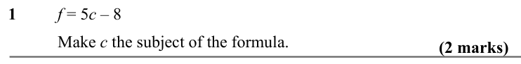

Text (lossy): 1    / f = 5 c – 8  / Make c the subject of the formula.   / (2 marks)

## Q2 (2 marks)

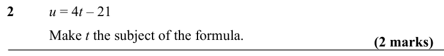

Text (lossy): 2     / u = 4 t – 21  / Make t the subject of the formula.      / (2 marks)

## Q3 (2 marks)

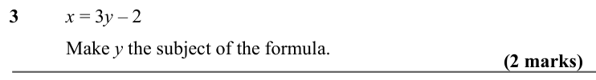

Text (lossy): 3      / x = 3 y – 2  / Make y the subject of the formula.     / (2 marks)

## Q4 (2 marks)

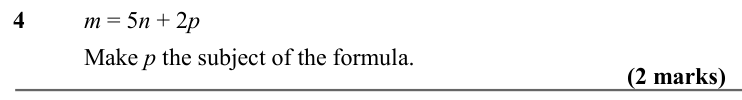

Text (lossy): 4    / m = 5 n + 2 p / Make p the subject of the formula.      / (2 marks)

## Q5 (2 marks)

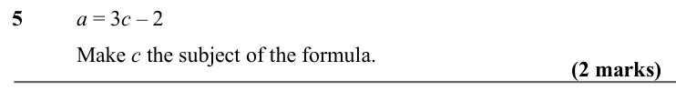

Text (lossy): 5     / a = 3 c – 2  / Make c the subject of the formula.      / (2 marks)

## Q6 (2 marks)

Text (lossy): 6     / P = 3 a + 3 b / Make a the subject of the formula.      / (2 marks)

## Q7 (2 marks)

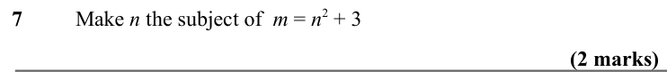

Text (lossy): 7    / Make n the subject of  m = n 2 + 3      / (2 marks)

## Q8 (2 marks)

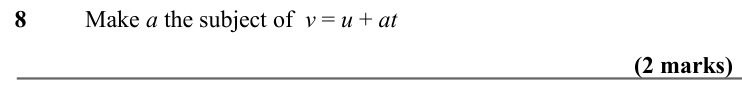

Text (lossy): 8      / Make a the subject of  v = u + at    / (2 marks)

## Q9 (5 marks)

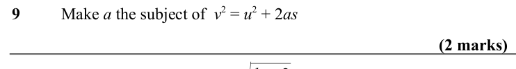

Text (lossy): 9     / Make a the subject of  v 2 = u 2 + 2 as     / (2 marks) / (3 marks) / a=√ / b + 2

## Q10 (marks not printed)

Text (lossy): 10    / Make b the subject of

## Q11 (2 marks)

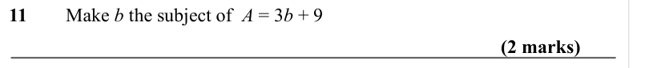

Text (lossy): 11     Make b the subject of  A = 3 b + 9    / (2 marks)

## Q12 (2 marks)

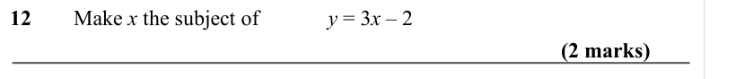

Text (lossy): 12     Make x the subject of  / y = 3 x – 2    / (2 marks) / 1 / 2

## Q13 (2 marks)

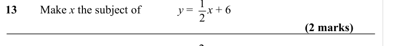

Text (lossy): 13      Make x the subject of  / y =     x + 6   / (2 marks) / 2 / 5

## Q14 (2 marks)

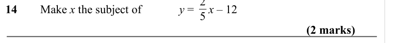

Text (lossy): 14     / Make x the subject of  / y =     x – 12      / (2 marks)

## Q15 (2 marks)

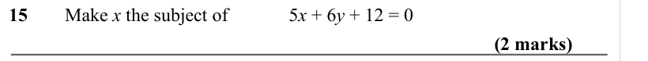

Text (lossy): 15     Make x the subject of  / 5 x + 6 y + 12 = 0 / (2 marks)

## Q16 (2 marks)

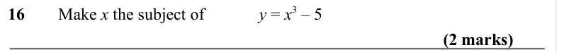

Text (lossy): 16      Make x the subject of  / y = x 3 – 5   / (2 marks)

## Q17 (marks not printed)

Text (lossy): 17     / Make x the subject of   / y = 2 x + 3

## Q18 (2 marks)

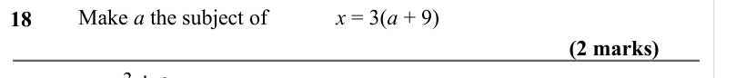

Text (lossy): 18     /     / Make a the subject of  / x = 3(a + 9)  / (2 marks) / a = 3 + c

## Q19 (2 marks)

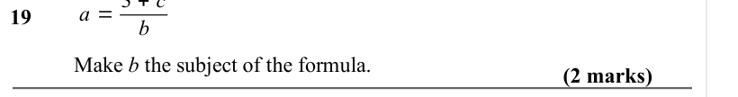

Text (lossy): 19 / b / Make b the subject of the formula.      / (2 marks) / d = √

## Q20 (marks not printed)

Text (lossy): 20

