# Expanding and Factorising Quadratics — Exam Questions (GCSE Maths · Edexcel · Grade 5)

Topic code `5.7` · slug `grade-5-5-7-expanding-and-factorising-quadratics` · source sheet sha256 `f9b7ec62244f6335…`

## Q1 (2 marks)

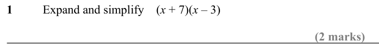

Text (lossy): 1 / Expand and simplify    (x + 7)(x – 3) / (2 marks)

## Q2 (4 marks · parts a, b)

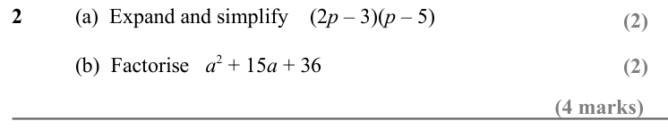

Text (lossy): 2 / (a)  Expand and simplify    (2 p – 3)(p – 5) / (2) / (b)  Factorise   a 2 + 15 a + 36 / (2) / (4 marks)

## Q3 (4 marks · parts a, b)

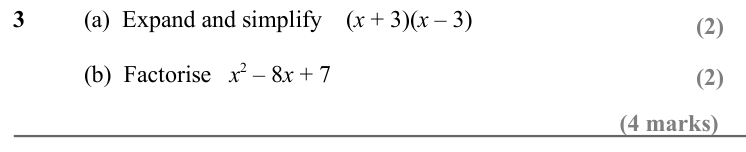

Text (lossy): 3 / (a)  Expand and simplify    (x + 3)(x – 3) / (2) / (b)  Factorise   x 2 – 8 x + 7 / (2) / (4 marks)

## Q4 (2 marks)

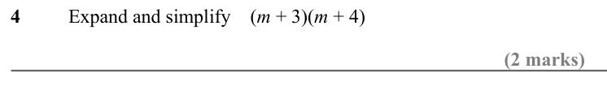

Text (lossy): 4 / Expand and simplify    (m + 3)(m + 4) / (2 marks)

## Q5 (3 marks · parts a, b)

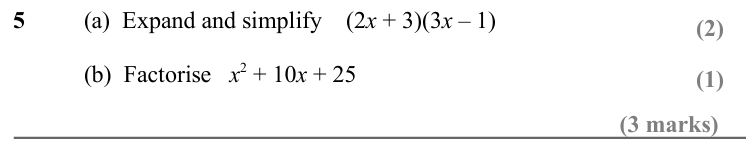

Text (lossy): 5 / (a)  Expand and simplify    (2 x + 3)(3 x – 1) / (2) / (b)  Factorise   x 2 + 10 x + 25 / (1) / (3 marks)

## Q6 (4 marks · parts a, b)

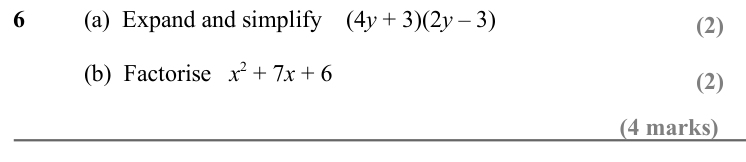

Text (lossy): 6 / (a)  Expand and simplify    (4 y + 3)(2 y – 3) / (2) / (b)  Factorise   x 2 + 7 x + 6 / (2) / (4 marks)

## Q7 (2 marks)

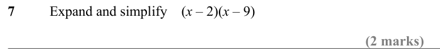

Text (lossy): 7 / Expand and simplify    (x – 2)(x – 9) / (2 marks)

## Q8 (3 marks · parts a, b)

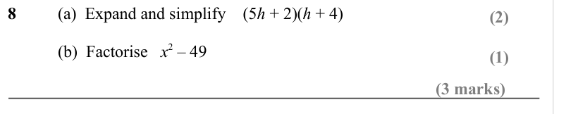

Text (lossy): 8 / (a)  Expand and simplify    (5 h + 2)(h + 4) / (2) / (b)  Factorise   x 2 – 49 / (1) / (3 marks)

## Q9 (4 marks · parts a, b)

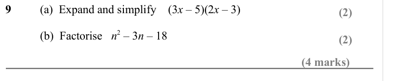

Text (lossy): 9 / (a)  Expand and simplify    (3 x – 5)(2 x – 3) / (2) / (b)  Factorise   n 2 – 3 n – 18 / (2) / (4 marks)

## Q10 (2 marks)

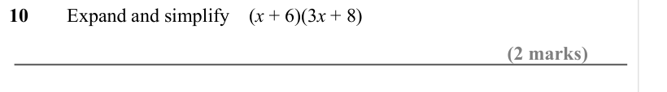

Text (lossy): 10 / Expand and simplify    (x + 6)(3 x + 8) / (2 marks)

## Q11 (3 marks · parts a, b)

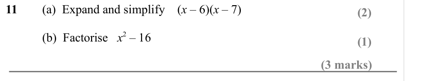

Text (lossy): 11 / (a)  Expand and simplify    (x – 6)(x – 7) / (2) / (b)  Factorise   x 2 – 16 / (1) / (3 marks)

## Q12 (4 marks · parts a, b)

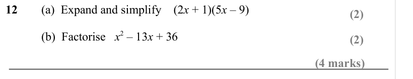

Text (lossy): 12 / (a)  Expand and simplify    (2 x + 1)(5 x – 9) / (2) / (b)  Factorise   x 2 – 13 x + 36 / (2) / (4 marks)

## Q13 (2 marks)

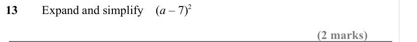

Text (lossy): 13 / Expand and simplify    (a – 7)2 / (2 marks)

## Q14 (3 marks · parts a, b)

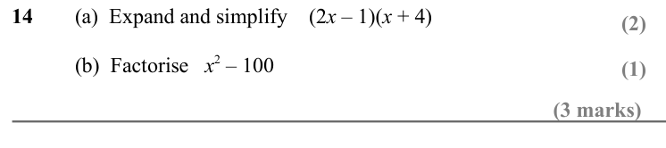

Text (lossy): 14 / (a)  Expand and simplify    (2 x – 1)(x + 4) / (2) / (b)  Factorise   x 2 – 100 / (1) / (3 marks)

## Q15 (4 marks · parts a, b)

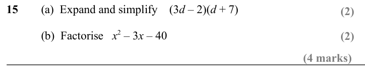

Text (lossy): 15 / (a)  Expand and simplify    (3 d – 2)(d + 7) / (2) / (b)  Factorise   x 2 – 3 x – 40 / (2) / (4 marks)

## Q16 (2 marks)

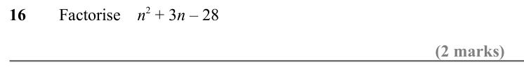

Text (lossy): 16 / Factorise    n 2 + 3 n – 28  / (2 marks)

## Q17 (3 marks · parts a, b)

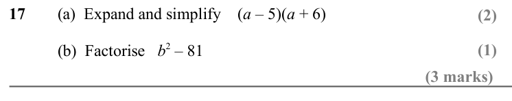

Text (lossy): 17 / (a)  Expand and simplify    (a – 5)(a + 6) / (2) / (b)  Factorise   b 2 – 81 / (1) / (3 marks)

## Q18 (4 marks · parts a, b)

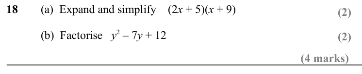

Text (lossy): 18 / (a)  Expand and simplify    (2 x + 5)(x + 9) / (2) / (b)  Factorise   y 2 – 7 y + 12 / (2) / (4 marks)

## Q19 (2 marks)

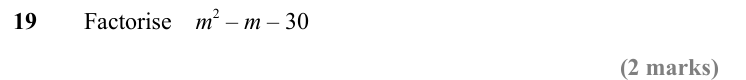

Text (lossy): 19 / Factorise    m 2 – m – 30  / (2 marks)

## Q20 (4 marks · parts a, b)

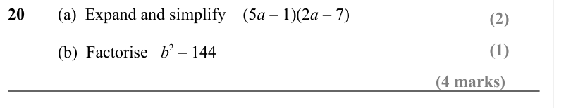

Text (lossy): 20 / (a)  Expand and simplify    (5 a – 1)(2 a – 7) / (2) / (1) / (b)  Factorise   b 2 – 144 / (4 marks)

## Q21 (4 marks · parts a, b)

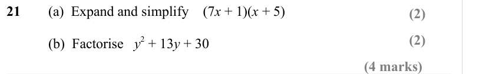

Text (lossy): 21 / (a)  Expand and simplify    (7 x + 1)(x + 5) / (2) / (2) / (b)  Factorise   y 2 + 13 y + 30 / (4 marks)

