# Solving Quadratics — Exam Questions (GCSE Maths · Edexcel · Grade 5)

Topic code `5.8` · slug `grade-5-5-8-solving-quadratics` · source sheet sha256 `81692ae9040a9ad7…`

## Q1 (marks not printed · parts a, b)

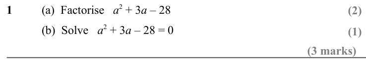

Text (lossy): 1 / (a)  Factorise   a 2 + 3 a – 28 / (b)  Solve   a 2 + 3 a – 28 = 0 / (1)

## Q2 (marks not printed · parts a, b)

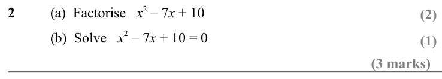

Text (lossy): 2 / (a)  Factorise   x 2 – 7 x + 10 / (b)  Solve   x 2 – 7 x + 10 = 0

## Q3 (marks not printed · parts a, b)

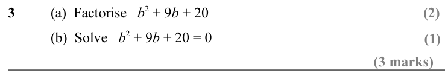

Text (lossy): 3 / (a)  Factorise   b 2 + 9 b + 20 / (b)  Solve   b 2 + 9 b + 20 = 0

## Q4 (marks not printed · parts a, b)

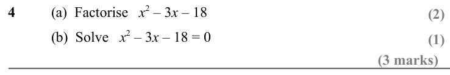

Text (lossy): 4 / (a)  Factorise   x 2 – 3 x – 18  / (b)  Solve   x 2 – 3 x – 18 = 0

## Q5 (marks not printed · parts a, b)

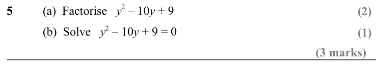

Text (lossy): 5 / (a)  Factorise   y 2 – 10 y + 9 / (b)  Solve   y 2 – 10 y + 9 = 0

## Q6 (marks not printed · parts a, b)

Text (lossy): 6 / (a)  Factorise   a 2 – a – 56  / (b)  Solve   a 2 – a – 56 = 0

## Q7 (marks not printed)

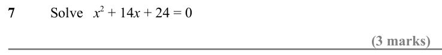

Text (lossy): 7 / Solve   x 2 + 14 x + 24 = 0

## Q8 (marks not printed)

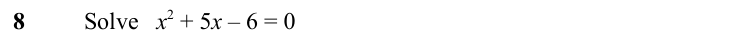

Text (lossy): 8 / Solve   x 2 + 5 x – 6 = 0

## Q9 (6 marks)

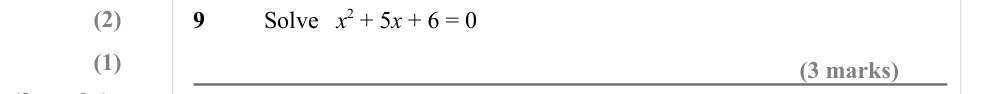

Text (lossy): (2) / 9 / Solve   x 2 + 5 x + 6 = 0 / (3 marks) / (3 marks)

## Q10 (3 marks)

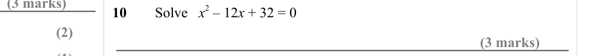

Text (lossy): 10 / Solve   x 2 – 12 x + 32 = 0 / (2) / (3 marks) / (1)

## Q11 (6 marks)

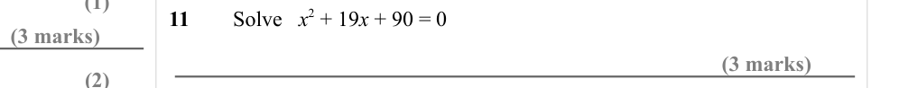

Text (lossy): 11 / Solve   x 2 + 19 x + 90 = 0 / (3 marks) / (3 marks) / (2)

## Q12 (6 marks)

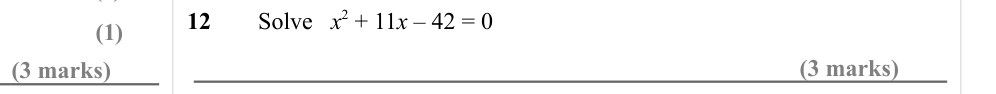

Text (lossy): 12 / Solve   x 2 + 11 x – 42 = 0 / (1) / (3 marks) / (3 marks)

## Q13 (6 marks)

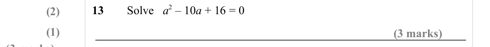

Text (lossy): 13 / Solve   a 2 – 10 a + 16 = 0 / (2) / (1) / (3 marks) / (3 marks)

## Q14 (3 marks)

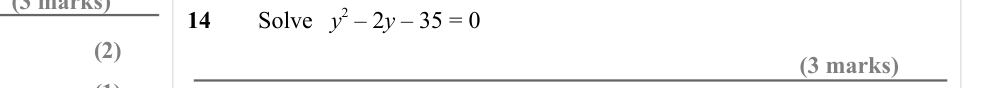

Text (lossy): 14 / Solve   y 2 – 2 y – 35 = 0 / (2) / (3 marks) / (1)

## Q15 (6 marks)

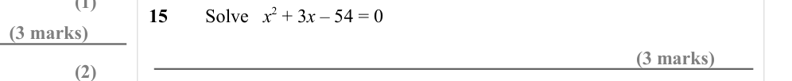

Text (lossy): 15 / Solve   x 2 + 3 x – 54 = 0 / (3 marks) / (3 marks) / (2)

## Q16 (6 marks)

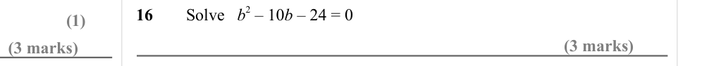

Text (lossy): 16 / Solve   b 2 – 10 b – 24 = 0 / (1) / (3 marks) / (3 marks)

## Q17 (6 marks)

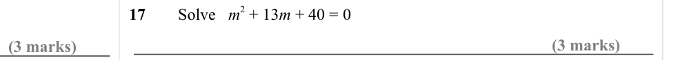

Text (lossy): 17 / Solve   m 2 + 13 m + 40 = 0 / (3 marks) / (3 marks)

## Q18 (6 marks)

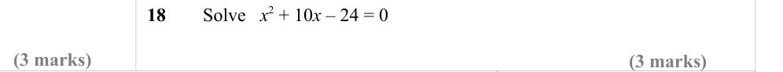

Text (lossy): 18 / Solve   x 2 + 10 x – 24 = 0 / (3 marks) / (3 marks)

