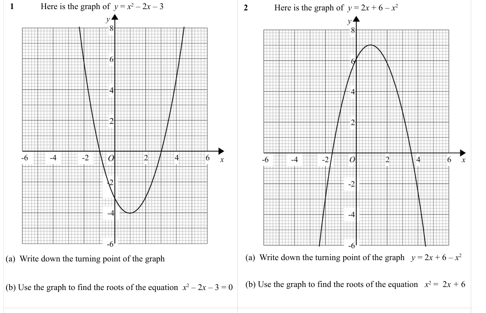
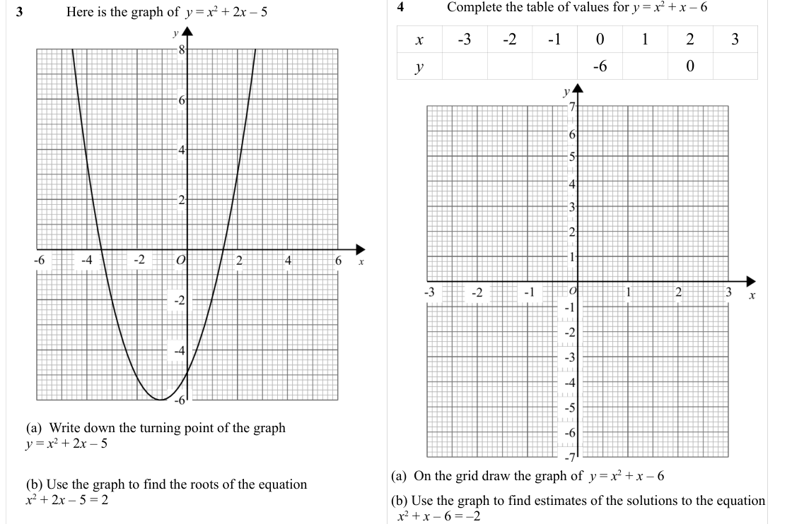

# Drawing Quadratic Graphs — Exam Questions (GCSE Maths · Edexcel · Grade 5)

Topic code `5.9` · slug `grade-5-5-9-drawing-quadratic-graphs` · source sheet sha256 `aca4cedd2ab2621f…`

## Q1 (marks not printed)

## Q2 (marks not printed · parts a, a, b, b)

Text (lossy): 1    / Here is the graph of  y = x 2 – 2 x – 3   / 2    / Here is the graph of  y = 2 x + 6 – x 2  / (a)  Write down the turning point of the graph   y = 2 x + 6 – x 2  / (a)  Write down the turning point of the graph /   / (b) Use the graph to find the roots of the equation   x 2 =  2 x + 6 / (b) Use the graph to find the roots of the equation  x 2 – 2 x – 3 = 0

## Q3 (marks not printed · parts a, b, a, b)

Text (lossy): 3    / Here is the graph of  y = x 2 + 2 x – 5  / x / -3 / -2 / -1 / 0 / 1 / 2 / 3 / y / -6 / 0 / (a)  Write down the turning point of the graph           / y = x 2 + 2 x – 5 /   / (b) Use the graph to find the roots of the equation    / x 2 + 2 x – 5 = 2 / (a)  On the grid draw the graph of  y = x 2 + x – 6 / (b) Use the graph to find estimates of the solutions to the equation  /   x 2 + x – 6 = 

