# Circle Theorems — Exam Questions (GCSE Maths · Edexcel · Grade 6)

Topic code `6.10` · slug `grade-6-6-10-circle-theorems` · source sheet sha256 `b68a1d4de8f3ca8c…`

## Q1 (2 marks)

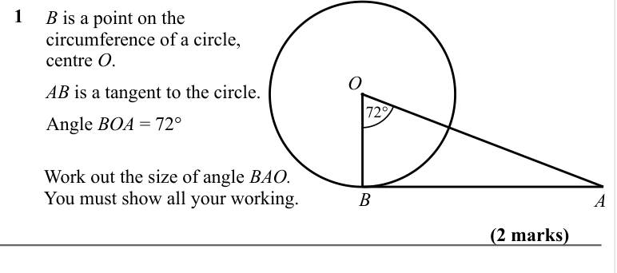

Text (lossy): 1      / B is a point on the  / circumference of a circle,  / centre O. /     / 72° / O / AB is a tangent to the circle. / Angle BOA = 72° / Work out the size of angle BAO. / You must show all your working. / A / B / (2 marks) / A

## Q2 (2 marks)

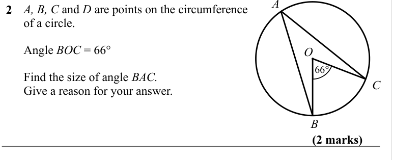

Text (lossy): A, B, C and D are points on the circumference  / of a circle.  / 2      /     / Angle BOC = 66° / 66° / O / Find the size of angle BAC. / Give a reason for your answer.  / B / (2 marks)

## Q3 (3 marks)

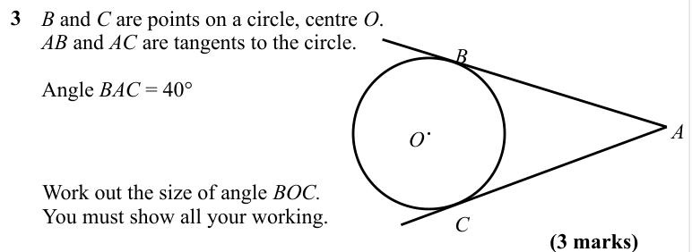

Text (lossy): 3      / B and C are points on a circle, centre O.  / AB and AC are tangents to the circle. / B /     / Angle BAC = 40° / A / O / Work out the size of angle BOC. / You must show all your working. / C / (3 marks)

## Q4 (4 marks)

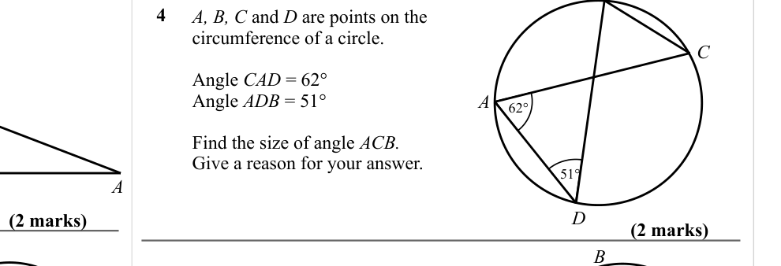

Text (lossy): 4      / A, B, C and D are points on the  / circumference of a circle.  / C /     / Angle CAD = 62° / Angle ADB = 51° / A / 62° / Find the size of angle ACB. / Give a reason for your answer.  / 51° / D / (2 marks) / (2 marks) / B

## Q5 (4 marks)

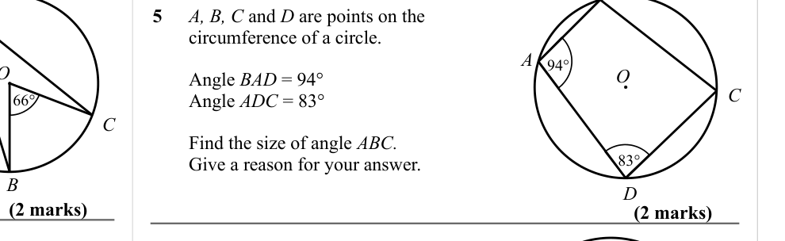

Text (lossy): 5      / A, B, C and D are points on the  / circumference of a circle. /     / A / 94° / O / Angle BAD = 94° / Angle ADC = 83° / C / C / Find the size of angle ABC. / Give a reason for your answer.  / 83° / D / (2 marks) / (2 marks)

## Q6 (5 marks)

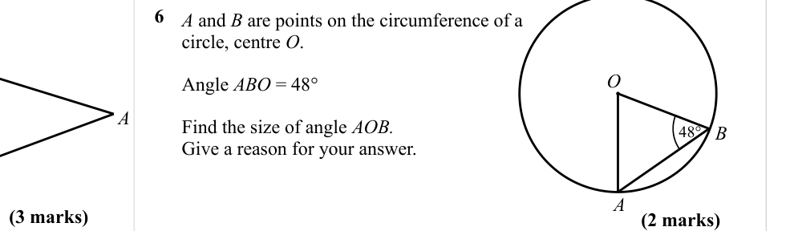

Text (lossy): 6      / A and B are points on the circumference of a  / circle, centre O.  /     / O / Angle ABO = 48° / Find the size of angle AOB. / Give a reason for your answer.  / B / 48° / A / (3 marks) / (2 marks)

## Q7 (4 marks)

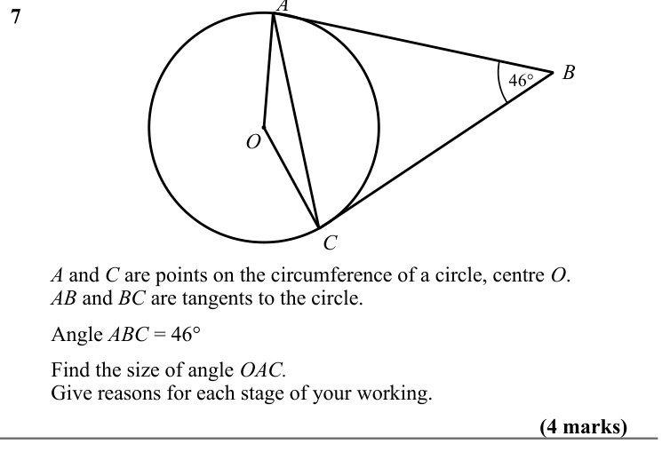

Text (lossy): 7      / B / 46° / O / C / A and C are points on the circumference of a circle, centre O. / AB and BC are tangents to the circle.  / Angle ABC = 46° / Find the size of angle OAC. / Give reasons for each stage of your working. / (4 marks)

## Q8 (4 marks · parts a, b)

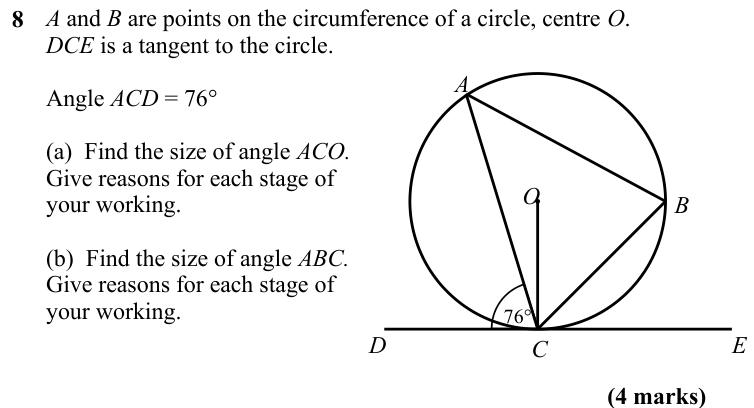

Text (lossy): A and B are points on the circumference of a circle, centre O.  / DCE is a tangent to the circle.  / 8 /     / A / Angle ACD = 76° / (a)  Find the size of angle ACO. / Give reasons for each stage of  / your working. / O / B / (b)  Find the size of angle ABC. / Give reasons for each stage of  / your working. / 76° / D / E / C / (4 marks)

## Q9 (4 marks)

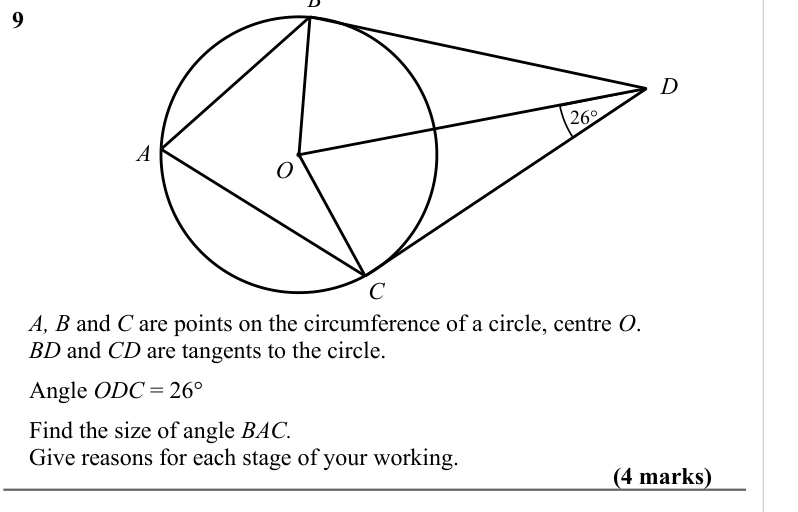

Text (lossy): 9      / D / 26° / A / O / C / A, B and C are points on the circumference of a circle, centre O. / BD and CD are tangents to the circle.  / Angle ODC = 26° / Find the size of angle BAC. / Give reasons for each stage of your working. / (4 marks)

## Q10 (4 marks)

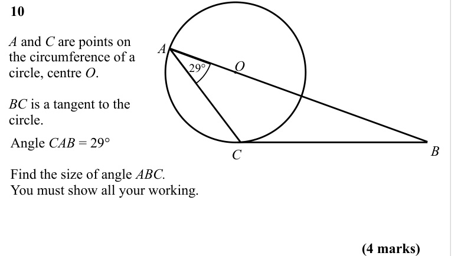

Text (lossy): 10      / A and C are points on  / the circumference of a  / circle, centre O.  / A / 29° / O / BC is a tangent to the  / circle.  / B / C / Angle CAB = 29° / Find the size of angle ABC. / You must show all your working. / (4 marks)

## Q11 (marks not printed)

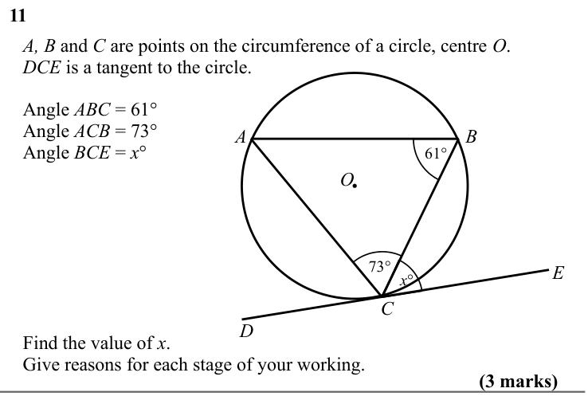

Text (lossy): 11 / A, B and C are points on the circumference of a circle, centre O.  / DCE is a tangent to the circle.  / Angle ABC = 61° / Angle ACB = 73° / Angle BCE = x° / A / B / 61° / O / 73° / x° / C / D / Find the value of x. / Give reasons for each stage of your working.

## Q12 (marks not printed)

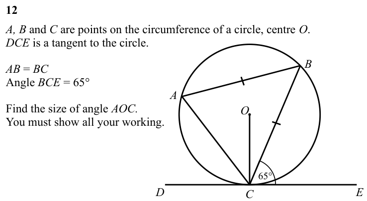

Text (lossy): 12 / A, B and C are points on the circumference of a circle, centre O.  / DCE is a tangent to the circle.  / B / AB = BC / Angle BCE = 65° / A / Find the size of angle AOC. / You must show all your working. / O / 65° / D / E / C

## Q13 (3 marks)

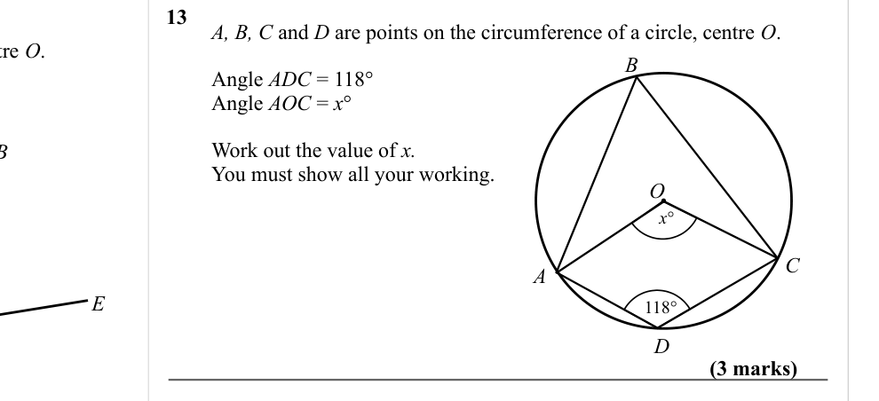

Text (lossy): 13 / A, B, C and D are points on the circumference of a circle, centre O.  / B / Angle ADC = 118° / Angle AOC = x° / Work out the value of x. / You must show all your working. / O / x° / C / A / E / 118° / D / (3 marks)

## Q14 (11 marks)

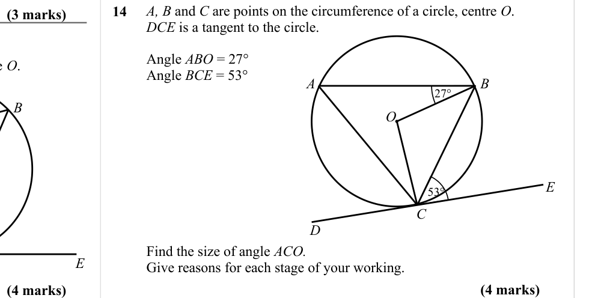

Text (lossy): A, B and C are points on the circumference of a circle, centre O.  / DCE is a tangent to the circle.  / 14 / (3 marks) / Angle ABO = 27° / Angle BCE = 53° / A / B / 27° / O / E / 53° / C / D / Find the size of angle ACO. / Give reasons for each stage of your working. / (4 marks) / (4 marks)

## Q15 (marks not printed)

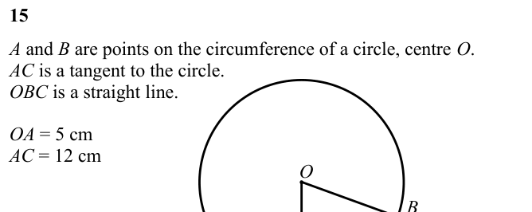

Text (lossy): 15 / A and B are points on the circumference of a circle, centre O.  / AC is a tangent to the circle.  / OBC is a straight line.  / OA = 5 cm / AC = 12 cm / O / B

## Q16 (marks not printed)

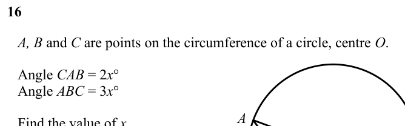

Text (lossy): 16 / A, B and C are points on the circumference of a circle, centre O.  / Angle CAB = 2 x° / Angle ABC = 3 x° / A / Find the value of x.  / You must show all your working.

## Q17 (3 marks)

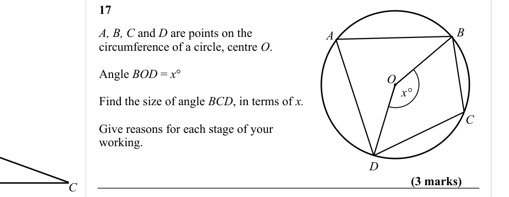

Text (lossy): 17 / B / A, B, C and D are points on the  / circumference of a circle, centre O.  / A / Angle BOD = x° / O / x° / Find the size of angle BCD, in terms of x. / C / Give reasons for each stage of your  / working. / D / (3 marks) / C

## Q18 (12 marks)

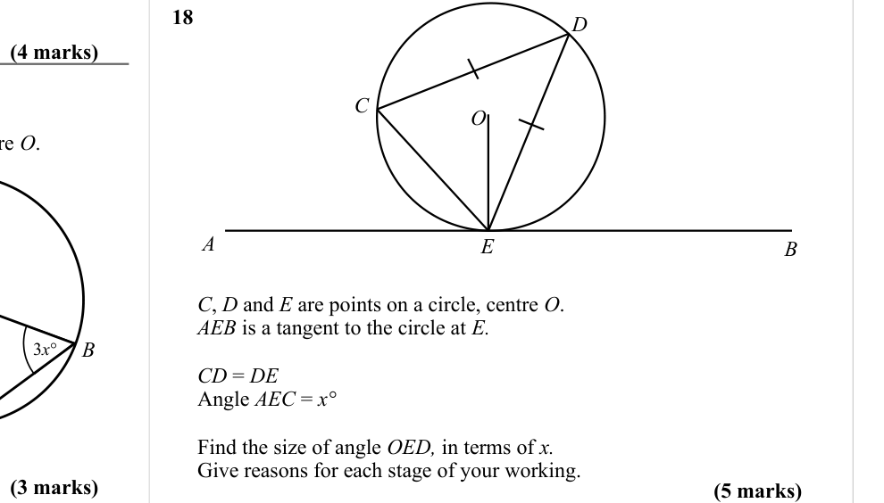

Text (lossy): 18 / D / (4 marks) / C / O / A / B / E / C, D and E are points on a circle, centre O. / AEB is a tangent to the circle at E. / B / CD = DE / Angle AEC = x° / Find the size of angle OED, in terms of x.       / Give reasons for each stage of your working. / (3 marks) / (5 marks)

