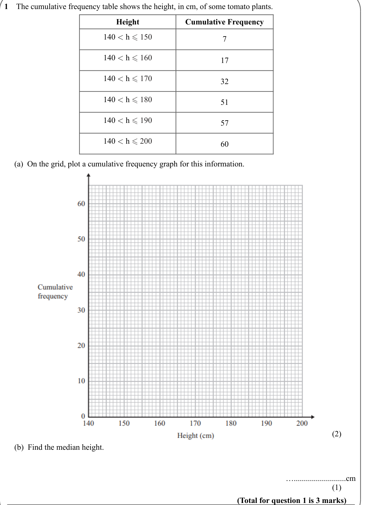
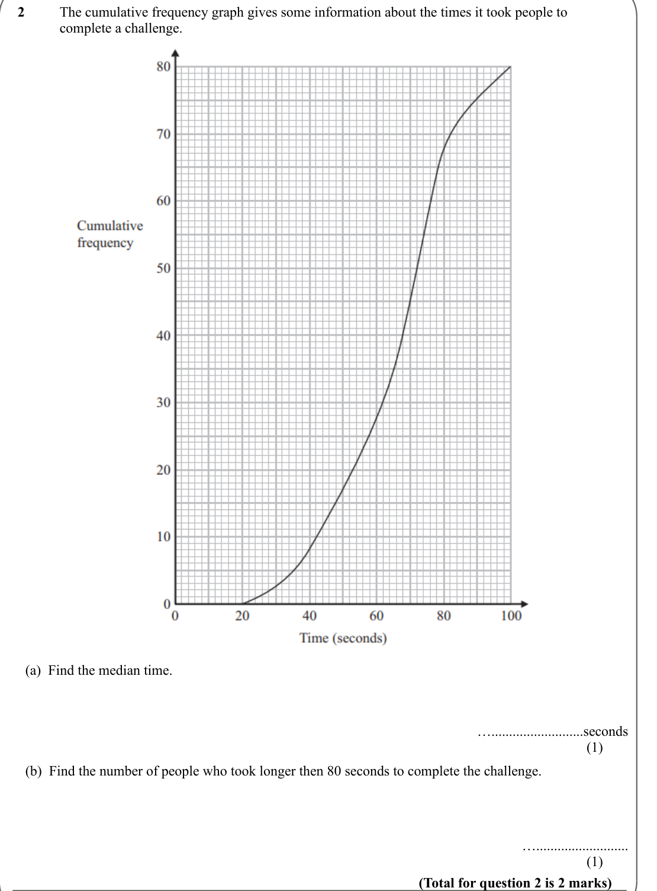
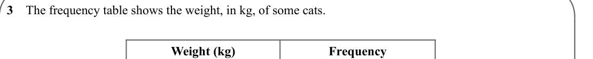
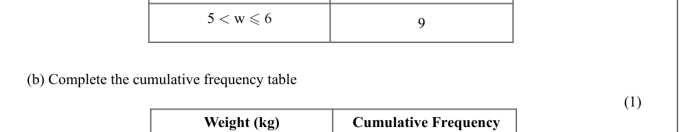
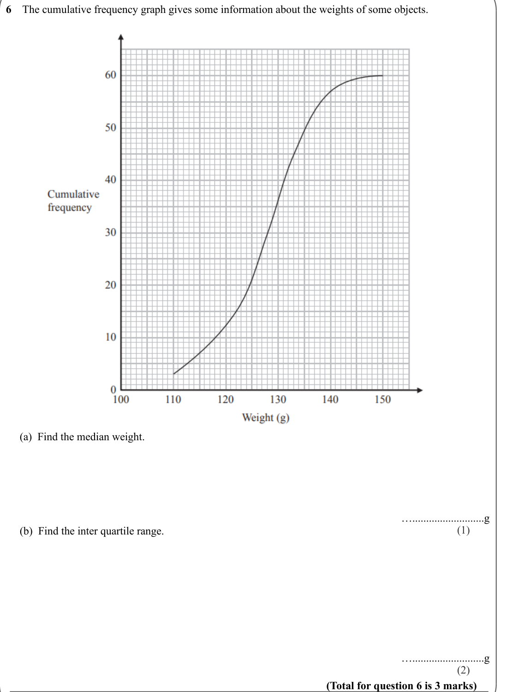

# Cumulative Frequency — Exam Questions (GCSE Maths · Edexcel · Grade 6)

Topic code `6.11` · slug `grade-6-6-11-cumulative-frequency` · source sheet sha256 `da03e1755db78ed6…`

## Q1 (marks not printed · parts a, b)

Text (lossy): 1    The cumulative frequency table shows the height, in cm, of some tomato plants. / Height / Cumulative Frequency / 140 < h  150 / 7 / 140 < h  160 / 17 / 140 < h  170 / 32 / 140 < h  180 / 51 / 140 < h  190 / 57 / 140 < h  200 / 60 /      (a)  On the grid, plot a cumulative frequency graph for this information.  / (2) /      (b)  Find the median height.  / …..........................cm / 

## Q2 (marks not printed · parts a, b)

Text (lossy): 2     / The cumulative frequency graph gives some information about the times it took people to  / complete a challenge. /      (a)  Find the median time.  / …..........................seconds / (1) /      (b)  Find the number of people who took longer then 80 seconds to complete the challenge.  / ….......................... / (1) / (Total for question 2 is 2 marks)

## Q3 (marks not printed)

Text (lossy): 3    The frequency table shows the weight, in kg, of some cats. / Weight (kg) / Frequency

## Q4 (marks not printed)

Text (lossy): 4 < w  5 / 13

## Q5 (marks not printed · parts b)

Text (lossy): 5 < w  6 / 9 /      (b) Complete the cumulative frequency table / (1) / Weight (kg) /  Cumulative Frequency

## Q6 (marks not printed · parts a, b)

Text (lossy): 6    The cumulative frequency graph gives some information about the weights of some objects. /      (a)  Find the median weight.  / …..........................g / (1) /      (b)  Find the inter quartile range. / …..........................g / (2) / (Total for question 6 is 3 marks)

