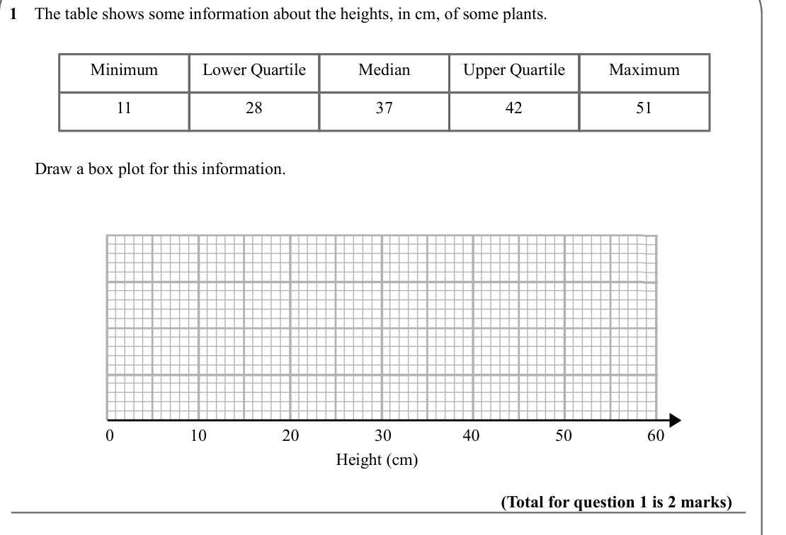
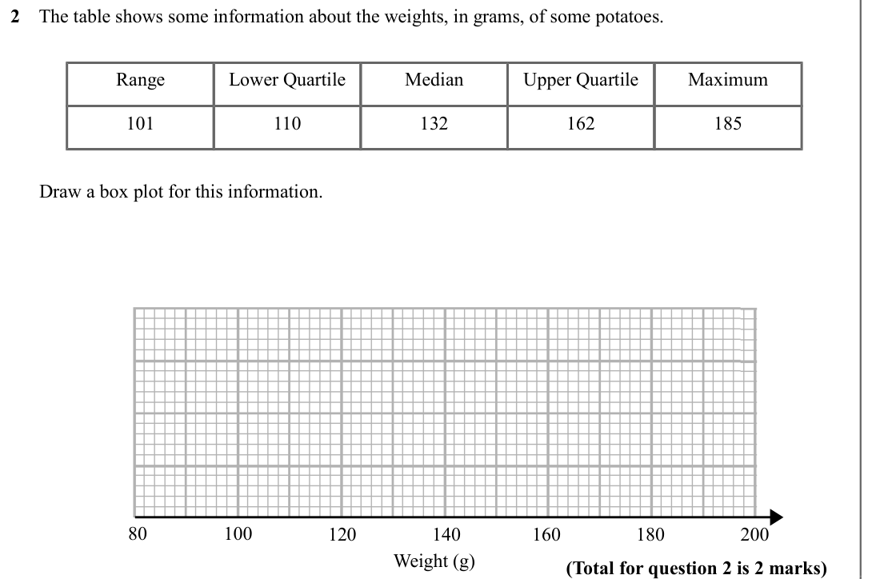
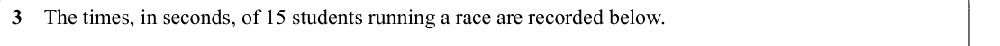
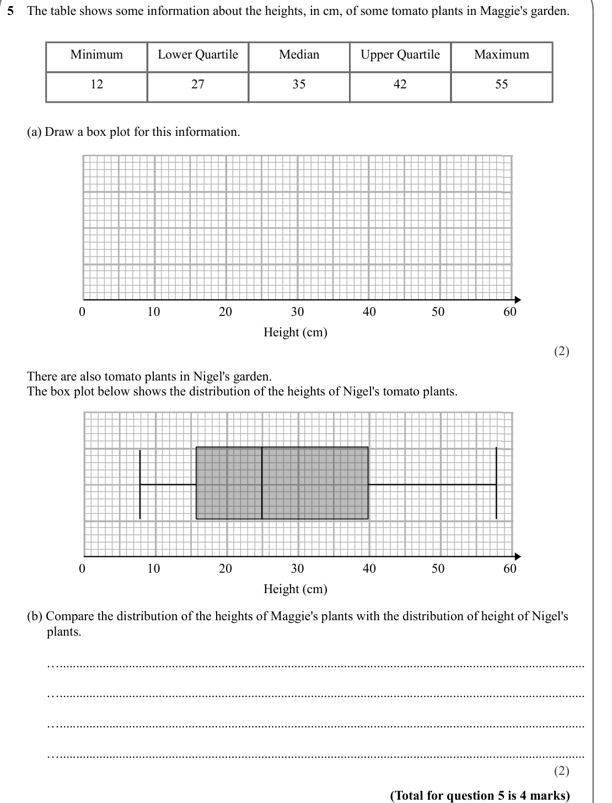
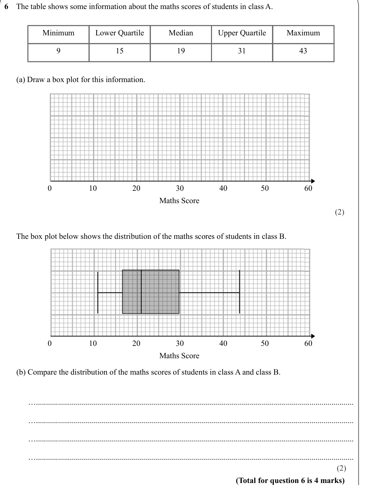
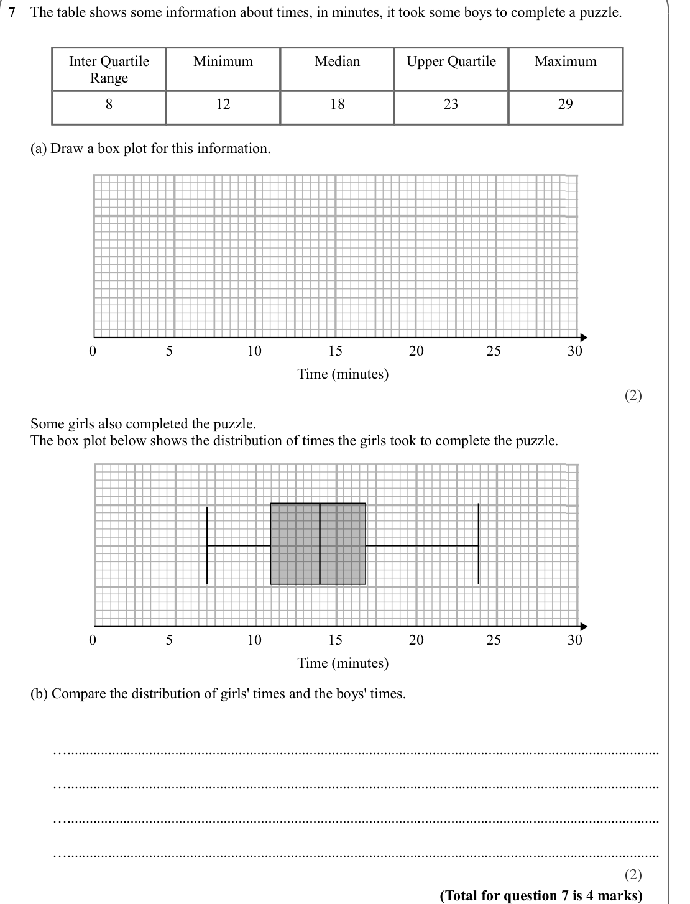
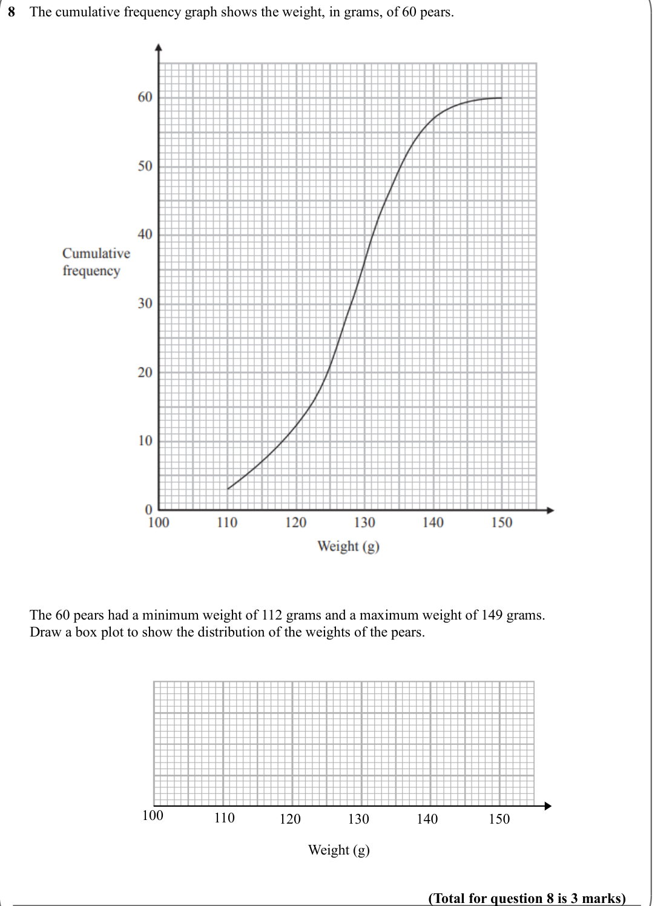
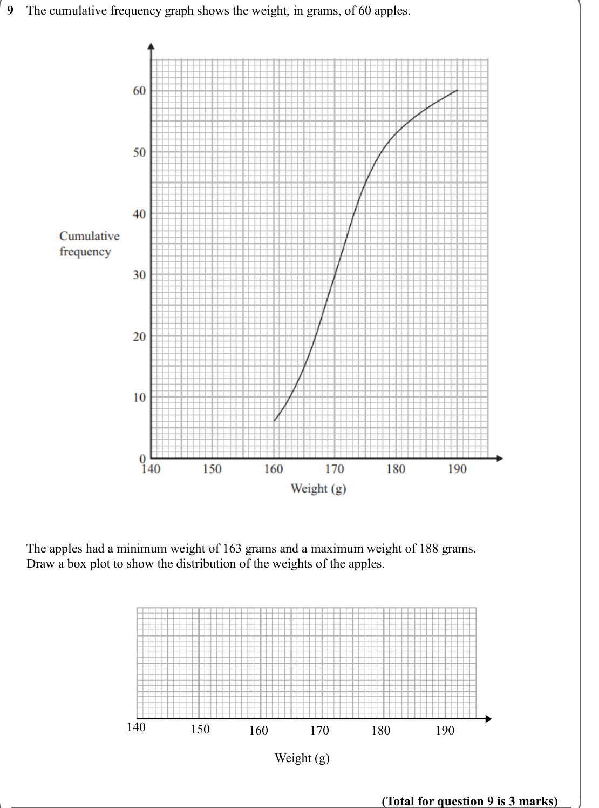

# Box Plots — Exam Questions (GCSE Maths · Edexcel · Grade 6)

Topic code `6.12` · slug `grade-6-6-12-box-plots` · source sheet sha256 `5910ac0c8349fbbf…`

## Q1 (marks not printed)

Text (lossy): 1    The table shows some information about the heights, in cm, of some plants. / Minimum / Lower Quartile / Median / Upper Quartile / Maximum /         / 11 / 28 / 37 / 42 / 51 /       Draw a box plot for this information.   / Height (cm) / 0 / 10 / 20 / 30 / 40 / 50 / 60 / (Total for question 1 is 2 marks)

## Q2 (marks not printed)

Text (lossy): 2    The table shows some information about the weights, in grams, of some potatoes.   / Range / Lower Quartile / Median / Upper Quartile / Maximum /         / 101 / 110 / 132 / 162 / 185 /       Draw a box plot for this information.   / Weight (g) / 80 / 100 / 120 / 140 / 160 / 180 / 200 / (Total for question 2 is 2 marks)

## Q3 (marks not printed)

Text (lossy): 3    The times, in seconds, of 15 students running a race are recorded below.

## Q4 (marks not printed)

Text (lossy): 4    The weights of 11 pigs, in kg, are recorded below.

## Q5 (marks not printed · parts a, b)

Text (lossy): 5    The table shows some information about the heights, in cm, of some tomato plants in Maggie's garden.   / Minimum / Lower Quartile / Median / Upper Quartile / Maximum /         / 12 / 27 / 35 / 42 / 55 /       (a) Draw a box plot for this information.   / 0 / 10 / 20 / 30 / 40 / 50 / 60 / Height (cm) / (2) /       There are also tomato plants in Nigel's garden.  /       The box plot below show

## Q6 (marks not printed · parts a, b)

Text (lossy): 6    The table shows some information about the maths scores of students in class A.   / Minimum / Lower Quartile / Median / Upper Quartile / Maximum /         / 9 / 15 / 19 / 31 / 43 /       (a) Draw a box plot for this information.   / 0 / 10 / 20 / 30 / 40 / 50 / 60 / Maths Score / (2) /        /       The box plot below shows the distribution of the maths scores of students in class B.  / 0 / 

## Q7 (marks not printed · parts a, b)

Text (lossy): 7    The table shows some information about times, in minutes, it took some boys to complete a puzzle.   / Inter Quartile  / Minimum / Median / Upper Quartile / Maximum /         / Range / 8 / 12 / 18 / 23 / 29 /       (a) Draw a box plot for this information.   / 0 / 5 / 10 / 15 / 20 / 25 / 30 / Time (minutes) / (2) /       Some girls also completed the puzzle.  /       The box plot below shows t

## Q8 (marks not printed)

Text (lossy): 8    The cumulative frequency graph shows the weight, in grams, of 60 pears. /       The 60 pears had a minimum weight of 112 grams and a maximum weight of 149 grams.  /       Draw a box plot to show the distribution of the weights of the pears.      / 100 / 110 / 120 / 130 / 140 / 150 / Weight (g) / (Total for question 8 is 3 marks)

## Q9 (marks not printed)

Text (lossy): 9    The cumulative frequency graph shows the weight, in grams, of 60 apples. /       The apples had a minimum weight of 163 grams and a maximum weight of 188 grams.  /       Draw a box plot to show the distribution of the weights of the apples.      / 140 / 150 / 160 / 170 / 180 / 190 / Weight (g) / (Total for question 9 is 3 marks)

