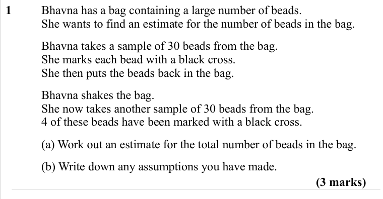
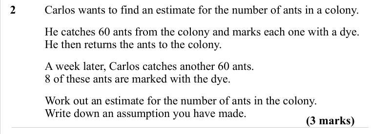
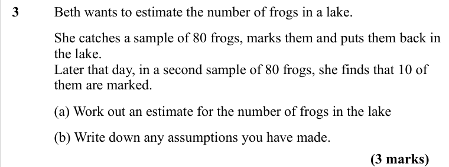
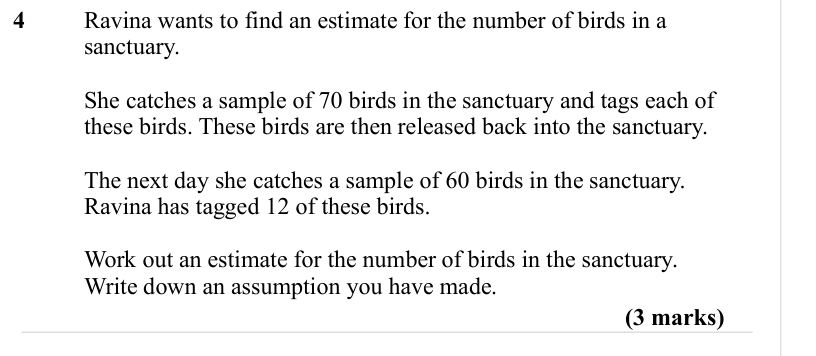
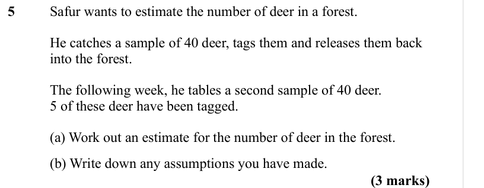

# Capture Recapture — Exam Questions (GCSE Maths · Edexcel · Grade 6)

Topic code `6.13` · slug `grade-6-6-13-capture-recapture` · source sheet sha256 `a13616dbbde041a7…`

## Q1 (3 marks · parts a, b)

Text (lossy): 1  / Bhavna has a bag containing a large number of beads. / She wants to find an estimate for the number of beads in the bag. / Bhavna takes a sample of 30 beads from the bag. / She marks each bead with a black cross. / She then puts the beads back in the bag. / Bhavna shakes the bag. / She now takes another sample of 30 beads from the bag. / 4 of these beads have been marked with a black cross. /

## Q2 (3 marks)

Text (lossy): 2  / Carlos wants to find an estimate for the number of ants in a colony. / He catches 60 ants from the colony and marks each one with a dye. / He then returns the ants to the colony. / A week later, Carlos catches another 60 ants. / 8 of these ants are marked with the dye. / Work out an estimate for the number of ants in the colony. / Write down an assumption you have made. / (3 marks)

## Q3 (3 marks · parts a, b)

Text (lossy): 3  / Beth wants to estimate the number of frogs in a lake. / She catches a sample of 80 frogs, marks them and puts them back in  / the lake. / Later that day, in a second sample of 80 frogs, she finds that 10 of  / them are marked. / (a) Work out an estimate for the number of frogs in the lake / (b) Write down any assumptions you have made. / (3 marks)

## Q4 (3 marks)

Text (lossy): 4  / Ravina wants to find an estimate for the number of birds in a  / sanctuary. / She catches a sample of 70 birds in the sanctuary and tags each of  / these birds. These birds are then released back into the sanctuary. / The next day she catches a sample of 60 birds in the sanctuary. / Ravina has tagged 12 of these birds. / Work out an estimate for the number of birds in the sanctuary. / Write d

## Q5 (3 marks · parts a, b)

Text (lossy): 5 / Safur wants to estimate the number of deer in a forest. / He catches a sample of 40 deer, tags them and releases them back  / into the forest. / The following week, he tables a second sample of 40 deer. / 5 of these deer have been tagged. / (a) Work out an estimate for the number of deer in the forest. / (b) Write down any assumptions you have made. / (3 marks)

