# The Product Rule for Counting — Exam Questions (GCSE Maths · Edexcel · Grade 6)

Topic code `6.3` · slug `grade-6-6-3-the-product-rule-for-counting` · source sheet sha256 `47e965d13f156009…`

## Q1 (2 marks)

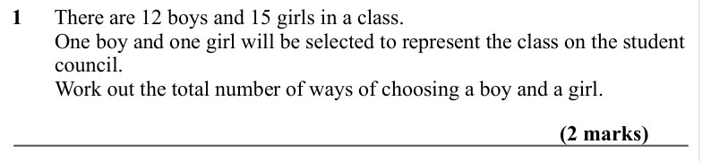

Text (lossy): 1      There are 12 boys and 15 girls in a class.  /         One boy and one girl will be selected to represent the class on the student  /         council.  /         Work out the total number of ways of choosing a boy and a girl.  / (2 marks)

## Q2 (2 marks)

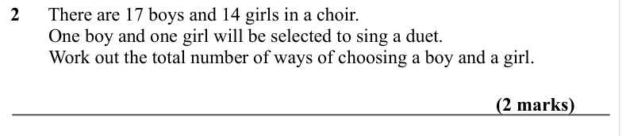

Text (lossy): 2      There are 17 boys and 14 girls in a choir.  /         One boy and one girl will be selected to sing a duet.  /         Work out the total number of ways of choosing a boy and a girl.  / (2 marks)

## Q3 (2 marks)

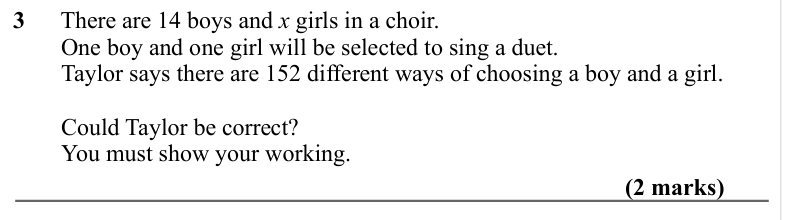

Text (lossy): 3      There are 14 boys and x girls in a choir.  /         One boy and one girl will be selected to sing a duet.  /         Taylor says there are 152 different ways of choosing a boy and a girl.  /         Could Taylor be correct? /         You must show your working.  / (2 marks)

## Q4 (2 marks)

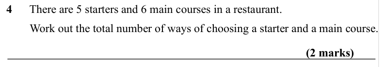

Text (lossy): 4      There are 5 starters and 6 main courses in a restaurant.  /         Work out the total number of ways of choosing a starter and a main course.  / (2 marks)

## Q5 (2 marks)

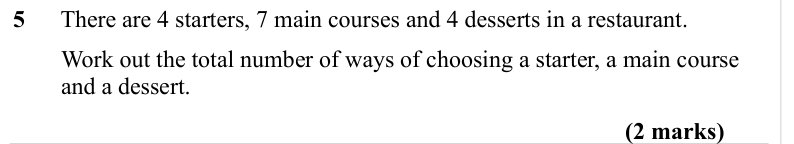

Text (lossy): 5      There are 4 starters, 7 main courses and 4 desserts in a restaurant.  /         Work out the total number of ways of choosing a starter, a main course       /         and a dessert.  / (2 marks)

## Q6 (2 marks)

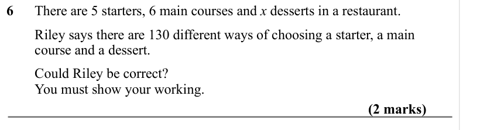

Text (lossy): 6      There are 5 starters, 6 main courses and x desserts in a restaurant.  /         Riley says there are 130 different ways of choosing a starter, a main           /         course and a dessert.  /         Could Riley be correct? /         You must show your working.  / (2 marks)

## Q7 (2 marks)

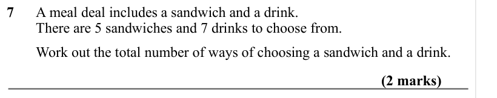

Text (lossy): 7      A meal deal includes a sandwich and a drink. /         There are 5 sandwiches and 7 drinks to choose from.  /         Work out the total number of ways of choosing a sandwich and a drink. / (2 marks)

## Q8 (2 marks)

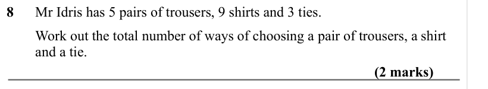

Text (lossy): 8      Mr Idris has 5 pairs of trousers, 9 shirts and 3 ties.  /         Work out the total number of ways of choosing a pair of trousers, a shirt     /         and a tie.  / (2 marks)

## Q9 (2 marks)

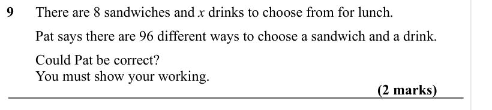

Text (lossy): 9      There are 8 sandwiches and x drinks to choose from for lunch.  /         Pat says there are 96 different ways to choose a sandwich and a drink.  /         Could Pat be correct? /         You must show your working.  / (2 marks)

## Q10 (2 marks)

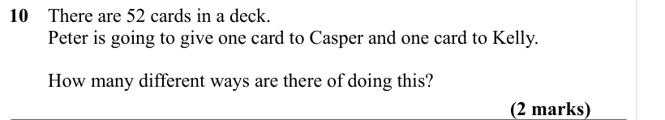

Text (lossy): 10    There are 52 cards in a deck.  /         Peter is going to give one card to Casper and one card to Kelly.  /         How many different ways are there of doing this? / (2 marks)

## Q11 (2 marks)

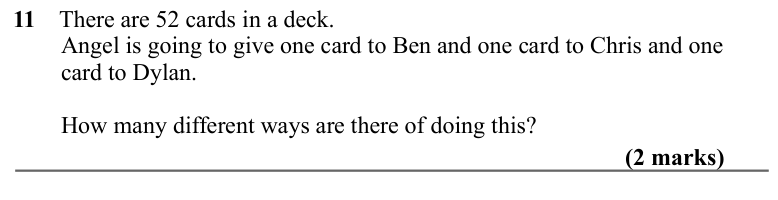

Text (lossy): 11    There are 52 cards in a deck.  /         Angel is going to give one card to Ben and one card to Chris and one         /         card to Dylan.  /         How many different ways are there of doing this? / (2 marks)

## Q12 (2 marks)

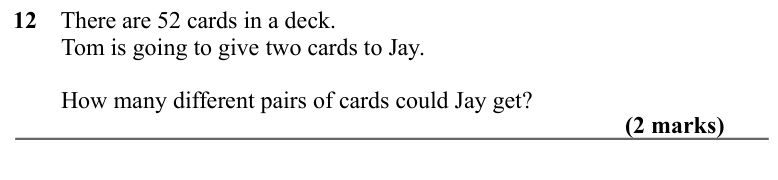

Text (lossy): 12    There are 52 cards in a deck.  /         Tom is going to give two cards to Jay.  /         How many different pairs of cards could Jay get? / (2 marks)

## Q13 (2 marks)

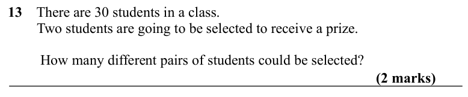

Text (lossy): 13    There are 30 students in a class.  /         Two students are going to be selected to receive a prize.  /          How many different pairs of students could be selected? / (2 marks)

## Q14 (2 marks)

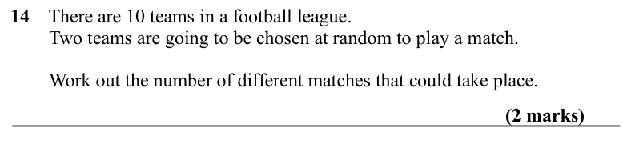

Text (lossy): 14    There are 10 teams in a football league. /         Two teams are going to be chosen at random to play a match. /         Work out the number of different matches that could take place.  / (2 marks)

## Q15 (2 marks)

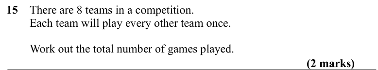

Text (lossy): 15    There are 8 teams in a competition. /         Each team will play every other team once. /         Work out the total number of games played.  / (2 marks)

## Q16 (2 marks)

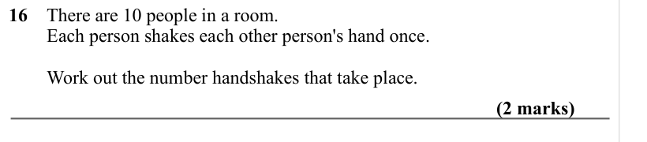

Text (lossy): 16    There are 10 people in a room.  /         Each person shakes each other person's hand once.  /         Work out the number handshakes that take place.  / (2 marks)

## Q17 (2 marks)

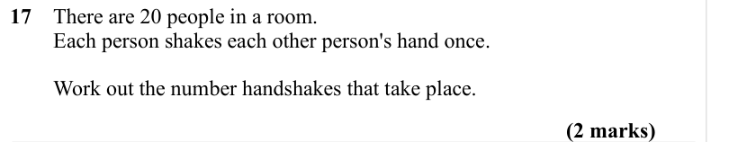

Text (lossy): 17    There are 20 people in a room.  /         Each person shakes each other person's hand once.  /         Work out the number handshakes that take place.  / (2 marks)

