# Repeated Percentage Change — Exam Questions (GCSE Maths · Edexcel · Grade 6)

Topic code `6.4` · slug `grade-6-6-4-repeated-percentage-change` · source sheet sha256 `8aa4273a80a96052…`

## Q1 (marks not printed)

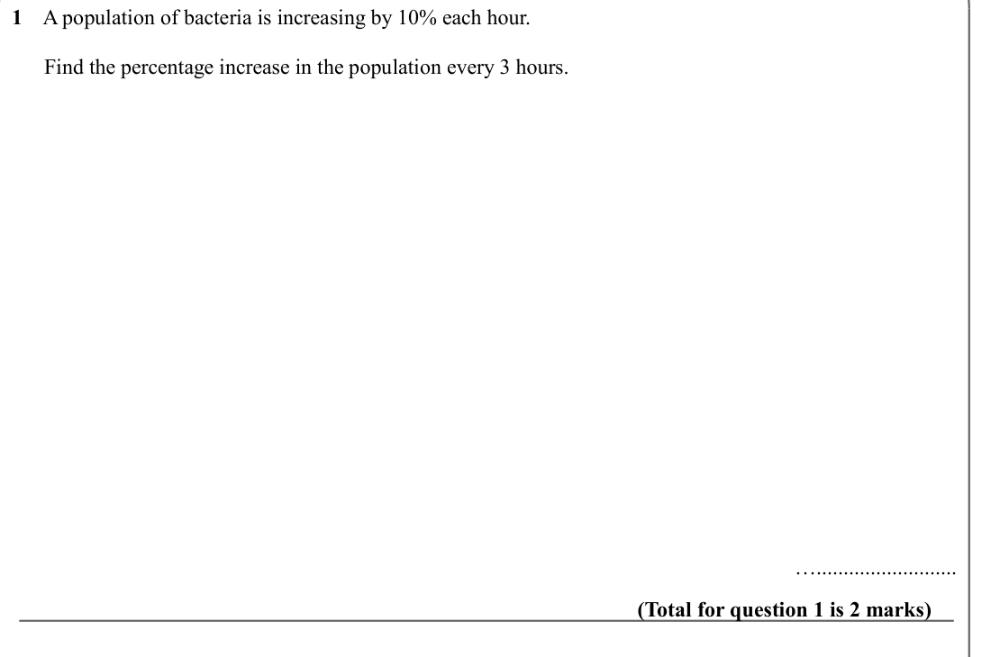

Text (lossy): 1    A population of bacteria is increasing by 10% each hour.  /       Find the percentage increase in the population every 3 hours.  /  ….......................... / (Total for question 1 is 2 marks)

## Q2 (marks not printed)

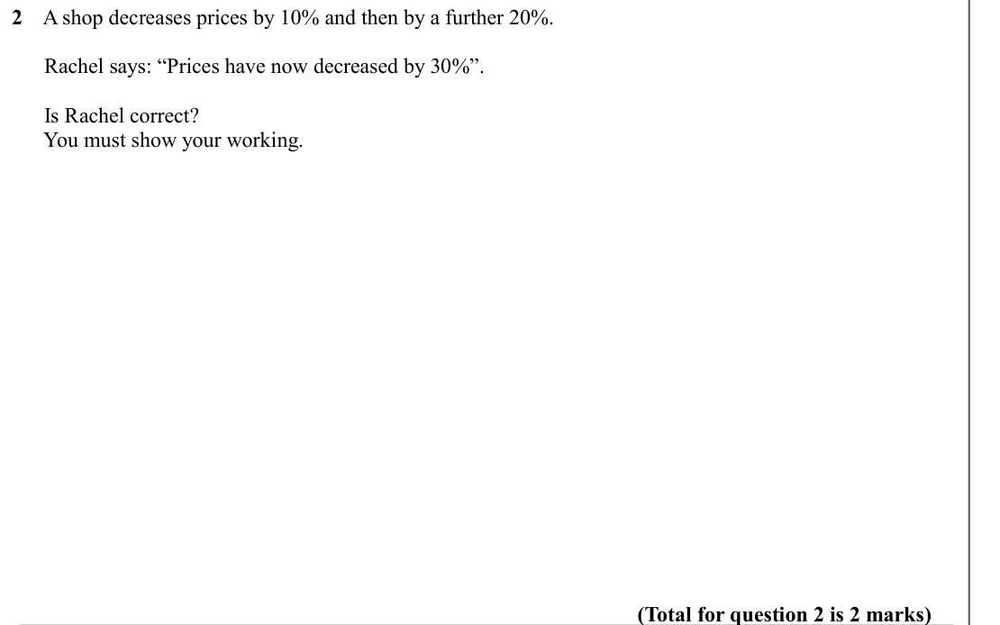

Text (lossy): 2    A shop decreases prices by 10% and then by a further 20%. /        /       Rachel says: “Prices have now decreased by 30%”.  /       Is Rachel correct? /       You must show your working.  / (Total for question 2 is 2 marks)

## Q3 (marks not printed)

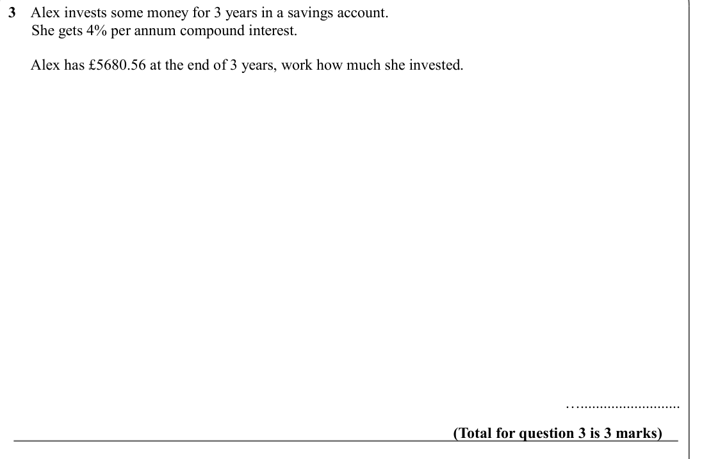

Text (lossy): 3    Alex invests some money for 3 years in a savings account.  /       She gets 4% per annum compound interest.  /       Alex has £5680.56 at the end of 3 years, work how much she invested.  /  ….......................... / (Total for question 3 is 3 marks)

## Q4 (marks not printed)

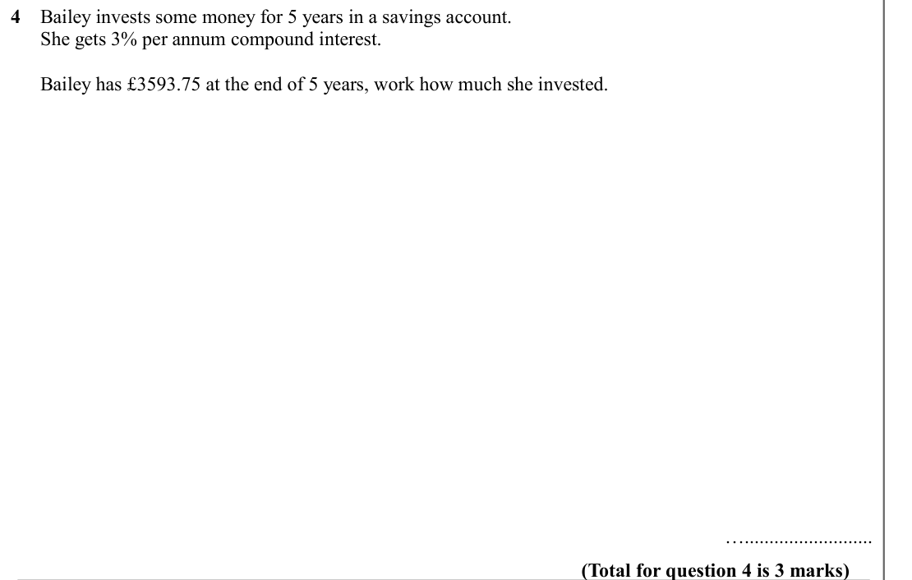

Text (lossy): 4    Bailey invests some money for 5 years in a savings account.  /       She gets 3% per annum compound interest.  /       Bailey has £3593.75 at the end of 5 years, work how much she invested.  /  ….......................... / (Total for question 4 is 3 marks)

## Q5 (marks not printed)

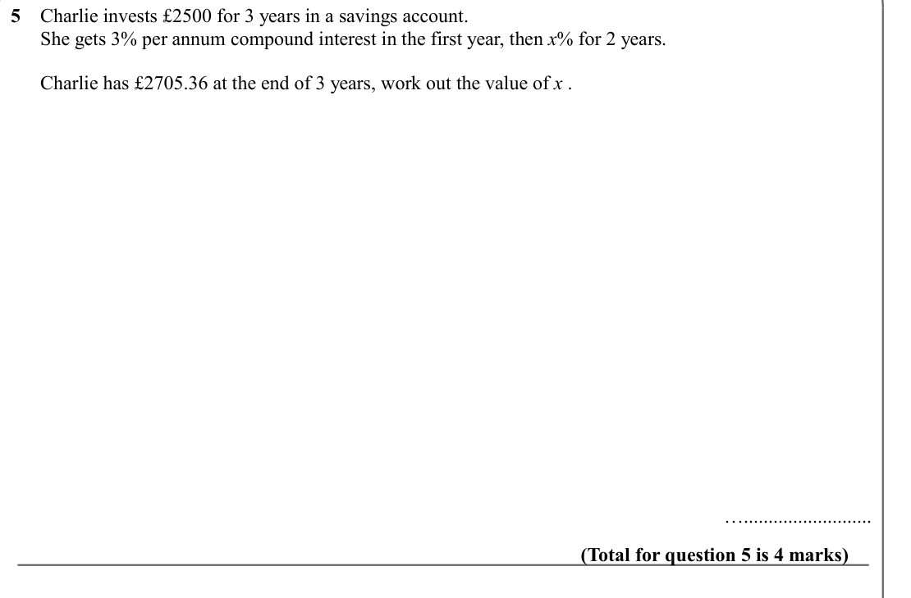

Text (lossy): 5    Charlie invests £2500 for 3 years in a savings account.  /       She gets 3% per annum compound interest in the first year, then x% for 2 years.  /       Charlie has £2705.36 at the end of 3 years, work out the value of x .  /  ….......................... / (Total for question 5 is 4 marks)

## Q6 (marks not printed)

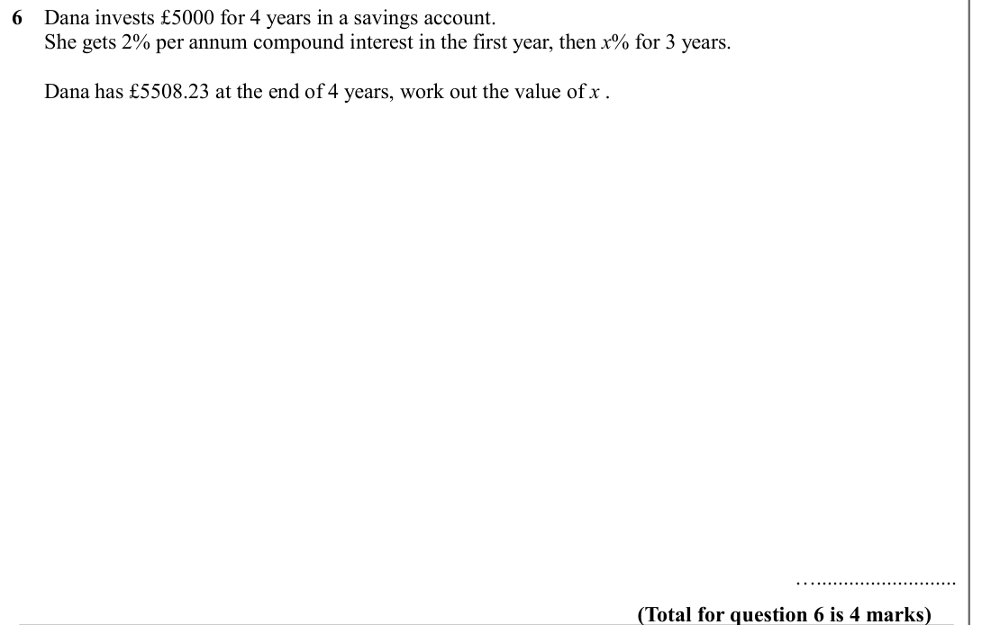

Text (lossy): 6    Dana invests £5000 for 4 years in a savings account.  /       She gets 2% per annum compound interest in the first year, then x% for 3 years.  /       Dana has £5508.23 at the end of 4 years, work out the value of x .  /  ….......................... / (Total for question 6 is 4 marks)

## Q7 (marks not printed)

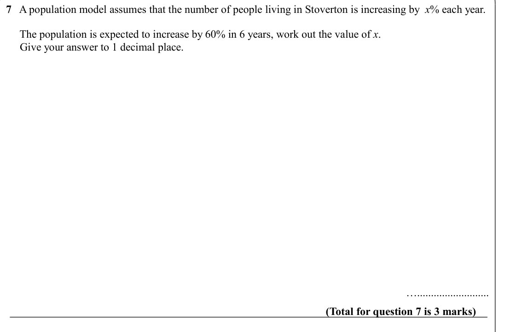

Text (lossy): 7   A population model assumes that the number of people living in Stoverton is increasing by  x% each year. /   /      The population is expected to increase by 60% in 6 years, work out the value of x.  /      Give your answer to 1 decimal place.  /  ….......................... / (Total for question 7 is 3 marks)

## Q8 (marks not printed)

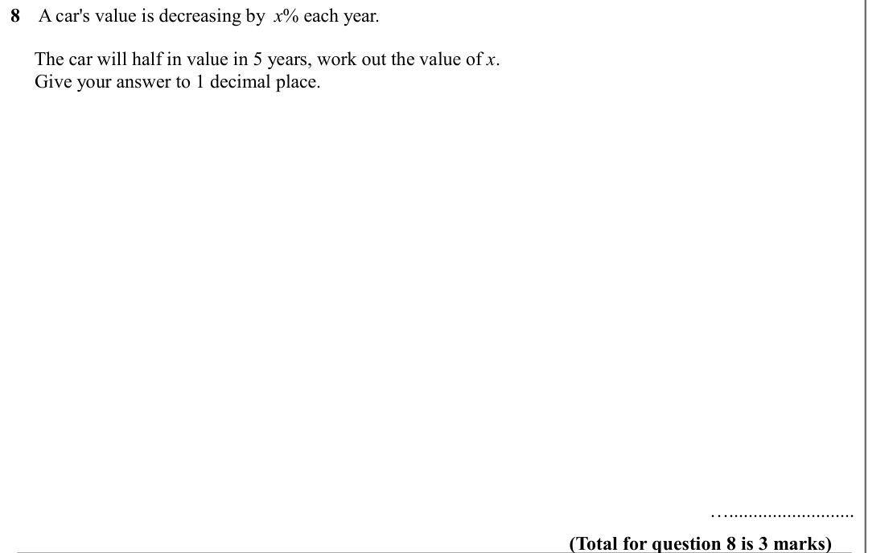

Text (lossy): 8    A car's value is decreasing by  x% each year. /   /      The car will half in value in 5 years, work out the value of x.  /      Give your answer to 1 decimal place.  /  ….......................... / (Total for question 8 is 3 marks)

## Q9 (marks not printed)

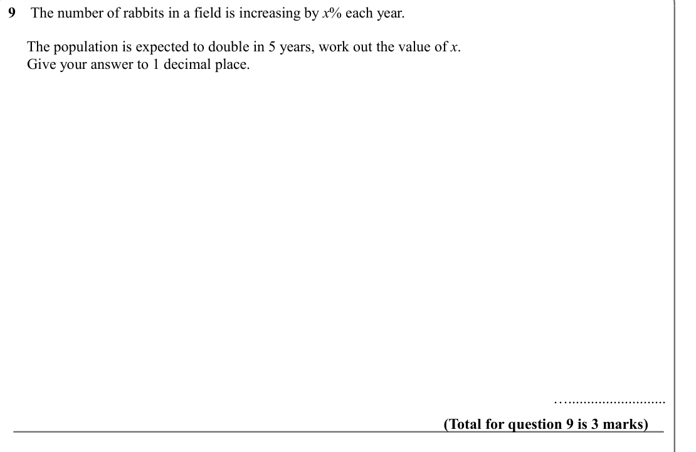

Text (lossy): 9    The number of rabbits in a field is increasing by x% each year. /   /      The population is expected to double in 5 years, work out the value of x.  /      Give your answer to 1 decimal place.  /  ….......................... / (Total for question 9 is 3 marks)

## Q10 (marks not printed)

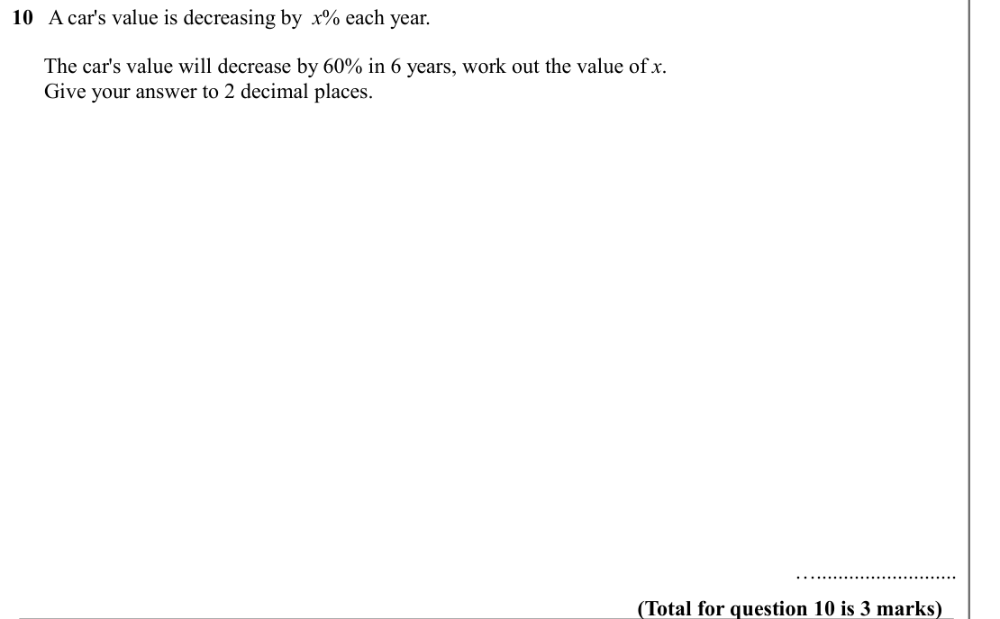

Text (lossy): 10   A car's value is decreasing by  x% each year. /   /       The car's value will decrease by 60% in 6 years, work out the value of x.  /       Give your answer to 2 decimal places.  /  ….......................... / (Total for question 10 is 3 marks)

## Q11 (marks not printed)

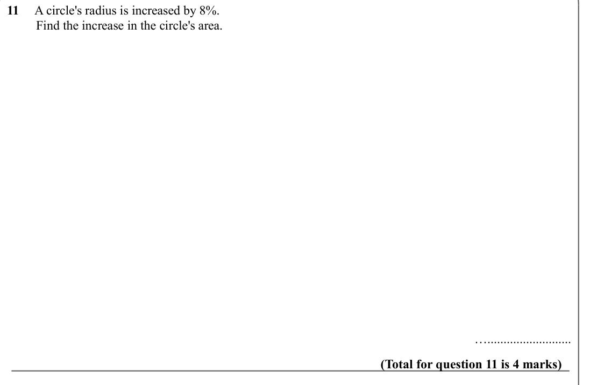

Text (lossy): 11     A circle's radius is increased by 8%.  /          Find the increase in the circle's area.  /  ….......................... / (Total for question 11 is 4 marks)

## Q12 (marks not printed)

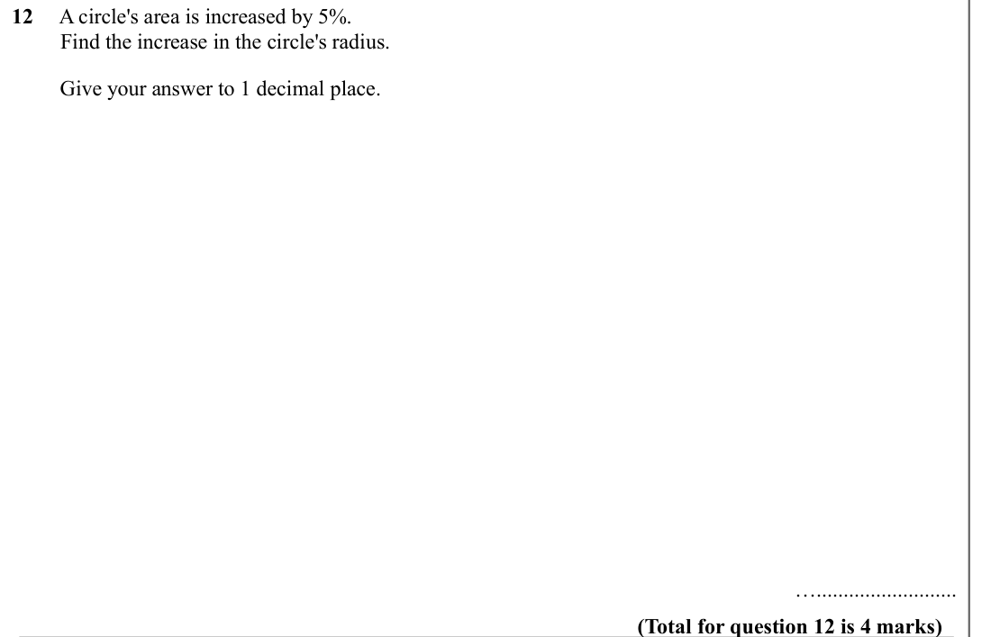

Text (lossy): 12     A circle's area is increased by 5%.  /          Find the increase in the circle's radius.  /         Give your answer to 1 decimal place.  /  ….......................... / (Total for question 12 is 4 marks)

## Q13 (marks not printed)

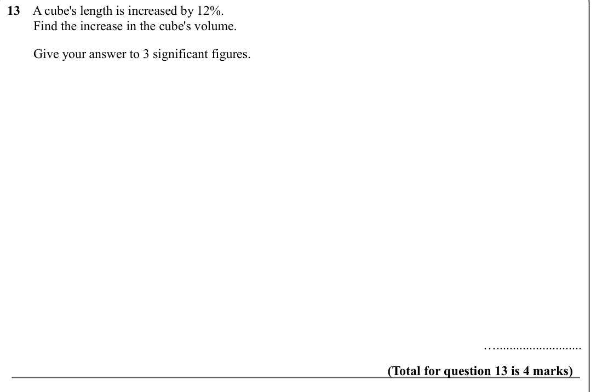

Text (lossy): 13    A cube's length is increased by 12%.  /         Find the increase in the cube's volume.  /         Give your answer to 3 significant figures. /  ….......................... / (Total for question 13 is 4 marks)

## Q14 (marks not printed)

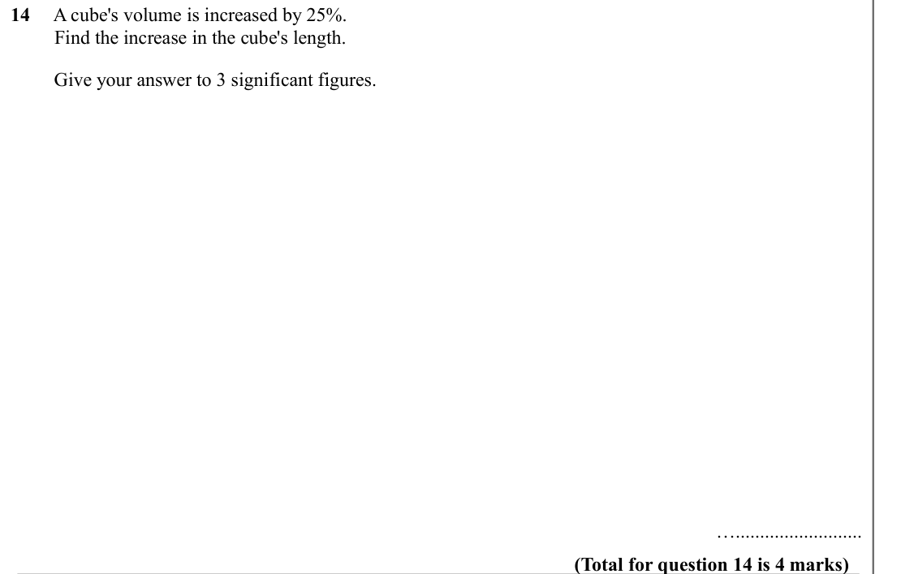

Text (lossy): 14     A cube's volume is increased by 25%.  /          Find the increase in the cube's length.  /         Give your answer to 3 significant figures. /  ….......................... / (Total for question 14 is 4 marks)

