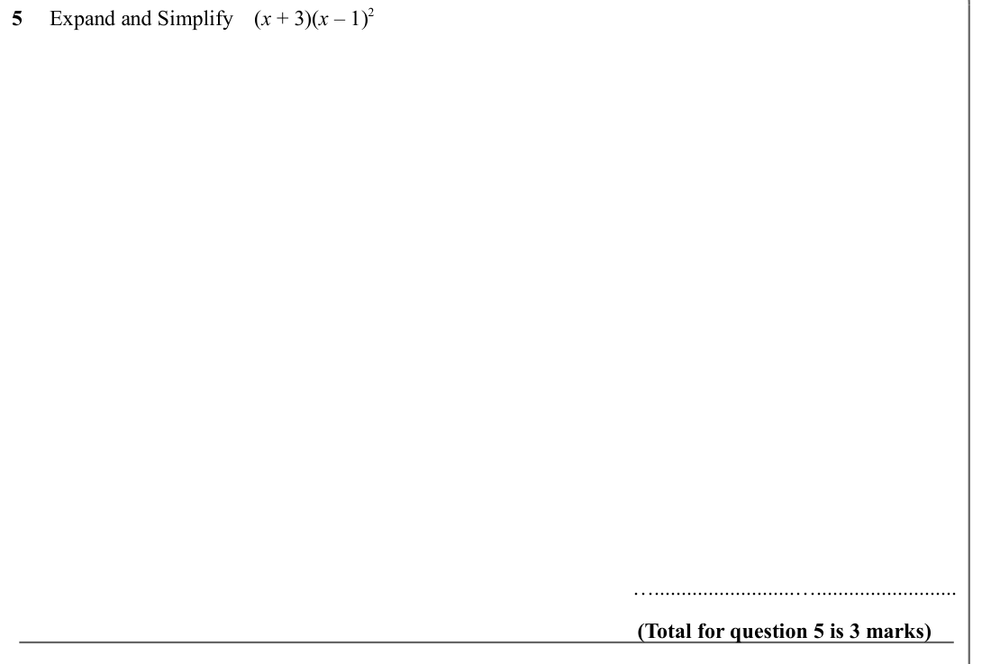
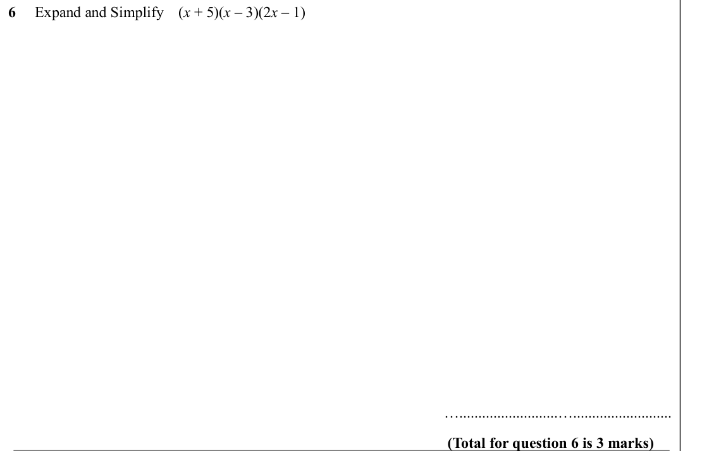
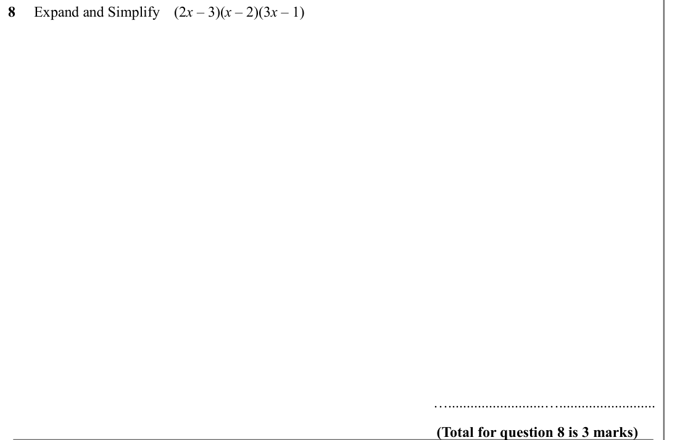
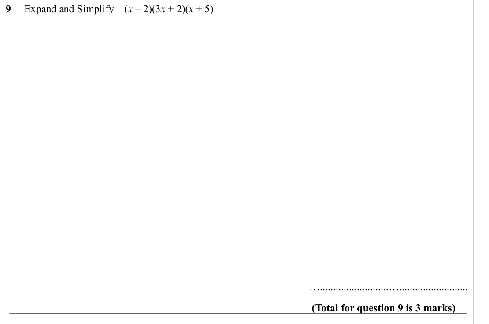
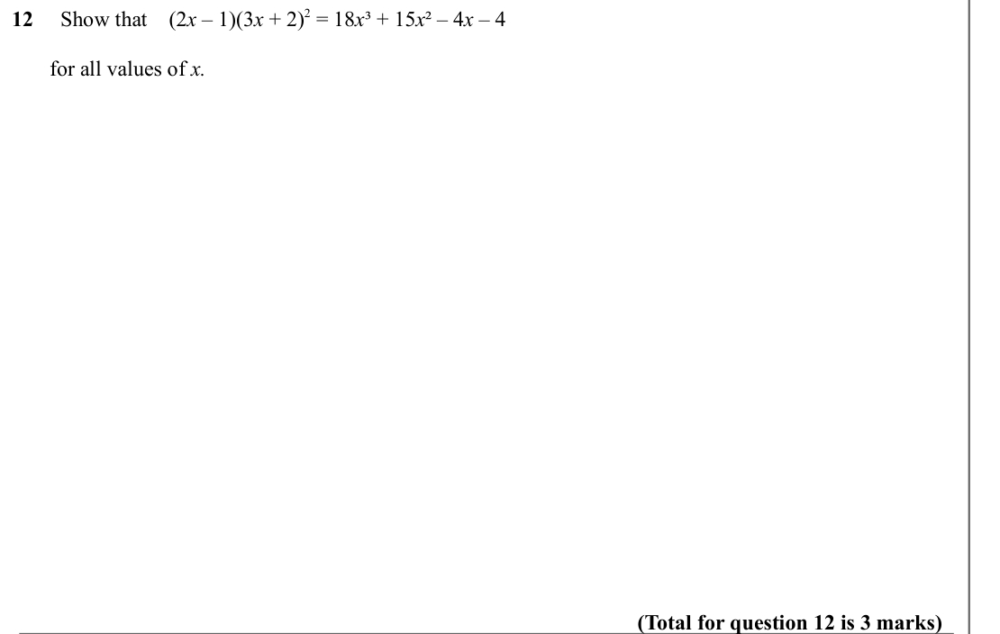
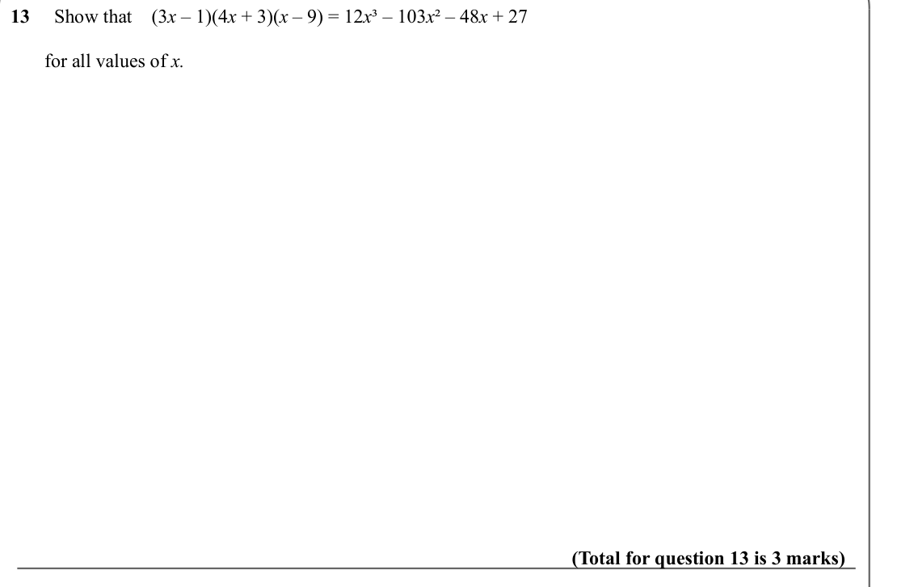
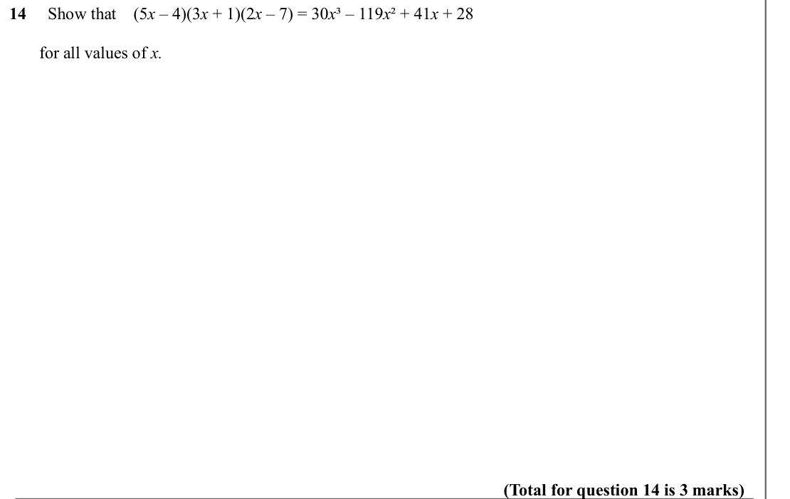

# Expanding Triple Brackets — Exam Questions (GCSE Maths · Edexcel · Grade 6)

Topic code `6.5` · slug `grade-6-6-5-expanding-triple-brackets` · source sheet sha256 `8d68176cd4a8e6a5…`

## Q1 (marks not printed)

Text (lossy): 1     Expand and Simplify    (x + 2)(x + 4)(x + 1) /     / …..........................….......................... / (Total for question 1 is 3 marks)

## Q2 (marks not printed)

Text (lossy): 2     Expand and Simplify    (x – 3)(x + 5)(x – 2) /     / …..........................….......................... / (Total for question 2 is 3 marks)

## Q3 (marks not printed)

Text (lossy): 3     Expand and Simplify    (x + 2)(x + 1)(x + 5) /     / …..........................….......................... / (Total for question 3 is 3 marks)

## Q4 (marks not printed)

Text (lossy): 4     Expand and Simplify    (x + 4)(x + 5)(x – 4) /     / …..........................….......................... / (Total for question 4 is 3 marks)

## Q5 (marks not printed)

Text (lossy): 5     Expand and Simplify    (x + 3)(x – 1)2 /     / …..........................….......................... / (Total for question 5 is 3 marks)

## Q6 (marks not printed)

Text (lossy): 6     Expand and Simplify    (x + 5)(x – 3)(2 x – 1) /     / …..........................….......................... / (Total for question 6 is 3 marks)

## Q7 (marks not printed)

Text (lossy): 7     Expand and Simplify    (2 x + 1)(x + 2)(x + 3) /     / …..........................….......................... / (Total for question 7 is 3 marks)

## Q8 (marks not printed)

Text (lossy): 8     Expand and Simplify    (2 x – 3)(x – 2)(3 x – 1) /     / …..........................….......................... / (Total for question 8 is 3 marks)

## Q9 (marks not printed)

Text (lossy): 9     Expand and Simplify    (x – 2)(3 x + 2)(x + 5) /     / …..........................….......................... / (Total for question 9 is 3 marks)

## Q10 (marks not printed)

Text (lossy): 10     Expand and Simplify    (3 x + 1)(x + 2)(x – 4) /     / …..........................….......................... / (Total for question 10 is 3 marks)

## Q11 (marks not printed)

Text (lossy): 11     Show that    (2 x + 3)(5 x + 2)(x – 5) = 10 x ³ – 31 x ² – 89 x – 30 /       /        for all values of x. /     / (Total for question 11 is 3 marks)

## Q12 (marks not printed)

Text (lossy): 12     Show that    (2 x – 1)(3 x + 2)2 = 18 x ³ + 15 x ² – 4 x – 4 /       /        for all values of x. /     / (Total for question 12 is 3 marks)

## Q13 (marks not printed)

Text (lossy): 13     Show that    (3 x – 1)(4 x + 3)(x – 9) = 12 x ³ – 103 x ² – 48 x + 27 /       /        for all values of x. /     / (Total for question 13 is 3 marks)

## Q14 (marks not printed)

Text (lossy): 14     Show that    (5 x – 4)(3 x + 1)(2 x – 7) = 30 x ³ – 119 x ² + 41 x + 28 /       /        for all values of x. /     / (Total for question 14 is 3 marks)

