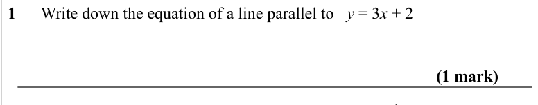
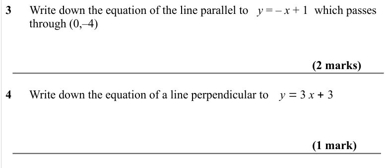

# Parallel and Perpendicular Lines — Exam Questions (GCSE Maths · Edexcel · Grade 6)

Topic code `6.6` · slug `grade-6-6-6-parallel-and-perpendicular-lines` · source sheet sha256 `8bbdc36f7c80cb42…`

## Q1 (1 marks)

Text (lossy): 1      Write down the equation of a line parallel to   y = 3 x + 2 / (1 mark) / y = 1

## Q2 (marks not printed)

## Q3 (3 marks)

Text (lossy): 3      Write down the equation of the line parallel to   y = – x + 1  which passes  /         through (0,–4) / (2 marks) / y = 3 x + 3 / 4      Write down the equation of a line perpendicular to  / (1 mark) / y = 1

