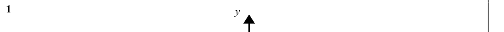

# Inequalities on Graphs — Exam Questions (GCSE Maths · Edexcel · Grade 6)

Topic code `6.7` · slug `grade-6-6-7-inequalities-on-graphs` · source sheet sha256 `d3924034c19b2f43…`

## Q1 (marks not printed)

Text (lossy): 1    / y

## Q2 (marks not printed)

Text (lossy): 2

## Q3 (marks not printed)

Text (lossy): 3

## Q4 (marks not printed)

Text (lossy): 4

## Q5 (marks not printed)

Text (lossy): 5

## Q6 (marks not printed)

Text (lossy): 6

## Q7 (marks not printed)

Text (lossy): 7

