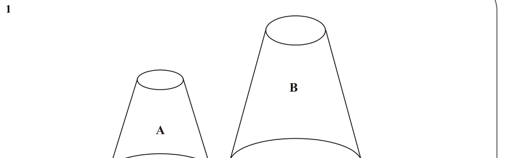
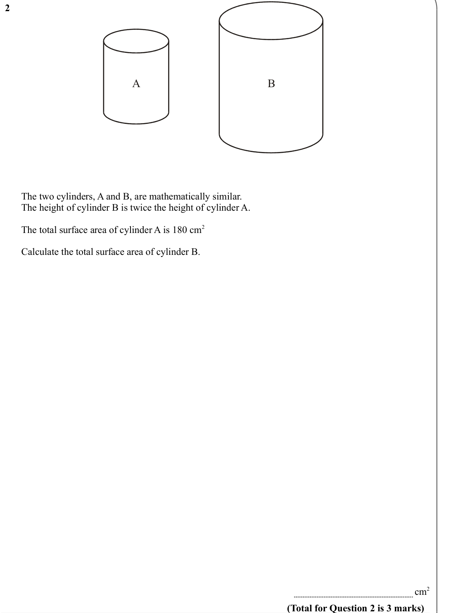
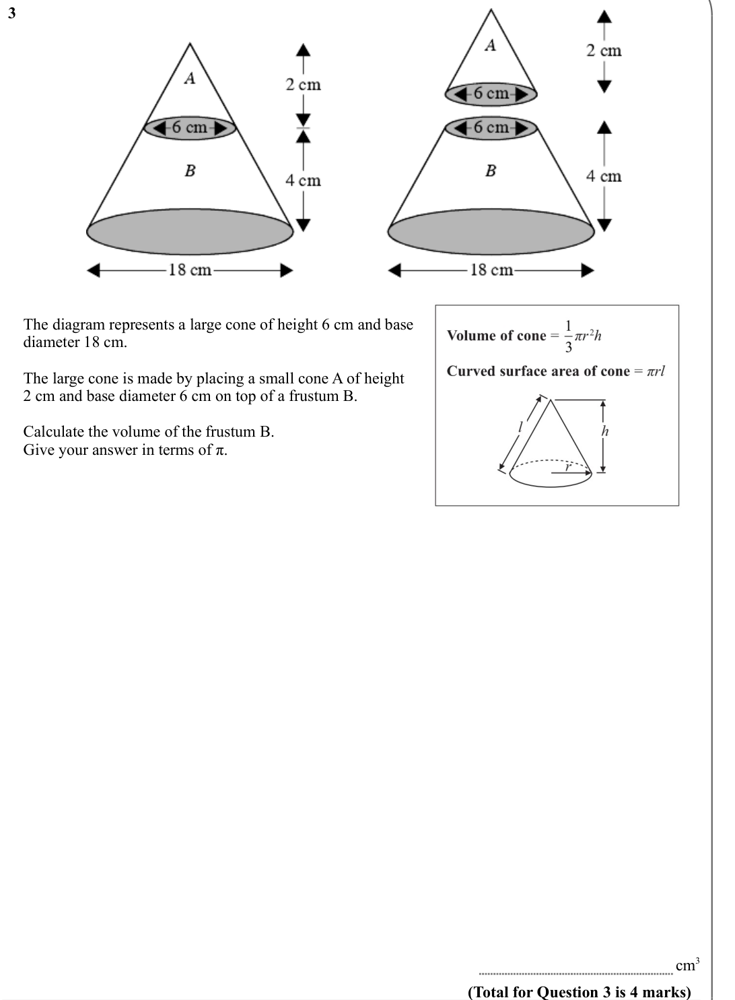
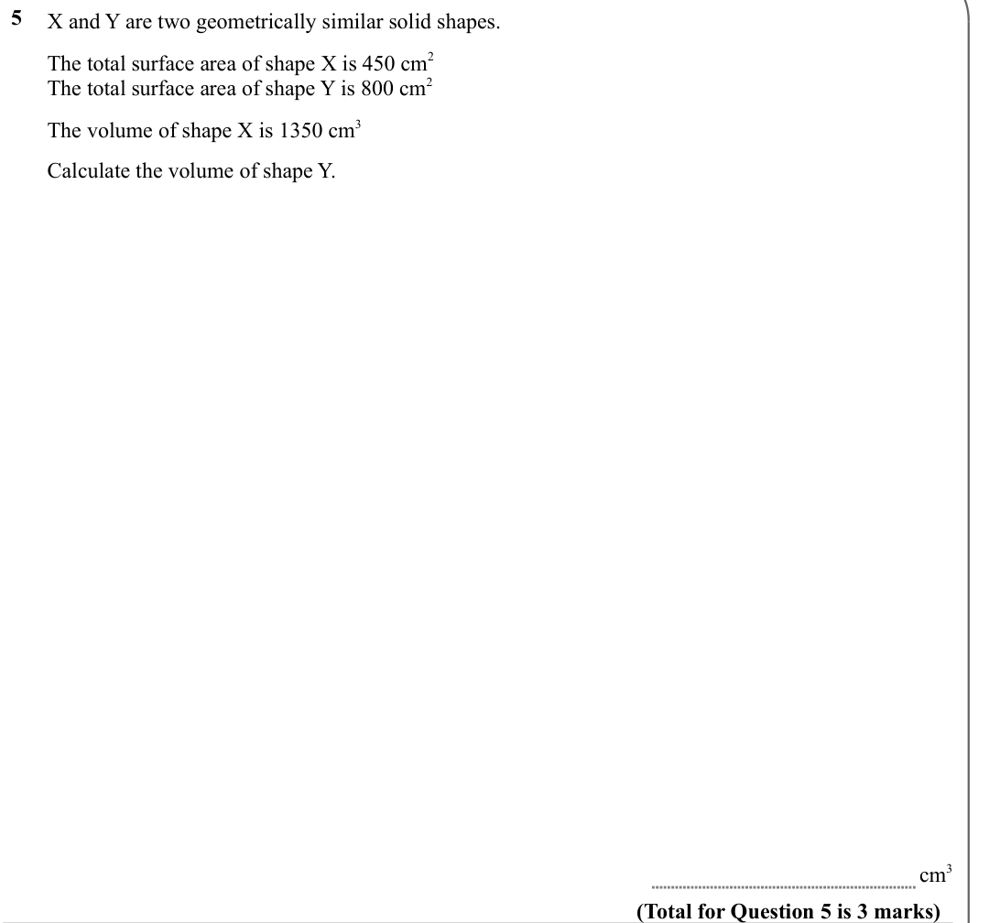
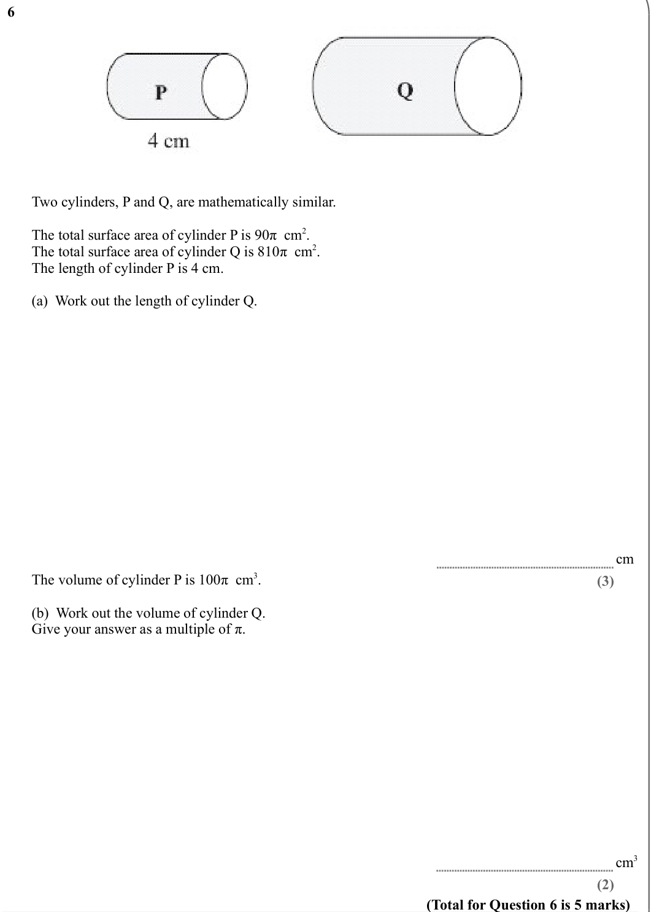
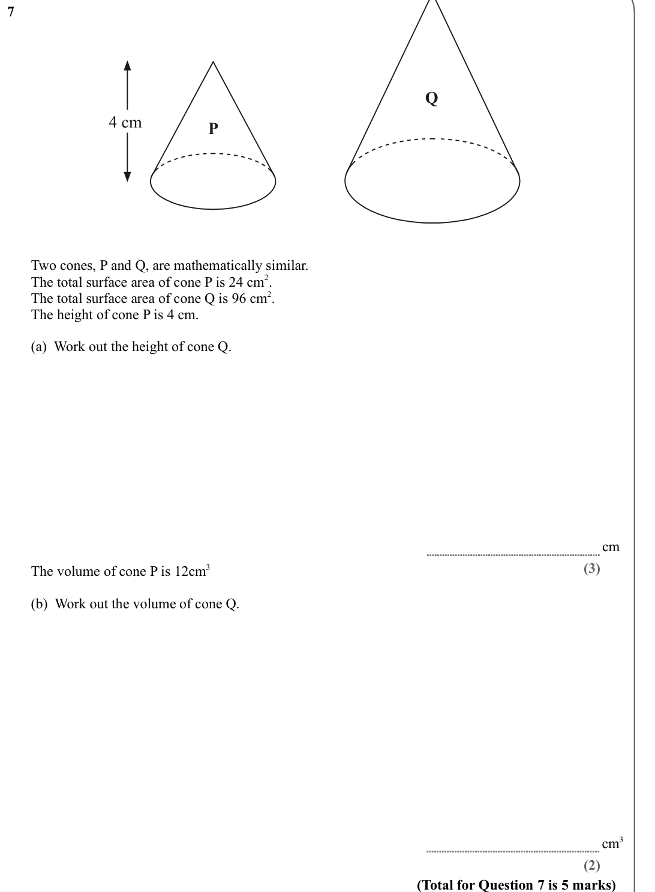

# Similar Shapes (Area and Volume) — Exam Questions (GCSE Maths · Edexcel · Grade 6)

Topic code `6.8` · slug `grade-6-6-8-similar-shapes-area-and-volume` · source sheet sha256 `c3ca3e2d4ca6570e…`

## Q1 (marks not printed)

Text (lossy): 1      /     / B / A

## Q2 (marks not printed)

Text (lossy): 2      /     / A / B / The two cylinders, A and B, are mathematically similar. / The height of cylinder B is twice the height of cylinder A. / The total surface area of cylinder A is 180 cm 2 / Calculate the total surface area of cylinder B. / cm 2 / (Total for Question 2 is 3 marks)

## Q3 (marks not printed)

Text (lossy): 3      /     / The diagram represents a large cone of height 6 cm and base  / diameter 18 cm. / The large cone is made by placing a small cone A of height  / 2 cm and base diameter 6 cm on top of a frustum B. / Calculate the volume of the frustum B. / Give your answer in terms of π. / cm 3 / (Total for Question 3 is 4 marks)

## Q4 (marks not printed)

Text (lossy): 4

## Q5 (marks not printed)

Text (lossy): 5      / X and Y are two geometrically similar solid shapes.  / The total surface area of shape X is 450 cm 2 /     / The total surface area of shape Y is 800 cm 2 / The volume of shape X is 1350 cm 3 / Calculate the volume of shape Y.  / cm 3 / (Total for Question 5 is 3 marks)

## Q6 (marks not printed · parts a, b)

Text (lossy): 6      /     / Two cylinders, P and Q, are mathematically similar. / The total surface area of cylinder P is 90π  cm 2. / The total surface area of cylinder Q is 810π  cm 2. / The length of cylinder P is 4 cm. / (a)  Work out the length of cylinder Q. / cm / The volume of cylinder P is 100π  cm 3. / (3) / (b)  Work out the volume of cylinder Q. / Give your answer as a multiple of π. / cm 3 / (2) /

## Q7 (marks not printed · parts a, b)

Text (lossy): 7      /     / Two cones, P and Q, are mathematically similar. / The total surface area of cone P is 24 cm 2. / The total surface area of cone Q is 96 cm 2.  / The height of cone P is 4 cm. / (a)  Work out the height of cone Q. / cm / (3) / The volume of cone P is 12cm 3  / (b)  Work out the volume of cone Q. / cm 3 / (2) / (Total for Question 7 is 5 marks)

