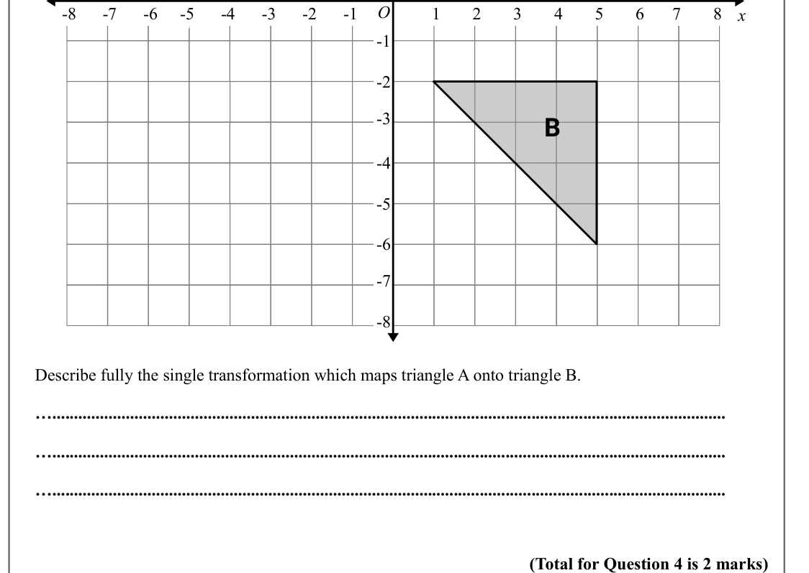
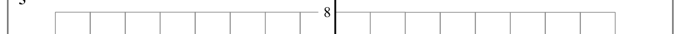

# Enlarging with Negative Scale Factors — Exam Questions (GCSE Maths · Edexcel · Grade 6)

Topic code `6.9` · slug `grade-6-6-9-enlarging-with-negative-scale-factors` · source sheet sha256 `d225604a188f8d29…`

## Q1 (marks not printed)

Text (lossy): 1

## Q2 (marks not printed)

Text (lossy): 2

## Q3 (marks not printed)

Text (lossy): 3

## Q4 (marks not printed)

Text (lossy): 4

## Q5 (marks not printed)

Text (lossy): 5

## Q6 (marks not printed)

## Q7 (marks not printed)

Text (lossy): O / 8 / -8 / -7 / 6 / -6 / 1 / -1 / -2 / -3 / -4 / -5 / 2 / 3 / 4 / 5 / 7 / x / -1 / -2 / -3 / B / -4 / -5 / -6 / -7 / -8 /    /       Describe fully the single transformation which maps triangle A onto triangle B.  /       …............................................................................................................................................................ /       ….........

## Q8 (marks not printed)

Text (lossy): 8

## Q9 (marks not printed)

Text (lossy): 9

