# Surds — Exam Questions (GCSE Maths · Edexcel · Grade 7)

Topic code `7.1` · slug `grade-7-7-1-surds` · source sheet sha256 `b9942d59d6409c3e…`

## Q1 (2 marks)

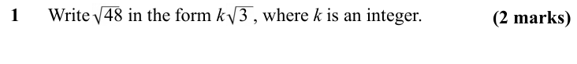

Text (lossy): 1      Write   48 in the form k   3 , where k is an integer.  /              / (2 marks)

## Q2 (2 marks)

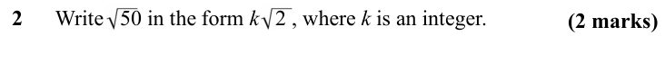

Text (lossy): 2      Write   50 in the form k   2 , where k is an integer.  /              / (2 marks)

## Q3 (2 marks)

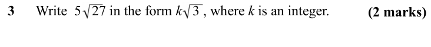

Text (lossy): 3      Write  5   27 in the form k   3 , where k is an integer.  /              / (2 marks)

## Q4 (2 marks)

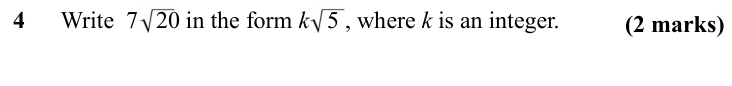

Text (lossy): 4      Write  7   20 in the form k   5 , where k is an integer.  /              / (2 marks)

## Q5 (2 marks)

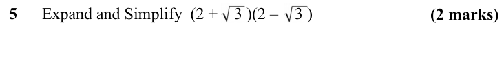

Text (lossy): 5      Expand and Simplify  (2 +    3 )(2 –    3 ) /               / (2 marks)

## Q6 (2 marks)

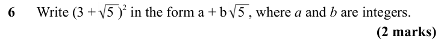

Text (lossy): 6      Write (3 +   5 )2 in the form a + b   5 , where a and b are integers.  /              / (2 marks)

## Q7 (2 marks)

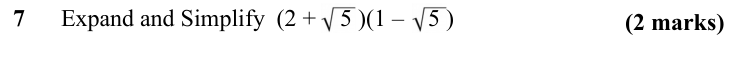

Text (lossy): 7      Expand and Simplify  (2 +    5 )(1 –    5 ) /               / (2 marks)

## Q8 (2 marks)

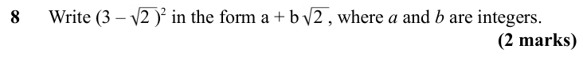

Text (lossy): 8      Write (3 –   2 )2 in the form a + b   2 , where a and b are integers.  /              / (2 marks)

## Q9 (2 marks)

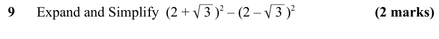

Text (lossy): 9      Expand and Simplify  (2 +    3 )2 – (2 –    3 )2 / (2 marks)

## Q10 (2 marks)

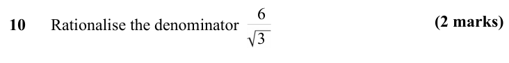

Text (lossy): 10      Rationalise the denominator   /              / 3 / 6 / (2 marks)

## Q11 (2 marks)

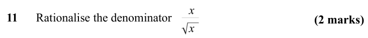

Text (lossy): 11      Rationalise the denominator   /              / x / x / (2 marks)

## Q12 (2 marks)

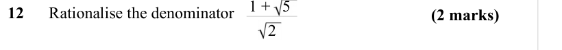

Text (lossy): 12      Rationalise the denominator   /              / 2 / (2 marks)

## Q13 (3 marks)

Text (lossy): 13      Simplify        / (3 +   6 ) / (3 marks)

## Q14 (3 marks)

Text (lossy): (3 marks) / 14      Simplify fully

## Q15 (marks not printed)

## Q16 (3 marks)

Text (lossy): 16      Show that                      can be written as    3  /              / (3 marks)

## Q17 (3 marks)

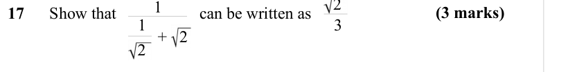

Text (lossy): (3 marks) / 17      Show that                    can be written as   /              / +   2 / 1 / 2

## Q18 (marks not printed)

## Q19 (2 marks)

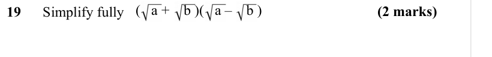

Text (lossy): (   a +    b )(   a –    b ) / (2 marks) / 19      Simplify fully

## Q20 (2 marks)

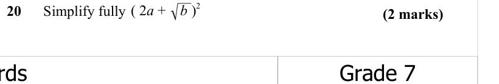

Text (lossy): ( 2 a +    b )2 / 20      Simplify fully / (2 marks)

