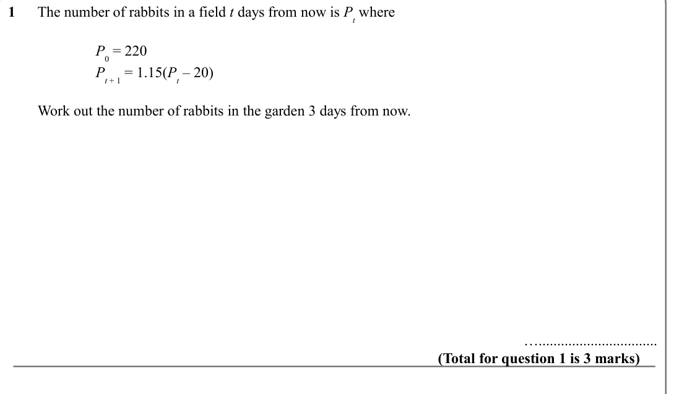
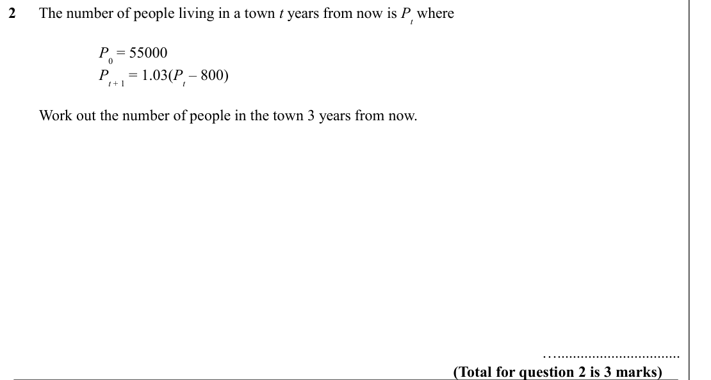
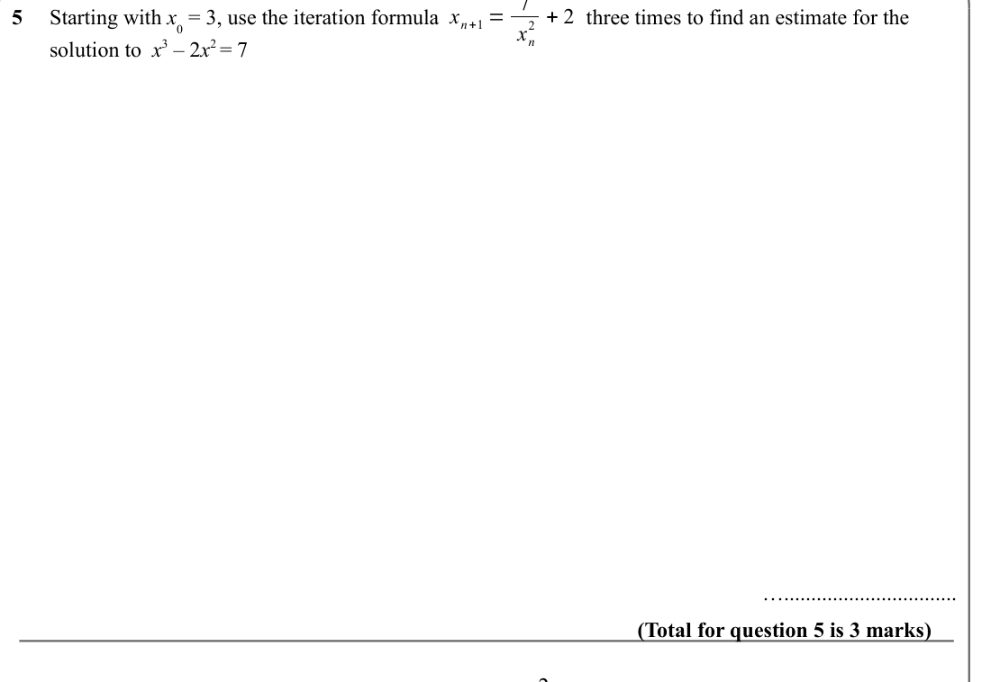
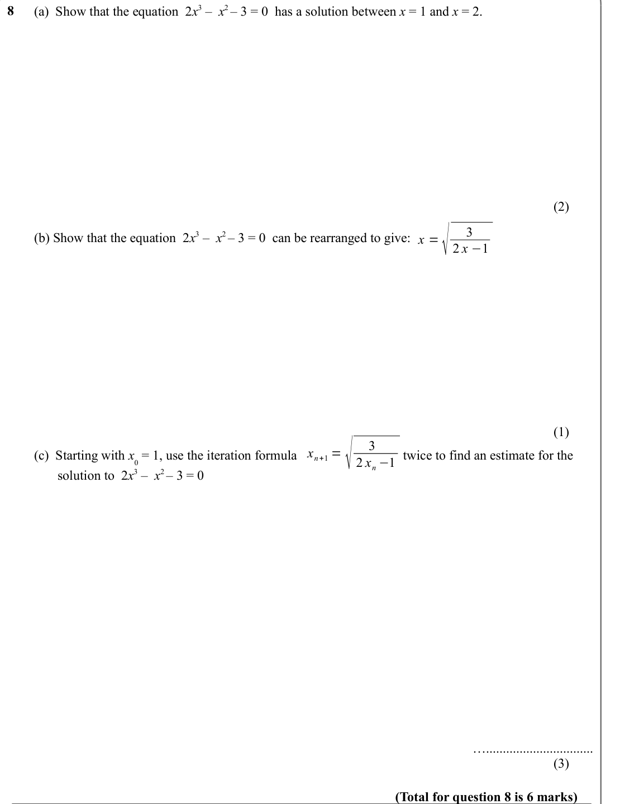
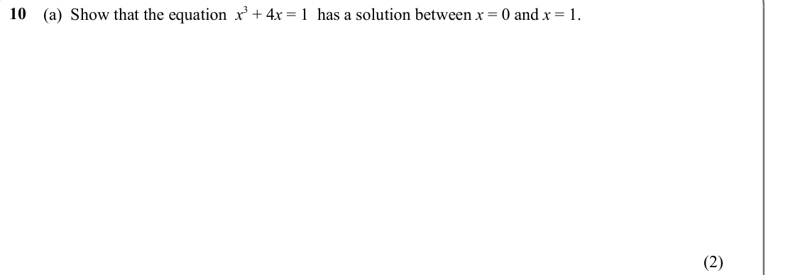

# Iteration — Exam Questions (GCSE Maths · Edexcel · Grade 7)

Topic code `7.10` · slug `grade-7-7-10-iteration` · source sheet sha256 `617ea8edd5bd851d…`

## Q1 (marks not printed)

Text (lossy): 1      The number of rabbits in a field t days from now is P t where / P 0 = 220 / P t + 1 = 1.15(P t – 20) /         Work out the number of rabbits in the garden 3 days from now.  / …................................ / (Total for question 1 is 3 marks)

## Q2 (marks not printed)

Text (lossy): 2      The number of people living in a town t years from now is P t where / P 0 = 55000 / P t + 1 = 1.03(P t – 800) /         Work out the number of people in the town 3 years from now.  / …................................ / (Total for question 2 is 3 marks)

## Q3 (marks not printed)

Text (lossy): 3       /         Using

## Q4 (marks not printed)

Text (lossy): 4       /         Using

## Q5 (marks not printed)

Text (lossy): 2 + 2 /        Starting with x 0 = 3, use the iteration formula  / three times to find an estimate for the          /        solution to  x 3 – 2 x 2 = 7 / 5       /         / x n /          / …................................ / (Total for question 5 is 3 marks) / x n+1 = / 2 / x n

## Q6 (marks not printed)

Text (lossy): Starting with x 0 = 0, use the iteration formula  / three times to find an estimate for the          /        solution to  x 3 + 3 x  =  2 / 6

## Q7 (marks not printed)

## Q8 (marks not printed · parts a, b, c)

Text (lossy): (a)  Show that the equation  2 x 3 –  x 2 – 3 = 0  has a solution between x = 1 and x = 2. / 8       /          / (2) / 3 / 2 x −1 /         (b) Show that the equation  2 x 3 –  x 2 – 3 = 0  can be rearranged to give: / x =√ / (1) / 3 / 2 x n −1 / x n+1 = √ /         (c)  Starting with x 0 = 1, use the iteration formula  / twice to find an estimate for the       /                solution to  2 x 3

## Q9 (marks not printed)

Text (lossy): 9       /         Using

## Q10 (marks not printed · parts a)

Text (lossy): (a)  Show that the equation  x 3 + 4 x = 1  has a solution between x = 0 and x = 1. / 10       /          / (2)

