# Finding the Area of Any Triangle — Exam Questions (GCSE Maths · Edexcel · Grade 7)

Topic code `7.11` · slug `grade-7-7-11-finding-the-area-of-any-triangle` · source sheet sha256 `80535d4fa28af548…`

## Q1 (marks not printed)

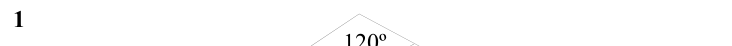

Text (lossy): 1     / 120º

## Q2 (marks not printed)

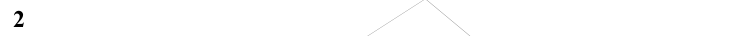

Text (lossy): 2

## Q3 (marks not printed)

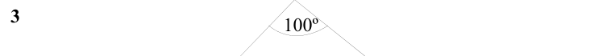

Text (lossy): 3     / 100º

## Q4 (marks not printed)

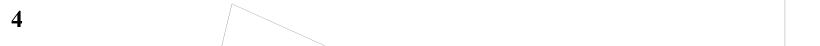

Text (lossy): 4

## Q5 (marks not printed)

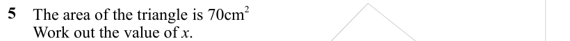

Text (lossy): 5     /       The area of the triangle is 70cm 2 /       Work out the value of x. /       Give your answer to 1 decimal place.

## Q6 (marks not printed)

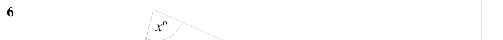

Text (lossy): 6     / x º

## Q7 (marks not printed)

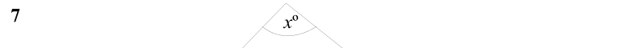

Text (lossy): 7     / x º

## Q8 (marks not printed)

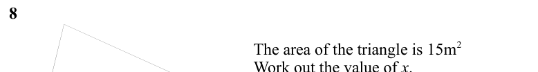

Text (lossy): 8    /       The area of the triangle is 15m 2 /       Work out the value of x. /       Give your answer to 3 significant figures.

## Q9 (4 marks)

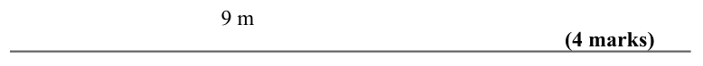

Text (lossy): 9 m / (4 marks)

## Q10 (marks not printed)

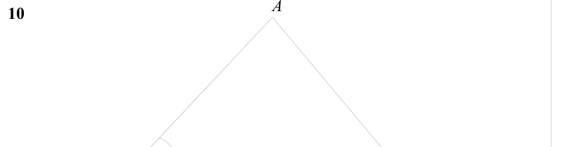

Text (lossy): 10

## Q11 (5 marks)

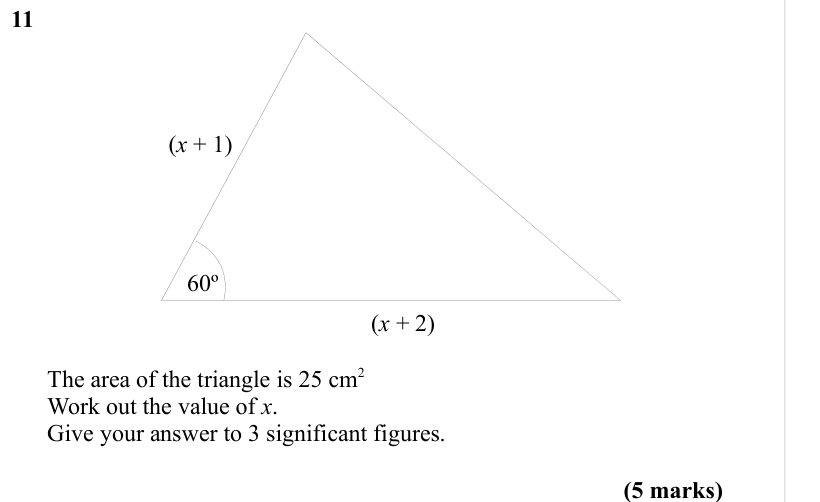

Text (lossy): 11     / (x + 1) / 60º / (x + 2)  /       The area of the triangle is 25 cm 2 /       Work out the value of x. /       Give your answer to 3 significant figures.  / (5 marks)

