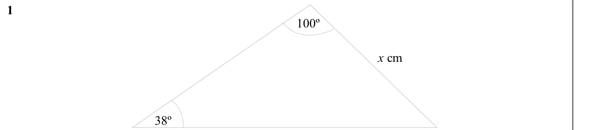
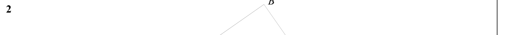
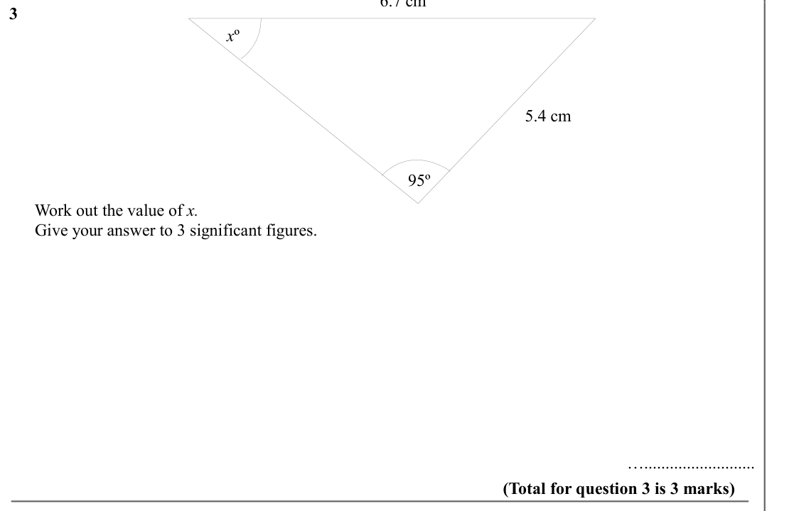
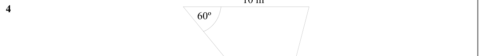
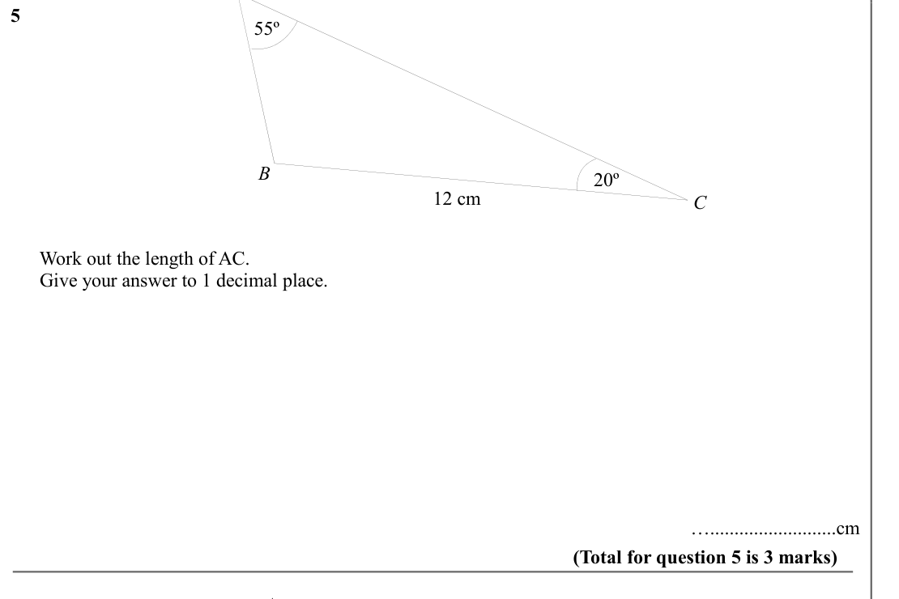
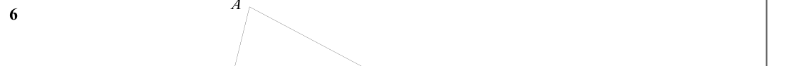
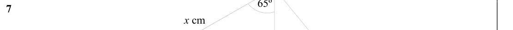
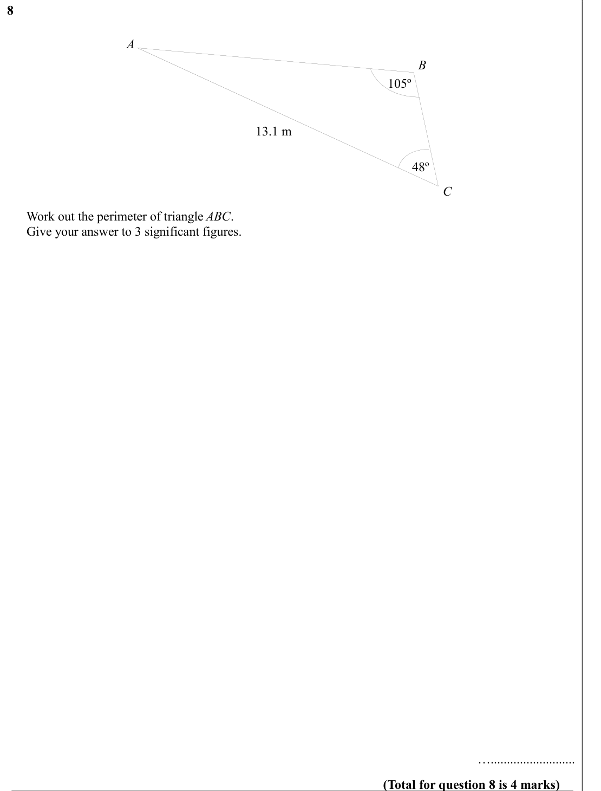
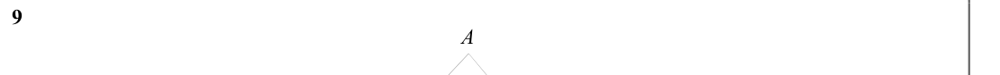
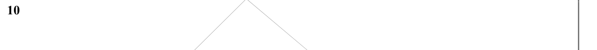

# The Sine Rule — Exam Questions (GCSE Maths · Edexcel · Grade 7)

Topic code `7.12` · slug `grade-7-7-12-the-sine-rule` · source sheet sha256 `803cbf928a24eecd…`

## Q1 (marks not printed)

Text (lossy): 1     / 100º / x cm / 38º

## Q2 (marks not printed)

Text (lossy): 2

## Q3 (marks not printed)

Text (lossy): 3     / x º / 5.4 cm / 95º /       Work out the value of x. /       Give your answer to 3 significant figures.      / ….......................... / (Total for question 3 is 3 marks)

## Q4 (marks not printed)

Text (lossy): 4     / 60º

## Q5 (marks not printed)

Text (lossy): 5     / 55º / B / 20º / 12 cm / C /       Work out the length of AC. /       Give your answer to 1 decimal place.      / …..........................cm / (Total for question 5 is 3 marks) / A

## Q6 (marks not printed)

Text (lossy): 6

## Q7 (marks not printed)

Text (lossy): 7     / x cm

## Q8 (marks not printed)

Text (lossy): 8     / A / B / 105º / 13.1 m / 48º / C /       Work out the perimeter of triangle ABC.  /       Give your answer to 3 significant figures. / ….......................... / (Total for question 8 is 4 marks)

## Q9 (marks not printed)

Text (lossy): 9     / A

## Q10 (marks not printed)

Text (lossy): 10

