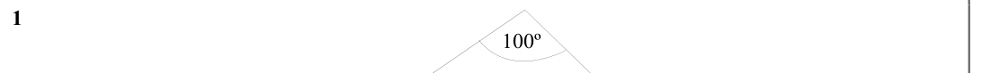
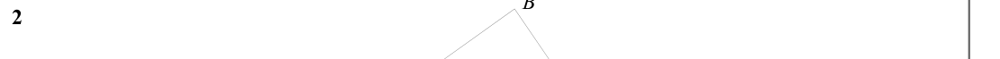
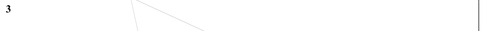
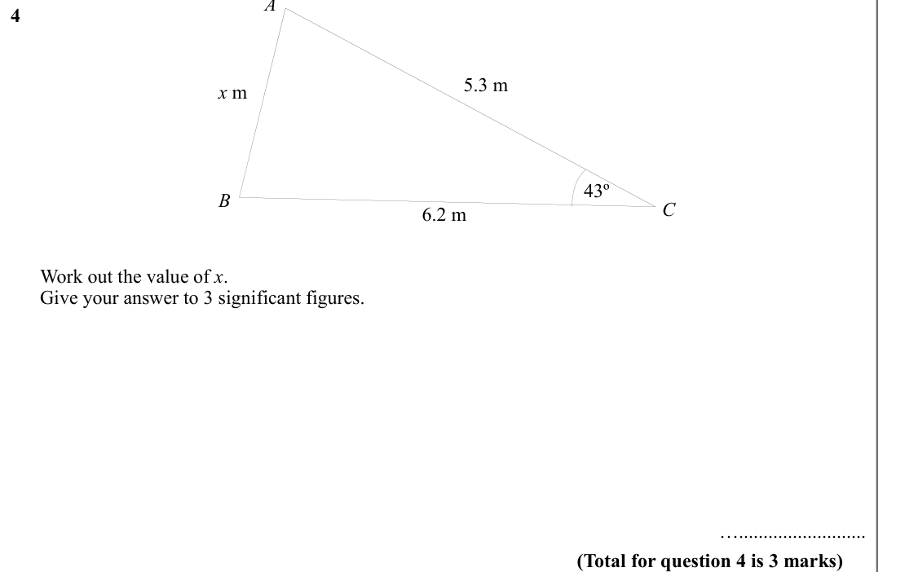
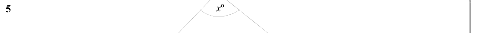
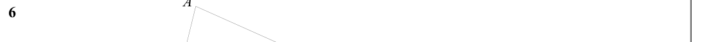
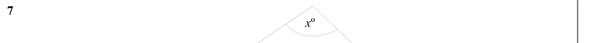
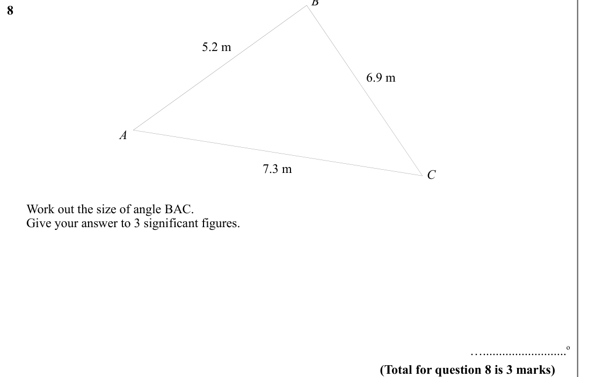
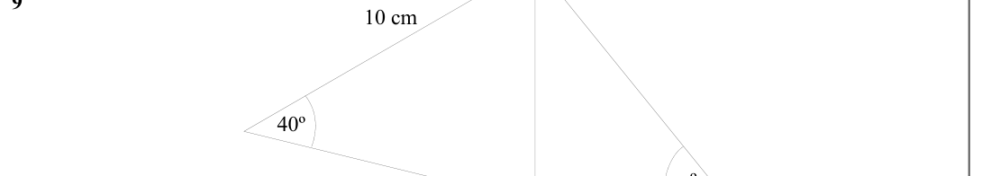
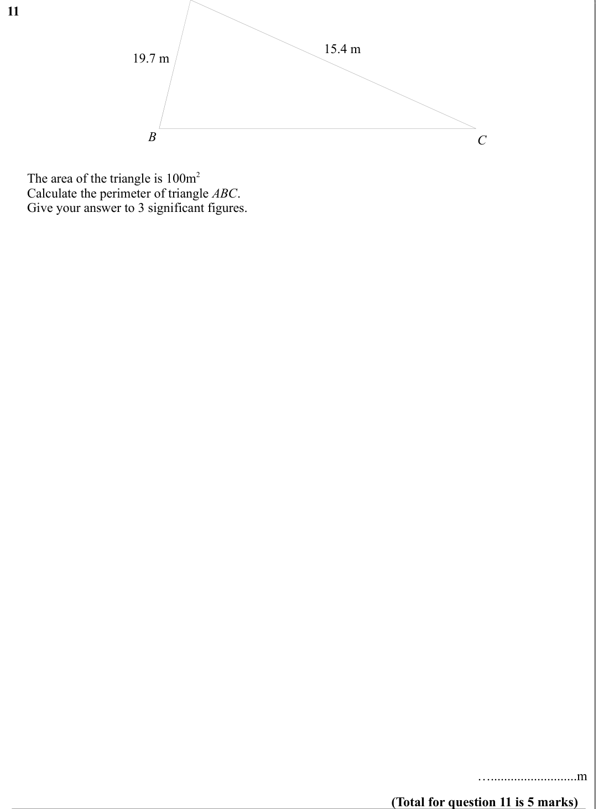

# The Cosine Rule — Exam Questions (GCSE Maths · Edexcel · Grade 7)

Topic code `7.13` · slug `grade-7-7-13-the-cosine-rule` · source sheet sha256 `546db6890f358db2…`

## Q1 (marks not printed)

Text (lossy): 1     / 100º

## Q2 (marks not printed)

Text (lossy): 2

## Q3 (marks not printed)

Text (lossy): 3

## Q4 (marks not printed)

Text (lossy): 4     / 5.3 m / x m / 43º / 6.2 m / C / B /       Work out the value of x. /       Give your answer to 3 significant figures.  /            / ….......................... / (Total for question 4 is 3 marks)

## Q5 (marks not printed)

Text (lossy): x º / 5

## Q6 (marks not printed)

Text (lossy): 6

## Q7 (marks not printed)

Text (lossy): 7     / x º

## Q8 (marks not printed)

Text (lossy): 8     / 5.2 m / 6.9 m / A / 7.3 m / C /       Work out the size of angle BAC. /       Give your answer to 3 significant figures.      / …..........................o / (Total for question 8 is 3 marks)

## Q9 (marks not printed)

Text (lossy): 9

## Q10 (marks not printed)

Text (lossy): 10 cm / 40º / x º

## Q11 (marks not printed)

Text (lossy): 11     / 15.4 m / 19.7 m / B / C /       The area of the triangle is 100m 2 /       Calculate the perimeter of triangle ABC. /       Give your answer to 3 significant figures.  /            / …..........................m / (Total for question 11 is 5 marks)

