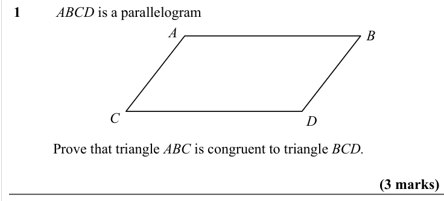
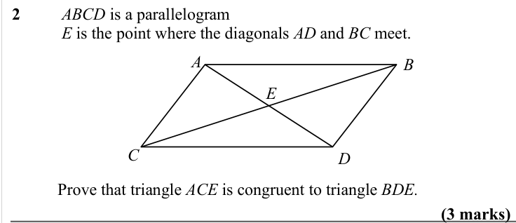
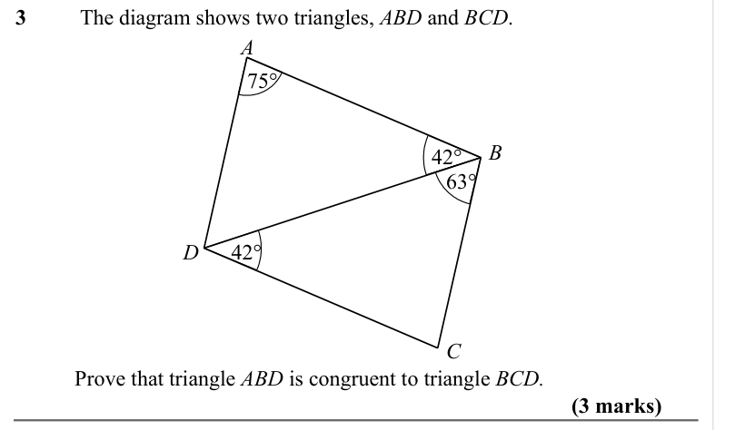
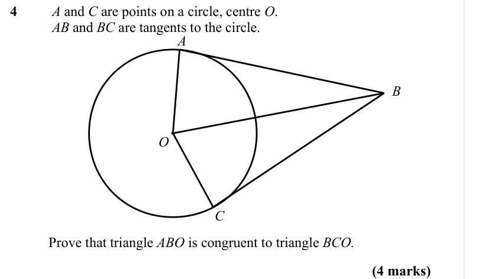
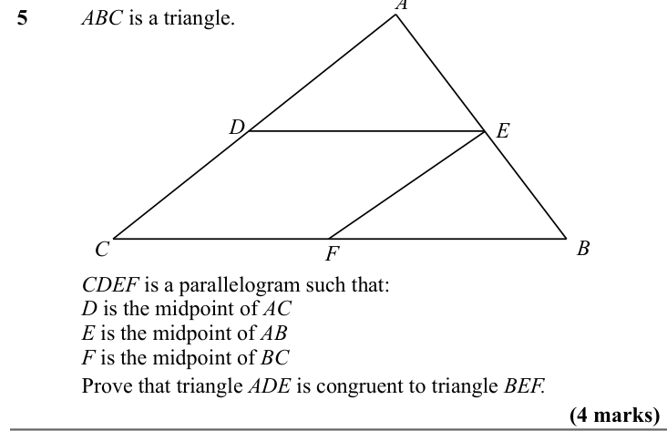
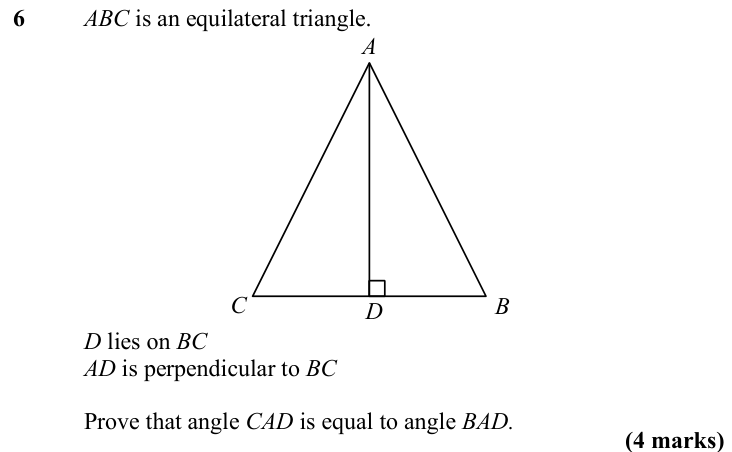
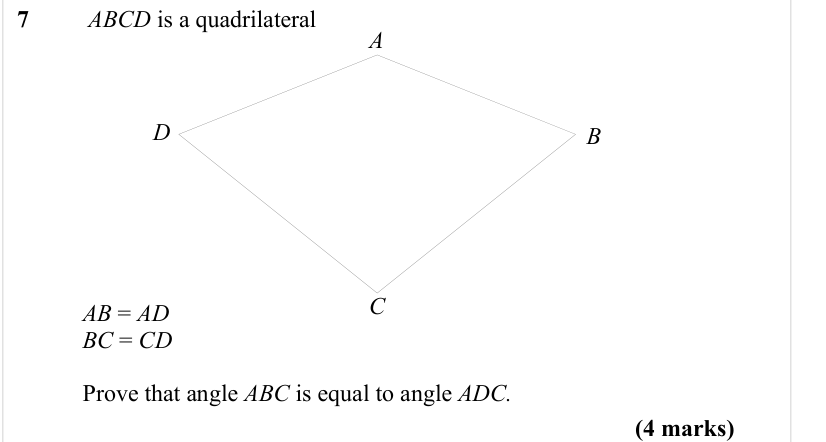

# Congruent Triangles — Exam Questions (GCSE Maths · Edexcel · Grade 7)

Topic code `7.14` · slug `grade-7-7-14-congruent-triangles` · source sheet sha256 `671bc5b1824b6b1a…`

## Q1 (3 marks)

Text (lossy): 1 / ABCD is a parallelogram / A / B / C / D /    / Prove that triangle ABC is congruent to triangle BCD. / (3 marks)

## Q2 (3 marks)

Text (lossy): 2 / ABCD is a parallelogram / E is the point where the diagonals AD and BC meet.  / A / B / E / C / D /    / Prove that triangle ACE is congruent to triangle BDE. / (3 marks)

## Q3 (3 marks)

Text (lossy): 3 / The diagram shows two triangles, ABD and BCD. / A / 75° / B / 42° / 63° / D / 42° / C /    / Prove that triangle ABD is congruent to triangle BCD. / (3 marks)

## Q4 (4 marks)

Text (lossy): 4 / A and C are points on a circle, centre O.  / AB and BC are tangents to the circle. / A / B / O / C /    / Prove that triangle ABO is congruent to triangle BCO. / (4 marks)

## Q5 (4 marks)

Text (lossy): 5 / ABC is a triangle. / D / E / B / C / F / CDEF is a parallelogram such that: / D is the midpoint of AC / E is the midpoint of AB / F is the midpoint of BC /    / Prove that triangle ADE is congruent to triangle BEF. / (4 marks)

## Q6 (4 marks)

Text (lossy): 6 / ABC is an equilateral triangle.  / A / B / C / D /    / D lies on BC /    / AD is perpendicular to BC  / Prove that angle CAD is equal to angle BAD. / (4 marks)

## Q7 (4 marks)

Text (lossy): 7 / ABCD is a quadrilateral / A / D / B / C /    / AB = AD  /    / BC = CD  / Prove that angle ABC is equal to angle ADC. / (4 marks)

