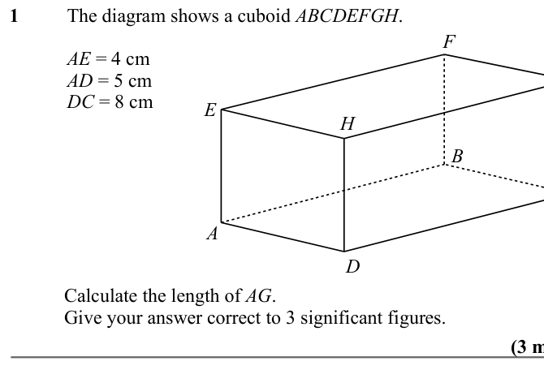
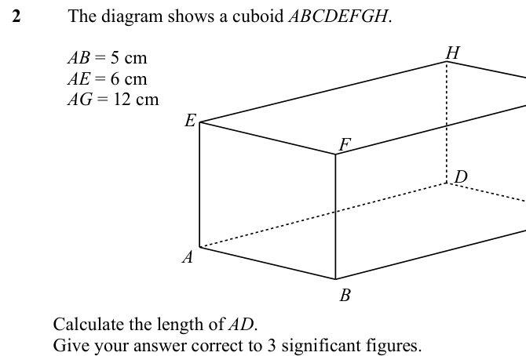
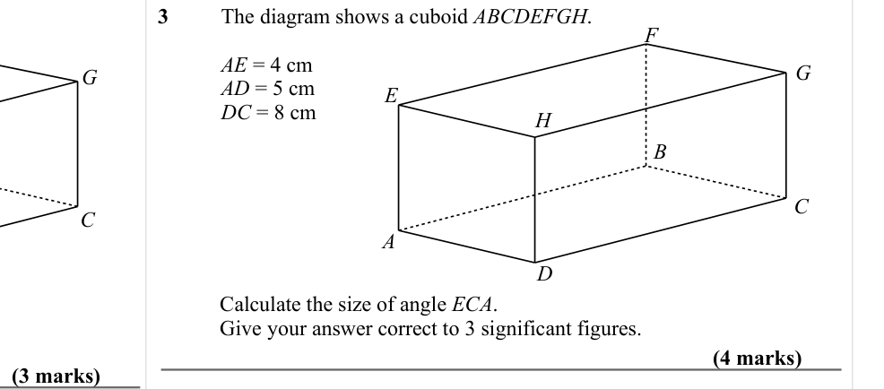
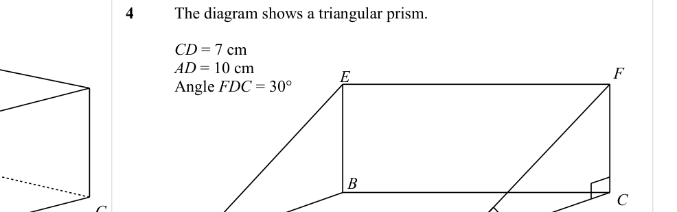
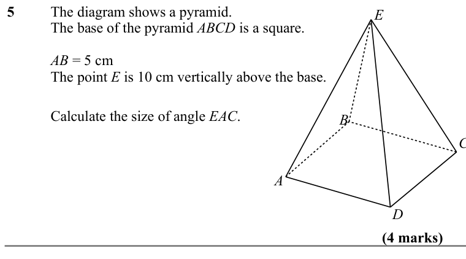
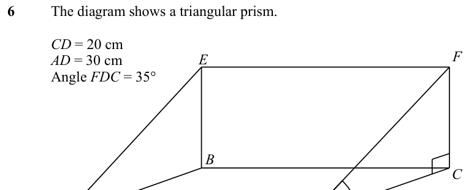
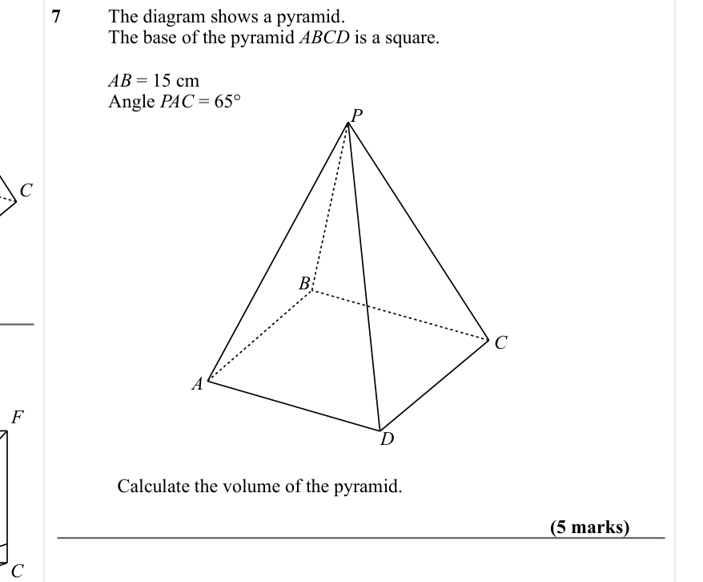

# 3d Pythagoras and Trigonometry — Exam Questions (GCSE Maths · Edexcel · Grade 7)

Topic code `7.15` · slug `grade-7-7-15-3d-pythagoras-and-trigonometry` · source sheet sha256 `c2bbd5e73f8e8cb9…`

## Q1 (marks not printed)

Text (lossy): 1 / The diagram shows a cuboid ABCDEFGH.  / F / AE = 4 cm / AD = 5 cm / DC = 8 cm / E / H / B / A / D / Calculate the length of AG.  / Give your answer correct to 3 significant figures.

## Q2 (marks not printed)

Text (lossy): 2 / The diagram shows a cuboid ABCDEFGH.  / H / AB = 5 cm / AE = 6 cm / AG = 12 cm / E / F / D / A / B / Calculate the length of AD.  / Give your answer correct to 3 significant figures.

## Q3 (7 marks)

Text (lossy): 3 / The diagram shows a cuboid ABCDEFGH.  / F / AE = 4 cm / AD = 5 cm / DC = 8 cm / G / G / E / H / B / C / C / A / D / Calculate the size of angle ECA.  / Give your answer correct to 3 significant figures.  / (4 marks) / (3 marks)

## Q4 (marks not printed)

Text (lossy): 4 / The diagram shows a triangular prism. / CD = 7 cm / AD = 10 cm / Angle FDC = 30° / E / F / B / C / C

## Q5 (4 marks)

Text (lossy): 5 / The diagram shows a pyramid.  / The base of the pyramid ABCD is a square.  / E / AB = 5 cm / The point E is 10 cm vertically above the base. / Calculate the size of angle EAC. / B / A / D / (4 marks)

## Q6 (marks not printed)

Text (lossy): 6 / The diagram shows a triangular prism. / CD = 20 cm / AD = 30 cm / Angle FDC = 35° / E / F / B

## Q7 (5 marks)

Text (lossy): 7 / The diagram shows a pyramid.  / The base of the pyramid ABCD is a square.  / AB = 15 cm / Angle PAC = 65° / P / C / B / C / A / D / Calculate the volume of the pyramid.  / (5 marks) / C

