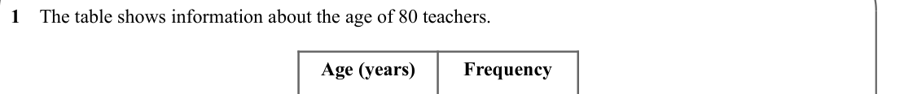
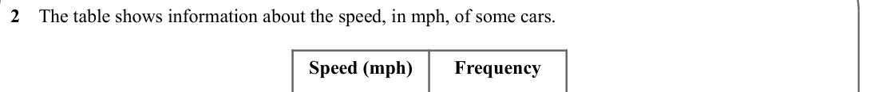
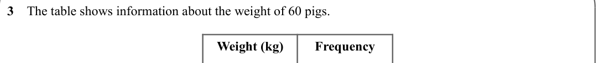
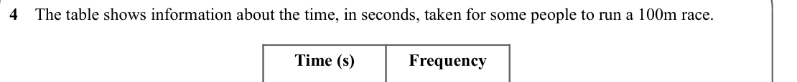
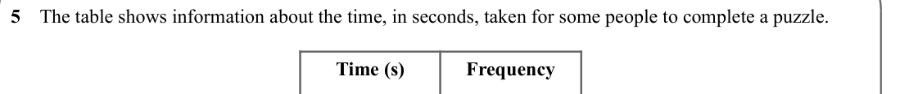
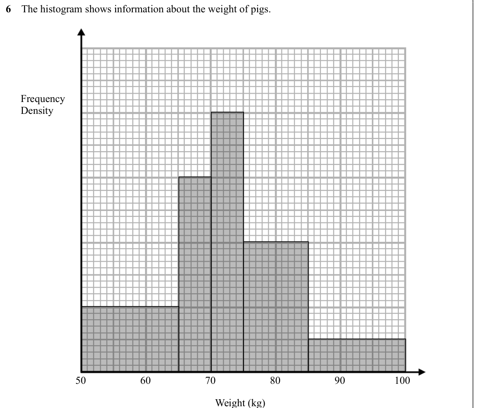
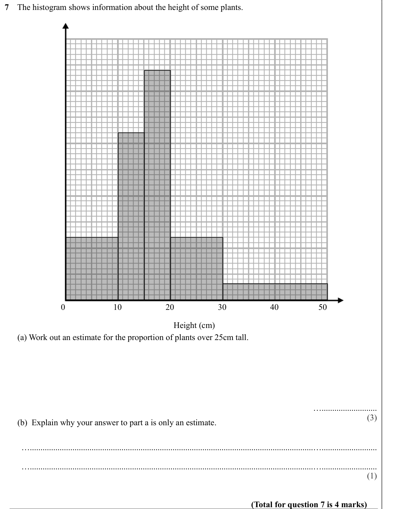

# Histograms — Exam Questions (GCSE Maths · Edexcel · Grade 7)

Topic code `7.16` · slug `grade-7-7-16-histograms` · source sheet sha256 `969e6fc396f5c784…`

## Q1 (marks not printed)

Text (lossy): 1    The table shows information about the age of 80 teachers.  / Age (years) / Frequency

## Q2 (marks not printed)

Text (lossy): 2    The table shows information about the speed, in mph, of some cars. / Speed (mph) / Frequency

## Q3 (marks not printed)

Text (lossy): 3    The table shows information about the weight of 60 pigs.  / Weight (kg) / Frequency

## Q4 (marks not printed)

Text (lossy): 4    The table shows information about the time, in seconds, taken for some people to run a 100m race. / Time (s) / Frequency

## Q5 (marks not printed)

Text (lossy): 5    The table shows information about the time, in seconds, taken for some people to complete a puzzle. / Time (s) / Frequency

## Q6 (marks not printed)

Text (lossy): 6    The histogram shows information about the weight of pigs.  / Frequency / Density / 50 / 60 / 70 / 80 / 90 / 100 / Weight (kg)

## Q7 (marks not printed · parts a, b)

Text (lossy): 7    The histogram shows information about the height of some plants.  / 0 / 10 / 20 / 30 / 40 / 50 / Height (cm) /       (a) Work out an estimate for the proportion of plants over 25cm tall.  / ….......................... / (3) /       (b)  Explain why your answer to part a is only an estimate.  / …...................................................................................................

