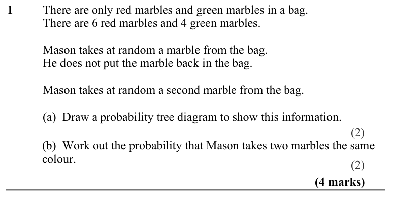
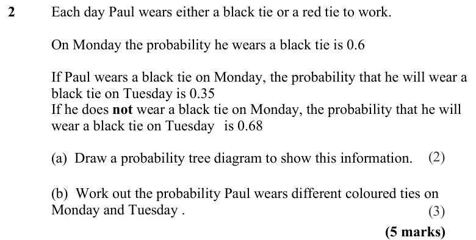
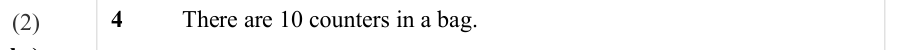
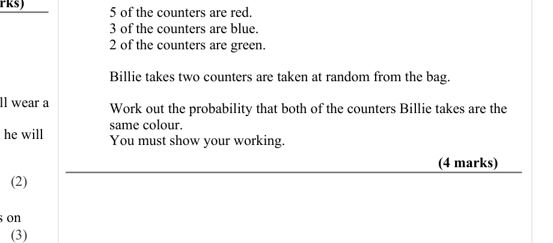
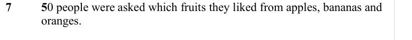

# Conditional Probability — Exam Questions (GCSE Maths · Edexcel · Grade 7)

Topic code `7.17` · slug `grade-7-7-17-conditional-probability` · source sheet sha256 `79ac84709ebb0735…`

## Q1 (4 marks · parts a, b)

Text (lossy): 1     / There are only red marbles and green marbles in a bag. / There are 6 red marbles and 4 green marbles. / Mason takes at random a marble from the bag. / He does not put the marble back in the bag. / Mason takes at random a second marble from the bag. /        / (a)  Draw a probability tree diagram to show this information.  /    /       / (b)  Work out the probability that Mason takes two ma

## Q2 (5 marks · parts a, b)

Text (lossy): 2     / Each day Paul wears either a black tie or a red tie to work. / On Monday the probability he wears a black tie is 0.6 / If Paul wears a black tie on Monday, the probability that he will wear a  / black tie on Tuesday is 0.35  / If he does not wear a black tie on Monday, the probability that he will  / wear a black tie on Tuesday is 0.68 /        / (a)  Draw a probability tree diagram to sho

## Q3 (marks not printed)

Text (lossy): 3     / There are 8 counters in a bag.

## Q4 (marks not printed)

Text (lossy): 4     / There are 10 counters in a bag.  / (2)

## Q5 (4 marks)

Text (lossy): 5 of the counters are red.  / 3 of the counters are blue. / 2 of the counters are green.   / Billie takes two counters are taken at random from the bag.  / Work out the probability that both of the counters Billie takes are the  / same colour.   / You must show your working.  / (4 marks) / (2) / (3)

