# Direct and Inverse Proportion — Exam Questions (GCSE Maths · Edexcel · Grade 7)

Topic code `7.3` · slug `grade-7-7-3-direct-and-inverse-proportion` · source sheet sha256 `4974e84791a7bbe6…`

## Q1 (2 marks)

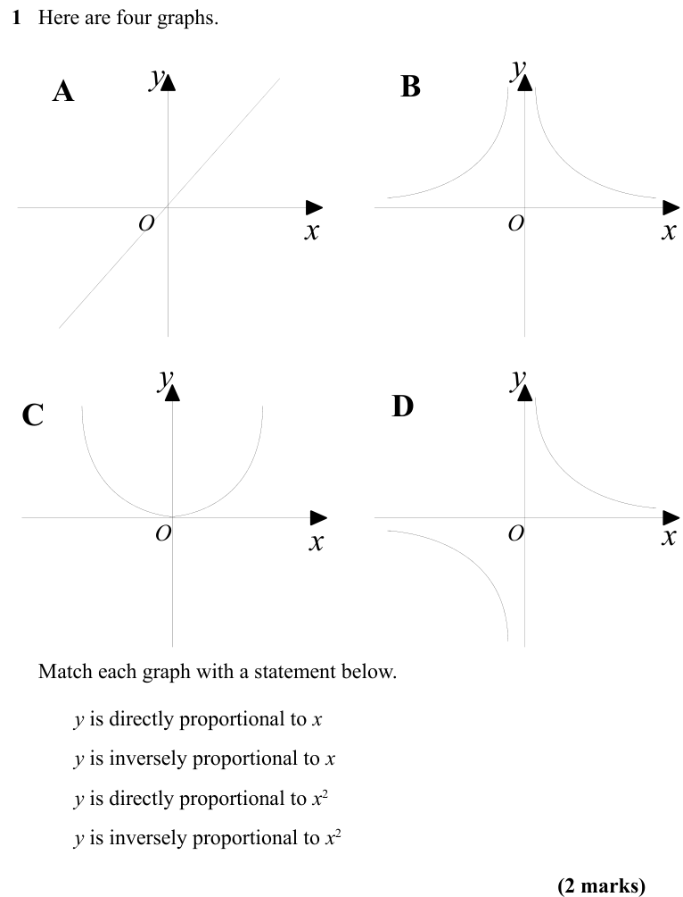

Text (lossy): 1   Here are four graphs.       / y / y / A / B / x / O / x / O / y / y / C / D / x / O / x / O /      Match each graph with a statement below.  / y is directly proportional to x / y is inversely proportional to x / y is directly proportional to x 2 / y is inversely proportional to x 2 / (2 marks)

## Q2 (3 marks)

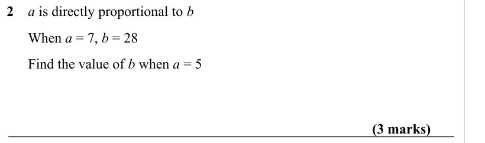

Text (lossy): 2    a is directly proportional to b /       When a = 7, b = 28  /       Find the value of b when a = 5  / (3 marks)

## Q3 (3 marks)

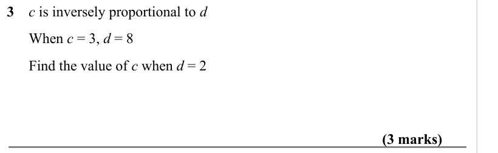

Text (lossy): 3    c is inversely proportional to d /       When c = 3, d = 8  /       Find the value of c when d = 2        / (3 marks)

## Q4 (3 marks)

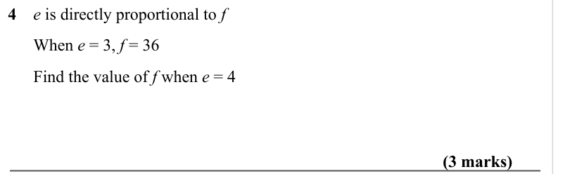

Text (lossy): 4    e is directly proportional to f /       When e = 3, f = 36  /       Find the value of f when e = 4      / (3 marks)

## Q5 (3 marks)

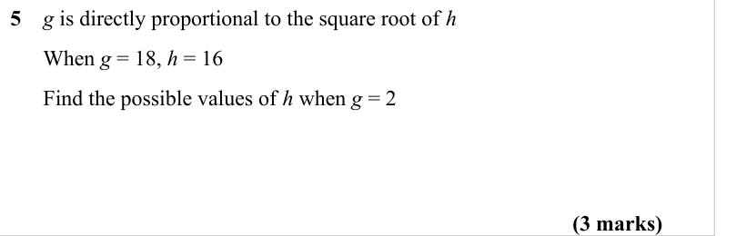

Text (lossy): 5    g is directly proportional to the square root of h /       When g = 18, h = 16  /       Find the possible values of h when g = 2  / (3 marks)

## Q6 (3 marks)

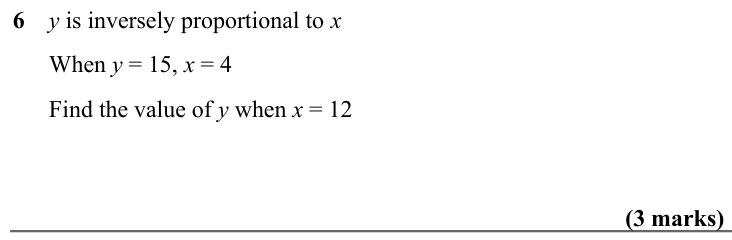

Text (lossy): 6    y is inversely proportional to x /       When y = 15, x = 4  /       Find the value of y when x = 12 / (3 marks)

## Q7 (3 marks)

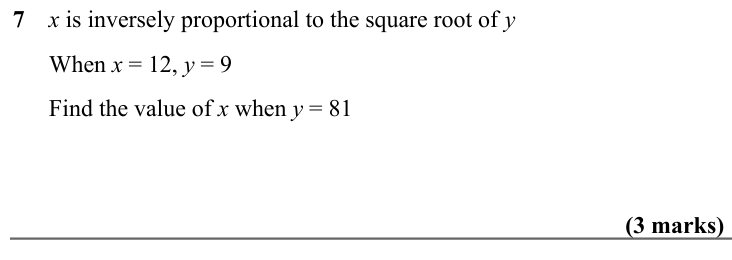

Text (lossy): 7    x is inversely proportional to the square root of y /       When x = 12, y = 9  /       Find the value of x when y = 81      / (3 marks)

## Q8 (3 marks)

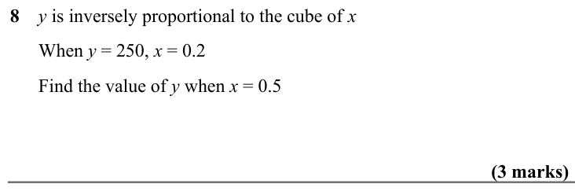

Text (lossy): 8    y is inversely proportional to the cube of x /       When y = 250, x = 0.2  /       Find the value of y when x = 0.5      / (3 marks)

## Q9 (3 marks)

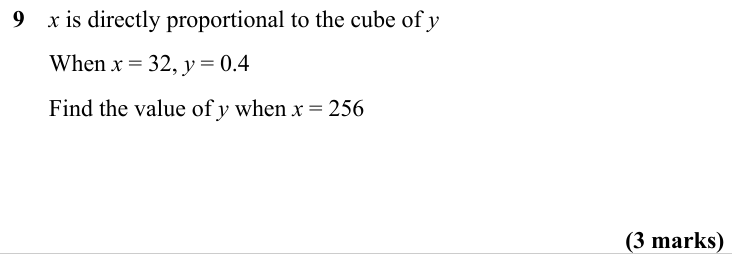

Text (lossy): 9    x is directly proportional to the cube of y /       When x = 32, y = 0.4 /       Find the value of y when x = 256      / (3 marks)

## Q10 (4 marks)

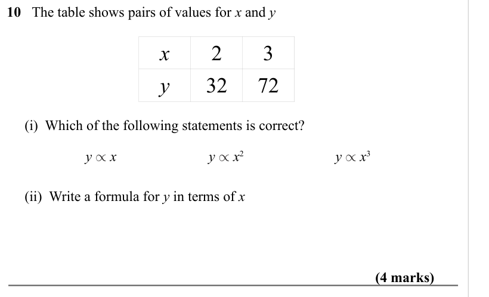

Text (lossy): 10   The table shows pairs of values for x and y     / x / 2 / 3 / y / 32 / 72 /      (i)  Which of the following statements is correct? /  y µ x / y µ x 2 / y µ x 3 /      (ii)  Write a formula for y in terms of x  / (4 marks)

## Q11 (4 marks)

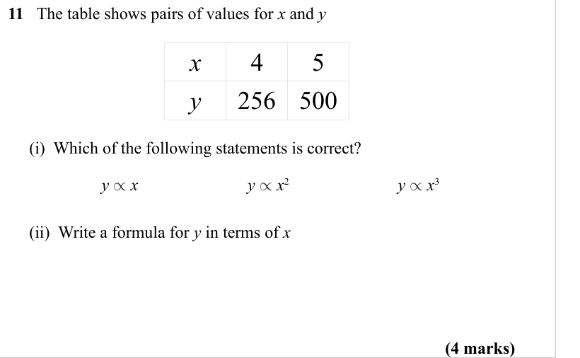

Text (lossy): 11   The table shows pairs of values for x and y     / x / 4 / 5 / y / 256 / 500 /      (i)  Which of the following statements is correct? /  y µ x / y µ x 2 / y µ x 3 /      (ii)  Write a formula for y in terms of x  / (4 marks)

