# Quadratic Formula — Exam Questions (GCSE Maths · Edexcel · Grade 7)

Topic code `7.4` · slug `grade-7-7-4-quadratic-formula` · source sheet sha256 `fdb12172770d49cd…`

## Q1 (marks not printed)

Text (lossy): 1     Solve    x ² + 5 x + 3 = 0 /       /        Give your solutions correct to 2 decimal places.  /     / (Total for question 1 is 3 marks)

## Q2 (marks not printed)

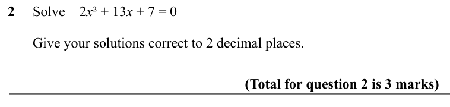

Text (lossy): 2     Solve    2 x ² + 13 x + 7 = 0 /       /        Give your solutions correct to 2 decimal places.  /     / (Total for question 2 is 3 marks)

## Q3 (marks not printed)

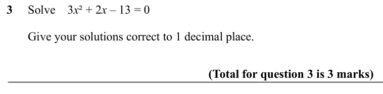

Text (lossy): 3     Solve    3 x ² + 2 x – 13 = 0 /       /        Give your solutions correct to 1 decimal place.  /     / (Total for question 3 is 3 marks)

## Q4 (marks not printed)

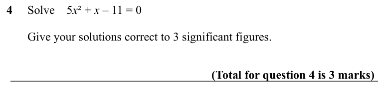

Text (lossy): 4     Solve    5 x ² + x – 11 = 0 /       /        Give your solutions correct to 3 significant figures.  /     / (Total for question 4 is 3 marks)

## Q5 (marks not printed)

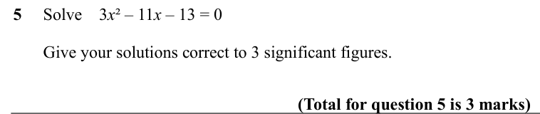

Text (lossy): 5     Solve    3 x ² – 11 x – 13 = 0 /       /        Give your solutions correct to 3 significant figures.  /     / (Total for question 5 is 3 marks)

## Q6 (marks not printed)

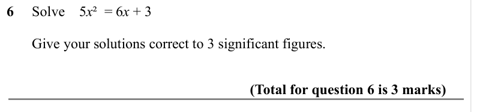

Text (lossy): 6     Solve    5 x ²  = 6 x + 3 /       /        Give your solutions correct to 3 significant figures.  /     / (Total for question 6 is 3 marks)

## Q7 (marks not printed)

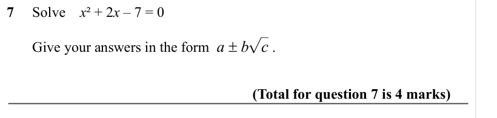

Text (lossy): 7     Solve    x ² + 2 x – 7 = 0 /       /        Give your answers in the form  a ± bc .  /     / (Total for question 7 is 4 marks)

## Q8 (marks not printed)

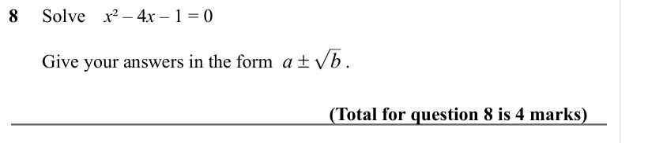

Text (lossy): 8     Solve    x ² – 4 x – 1 = 0 /       /        Give your answers in the form  a ± b .  /     / (Total for question 8 is 4 marks)

## Q9 (marks not printed)

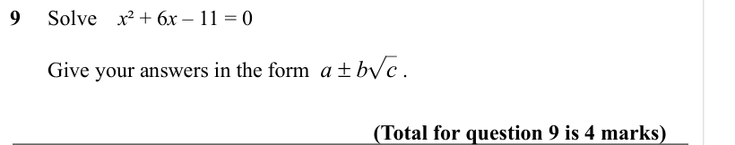

Text (lossy): 9     Solve    x ² + 6 x – 11 = 0 /       /        Give your answers in the form  a ± bc .  /     / (Total for question 9 is 4 marks)

## Q10 (marks not printed)

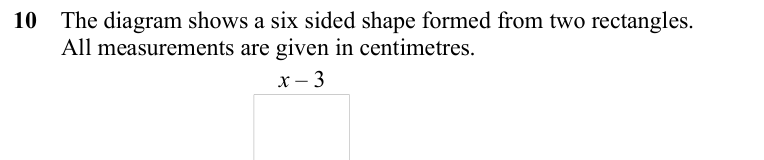

Text (lossy): 10    The diagram shows a six sided shape formed from two rectangles.  /         All measurements are given in centimetres.  /   / x – 3

## Q11 (marks not printed)

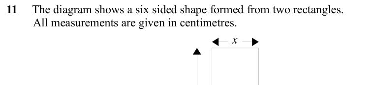

Text (lossy): 11     The diagram shows a six sided shape formed from two rectangles.  /          All measurements are given in centimetres.  / x

## Q12 (marks not printed)

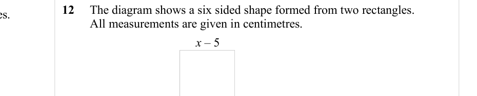

Text (lossy): 12     The diagram shows a six sided shape formed from two rectangles.  /          All measurements are given in centimetres.  / x – 5

## Q13 (marks not printed)

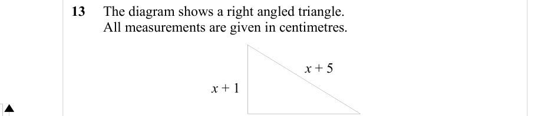

Text (lossy): 13     The diagram shows a right angled triangle.  /          All measurements are given in centimetres.  /     / x + 5 / x + 1

