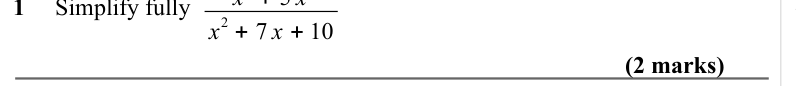
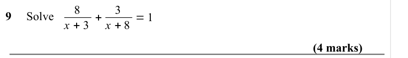
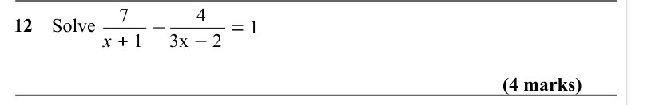
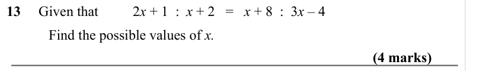
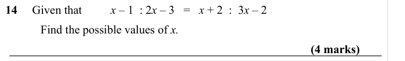
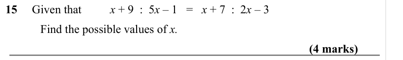
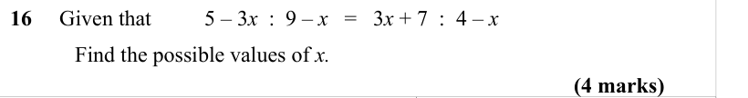

# Algebraic Fractions — Exam Questions (GCSE Maths · Edexcel · Grade 7)

Topic code `7.6` · slug `grade-7-7-6-algebraic-fractions` · source sheet sha256 `4b1830f41b6bc7b6…`

## Q1 (marks not printed)

Text (lossy): 1     Simplify fully

## Q2 (2 marks)

Text (lossy): 2 + 7 x + 10 / (2 marks)

## Q3 (marks not printed)

Text (lossy): 3 x

## Q4 (marks not printed)

## Q5 (marks not printed)

Text (lossy): 5     Write                               in the form                 where a, b, and c are integers.

## Q6 (marks not printed)

Text (lossy): 6     Write                             in the form                 where a, b, and c are integers.

## Q7 (marks not printed)

Text (lossy): 7     Simplify fully

## Q8 (marks not printed)

Text (lossy): 8     Simplify fully

## Q9 (4 marks)

Text (lossy): 9     Solve      8 / x + 3 + / 3 / x + 8 = 1 / (4 marks)

## Q10 (marks not printed)

## Q11 (marks not printed)

## Q12 (4 marks)

Text (lossy): 12    Solve      7 / x + 1 − / 4 / 3x −2 = 1 / (4 marks)

## Q13 (4 marks)

Text (lossy): 13     Given that  / 2 x + 1  :  x + 2   =   x + 8  :  3 x – 4  / Find the possible values of x.    / (4 marks)

## Q14 (4 marks)

Text (lossy): 14     Given that  / x – 1  : 2 x – 3   =   x + 2  :  3 x – 2   / Find the possible values of x.    / (4 marks)

## Q15 (4 marks)

Text (lossy): 15     Given that  / x + 9  :  5 x – 1   =   x + 7  :  2 x – 3   / Find the possible values of x.    / (4 marks)

## Q16 (4 marks)

Text (lossy): 16     Given that  / 5 – 3 x  :  9 – x   =   3 x + 7  :  4 – x   / Find the possible values of x.    / (4 marks)

