# Rearranging Harder Formulae — Exam Questions (GCSE Maths · Edexcel · Grade 7)

Topic code `7.7` · slug `grade-7-7-7-rearranging-harder-formulae` · source sheet sha256 `6ca22b5a59646648…`

## Q1 (marks not printed)

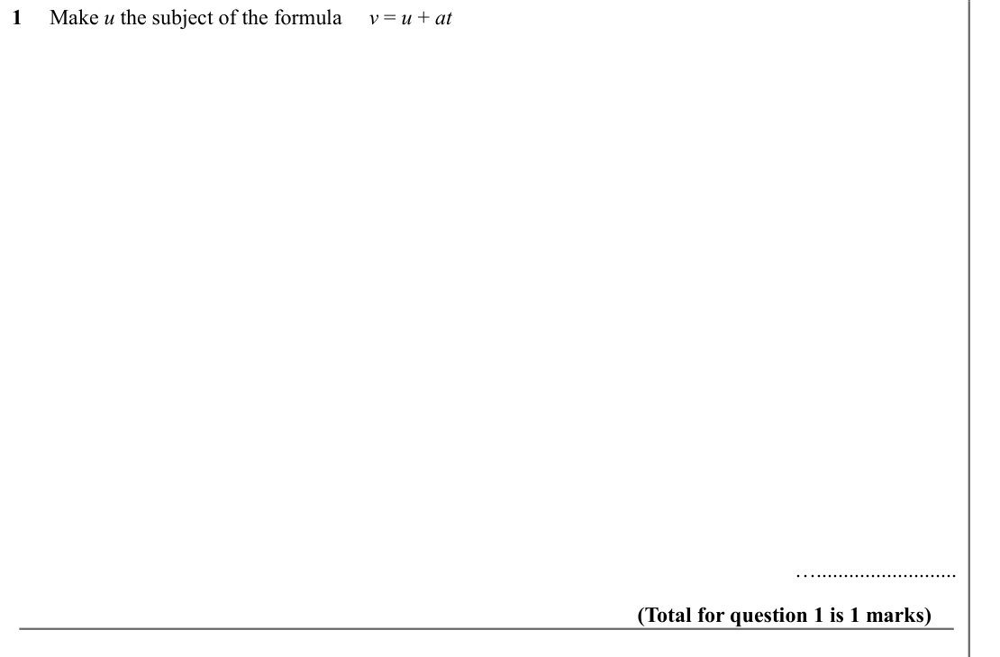

Text (lossy): 1     Make u the subject of the formula     v = u + at / ….......................... / (Total for question 1 is 1 marks)

## Q2 (marks not printed)

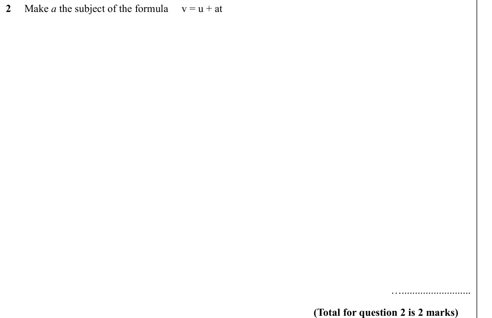

Text (lossy): 2     Make a the subject of the formula     v = u + at / ….......................... / (Total for question 2 is 2 marks)

## Q3 (marks not printed)

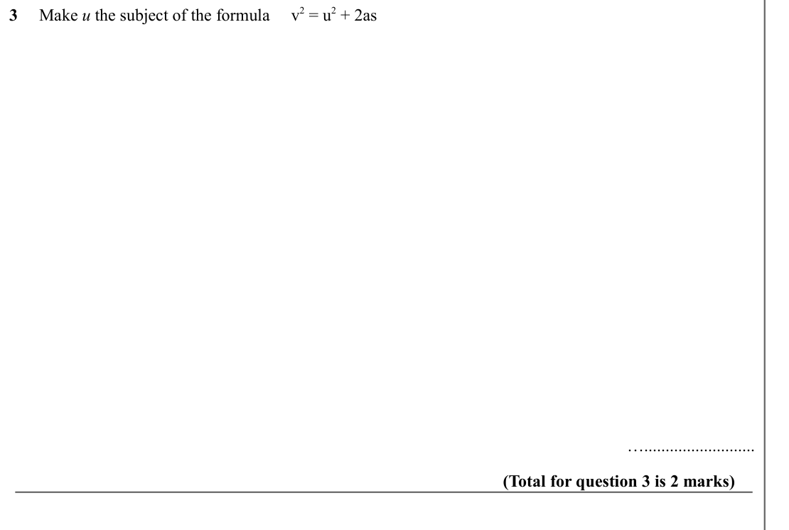

Text (lossy): 3     Make u the subject of the formula     v 2 = u 2 + 2as / ….......................... / (Total for question 3 is 2 marks)

## Q4 (marks not printed)

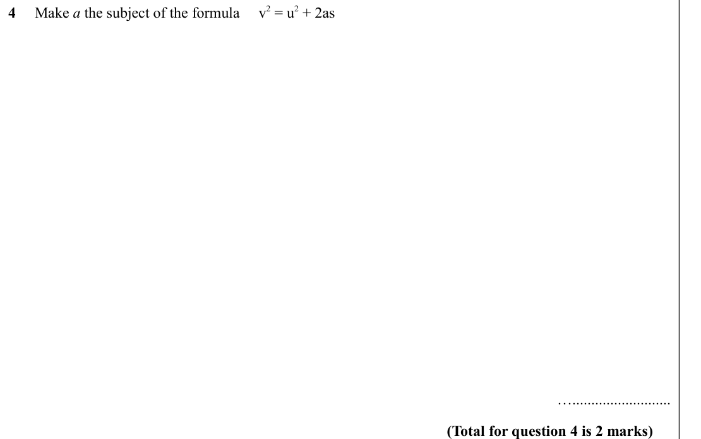

Text (lossy): 4     Make a the subject of the formula     v 2 = u 2 + 2as / ….......................... / (Total for question 4 is 2 marks)

## Q5 (marks not printed)

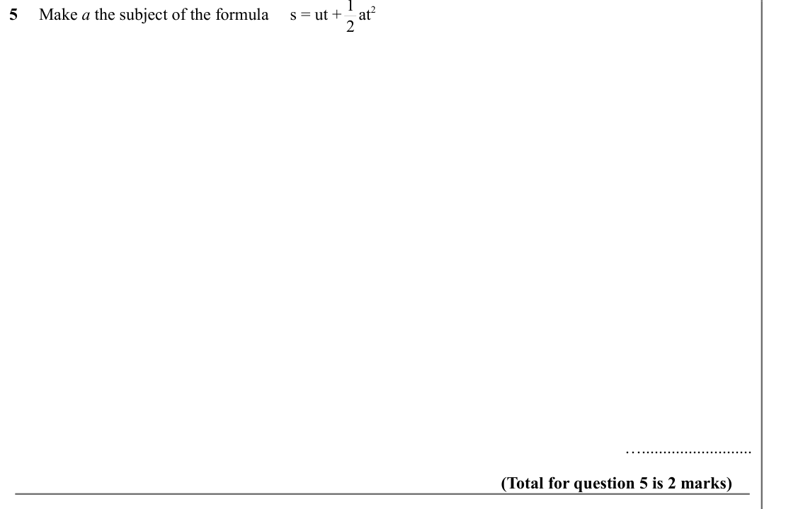

Text (lossy): 5     Make a the subject of the formula     s = ut +    at 2 / ….......................... / (Total for question 5 is 2 marks)

## Q6 (marks not printed)

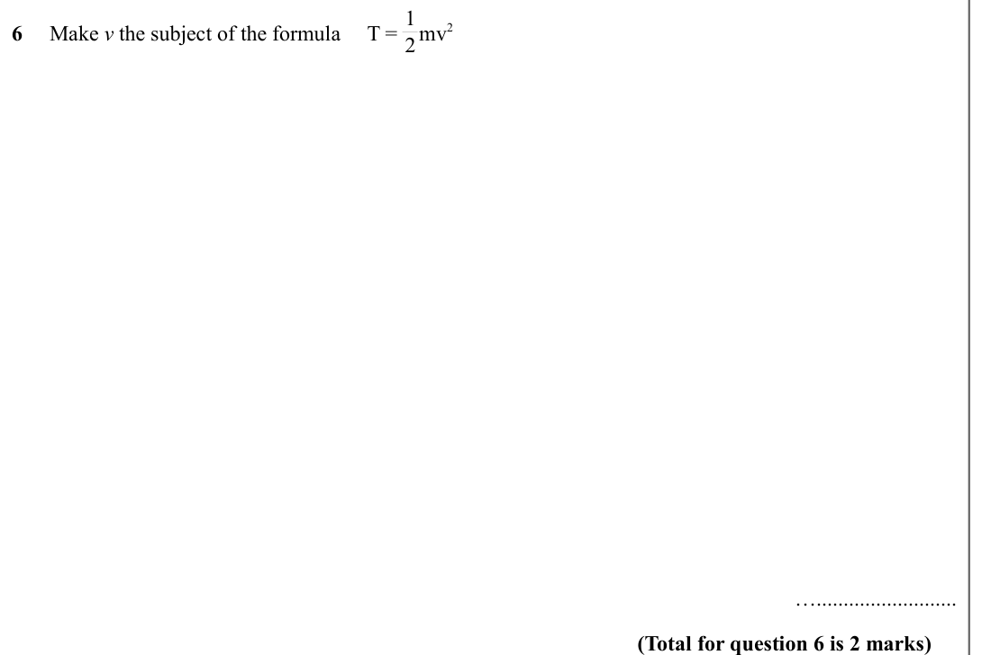

Text (lossy): 6     Make v the subject of the formula     T =    mv 2 / 1 / 2 / ….......................... / (Total for question 6 is 2 marks)

## Q7 (marks not printed)

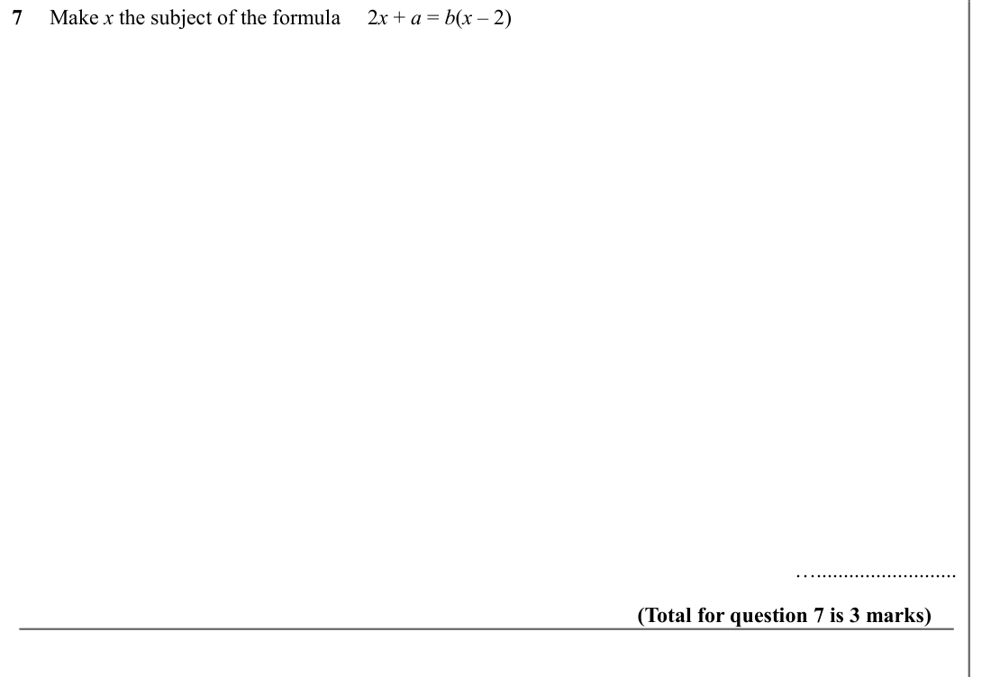

Text (lossy): 7     Make x the subject of the formula     2 x + a = b(x – 2) / ….......................... / (Total for question 7 is 3 marks)

## Q8 (marks not printed)

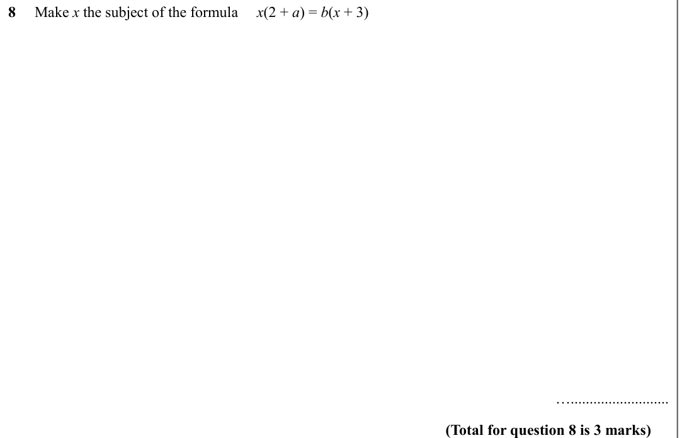

Text (lossy): 8     Make x the subject of the formula     x(2 + a) = b(x + 3) / ….......................... / (Total for question 8 is 3 marks)

## Q9 (marks not printed)

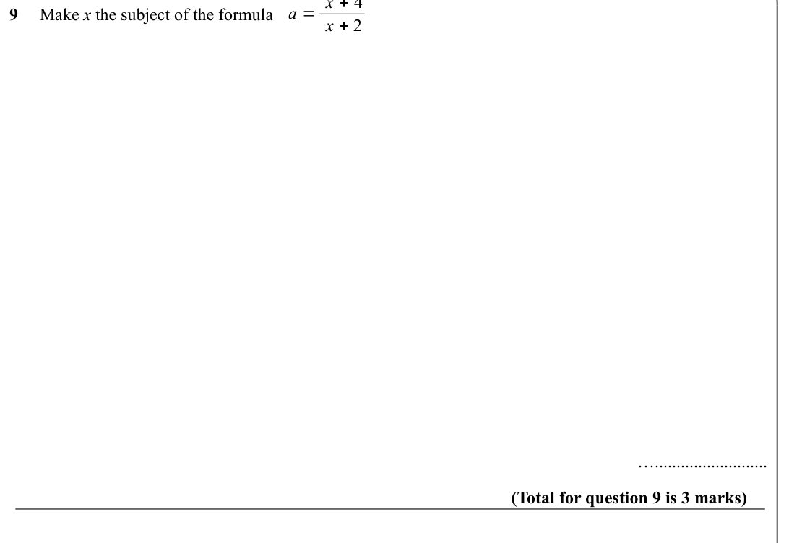

Text (lossy): 9     Make x the subject of the formula  / x + 2 / ….......................... / (Total for question 9 is 3 marks) / a = x + c

## Q10 (marks not printed)

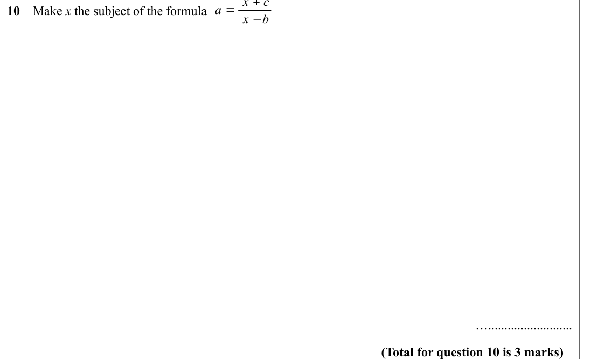

Text (lossy): 10    Make x the subject of the formula  / x −b / ….......................... / (Total for question 10 is 3 marks)

## Q11 (marks not printed)

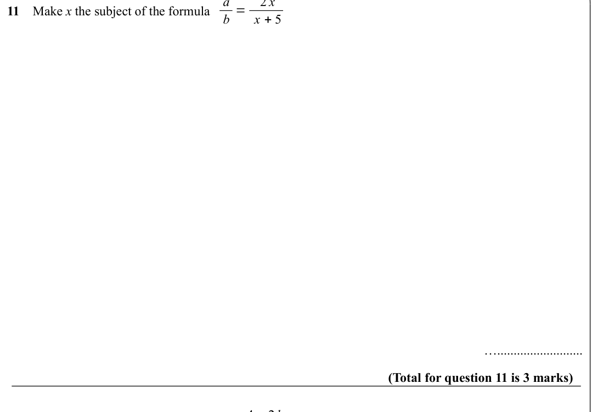

Text (lossy): 11    Make x the subject of the formula  / ….......................... / (Total for question 11 is 3 marks) / a = 4 + 2 bx

## Q12 (marks not printed)

Text (lossy): 12    Make x the subject of the formula

## Q13 (marks not printed)

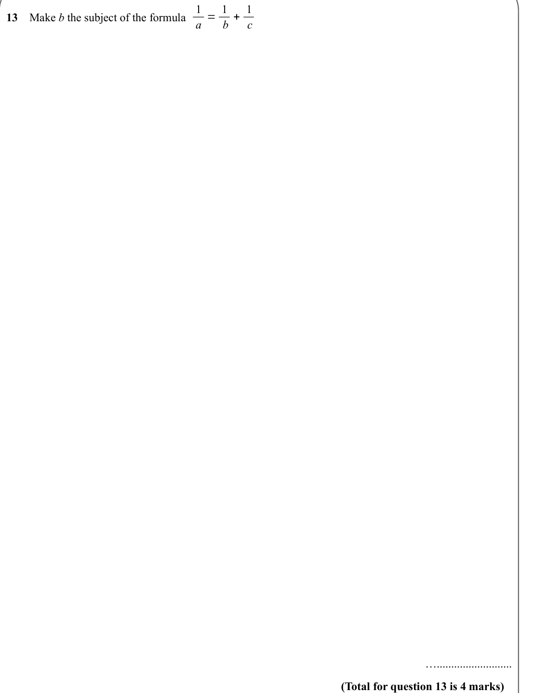

Text (lossy): 13    Make b the subject of the formula 1 / a = 1 / b + 1 / c / ….......................... / (Total for question 13 is 4 marks)

