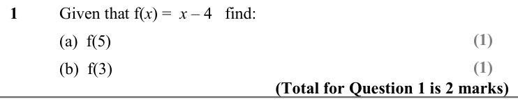
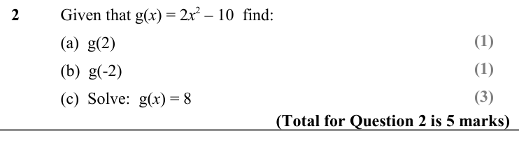
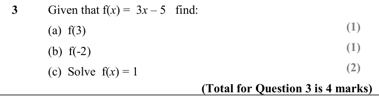
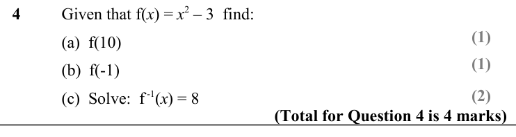
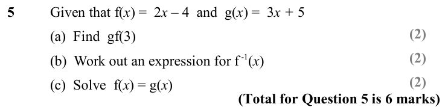
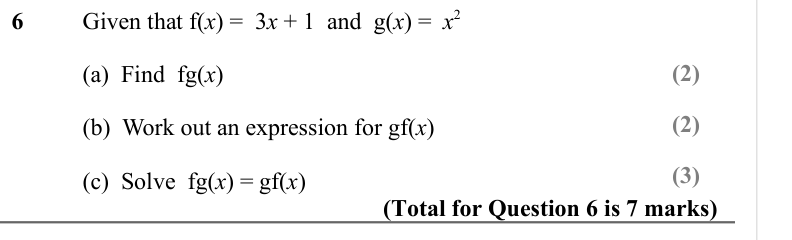
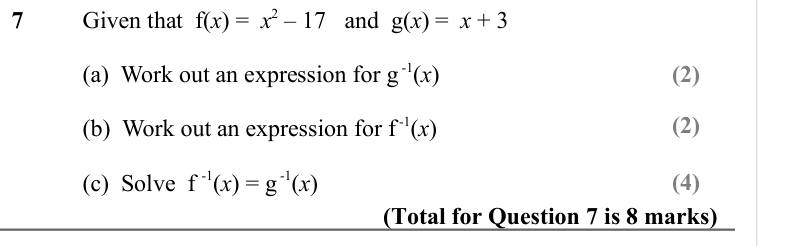
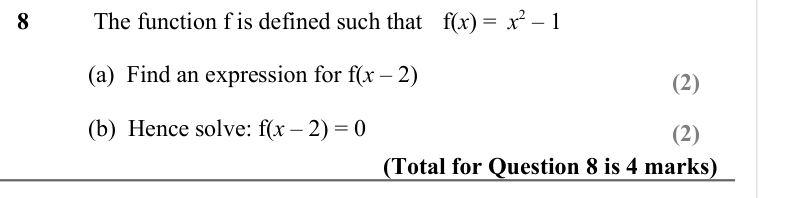
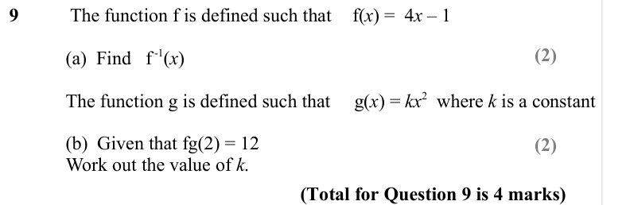

# Inverse and Composite Functions — Exam Questions (GCSE Maths · Edexcel · Grade 7)

Topic code `7.9` · slug `grade-7-7-9-inverse-and-composite-functions` · source sheet sha256 `39252e199ded3ee7…`

## Q1 (marks not printed · parts a, b)

Text (lossy): 1 / Given that f(x) =  x – 4   find: / (1) / (a)  f(5) / (1) / (b)  f(3) / (Total for Question 1 is 2 marks)

## Q2 (marks not printed · parts a, b, c)

Text (lossy): 2 / Given that g(x) = 2 x 2 – 10  find: / (1) / (a)  g(2) / (1) / (b)  g(-2) / (3) / (Total for Question 2 is 5 marks) / (c)  Solve:  g(x) = 8

## Q3 (marks not printed · parts a, b, c)

Text (lossy): 3 / Given that f(x) =  3 x – 5   find: / (1) / (a)  f(3) / (1) / (b)  f(-2) / (2) / (c)  Solve  f(x) = 1 / (Total for Question 3 is 4 marks)

## Q4 (marks not printed · parts a, b, c)

Text (lossy): 4 / Given that f(x) = x 2 – 3  find: / (1) / (a)  f(10) / (1) / (b)  f(-1) / (2) / (c)  Solve:  f -1(x) = 8 / (Total for Question 4 is 4 marks)

## Q5 (marks not printed · parts a, b, c)

Text (lossy): 5 / Given that f(x) =  2 x – 4  and  g(x) =  3 x + 5   / (2) / (a)  Find  gf(3) / (2) / (b)  Work out an expression for f -1(x) / (2) / (c)  Solve  f(x) = g(x) / (Total for Question 5 is 6 marks)

## Q6 (marks not printed · parts a, b, c)

Text (lossy): 6 / Given that f(x) =  3 x + 1  and  g(x) =  x 2  / (2) / (a)  Find  fg(x) / (2) / (b)  Work out an expression for gf(x) / (3) / (c)  Solve  fg(x) = gf(x) / (Total for Question 6 is 7 marks)

## Q7 (marks not printed · parts a, b, c)

Text (lossy): 7 / Given that  f(x) =  x 2 – 17   and  g(x) =  x + 3  / (a)  Work out an expression for g -1(x) / (2) / (2) / (b)  Work out an expression for f -1(x) / (c)  Solve  f -1(x) = g -1(x) / (4) / (Total for Question 7 is 8 marks)

## Q8 (marks not printed · parts a, b)

Text (lossy): 8 /  The function f is defined such that / f(x) =  x 2 – 1    / (a)  Find an expression for f(x – 2) / (2) / (b)  Hence solve: f(x – 2) = 0 / (2) / (Total for Question 8 is 4 marks)

## Q9 (marks not printed · parts a, b)

Text (lossy): 9 /  The function f is defined such that /  f(x) =  4 x – 1    / (2) / (a)  Find   f -1(x) / The function g is defined such that     g(x) = kx 2  where k is a constant / (b)  Given that fg(2) = 12 / Work out the value of k.  / (2) / (Total for Question 9 is 4 marks)

