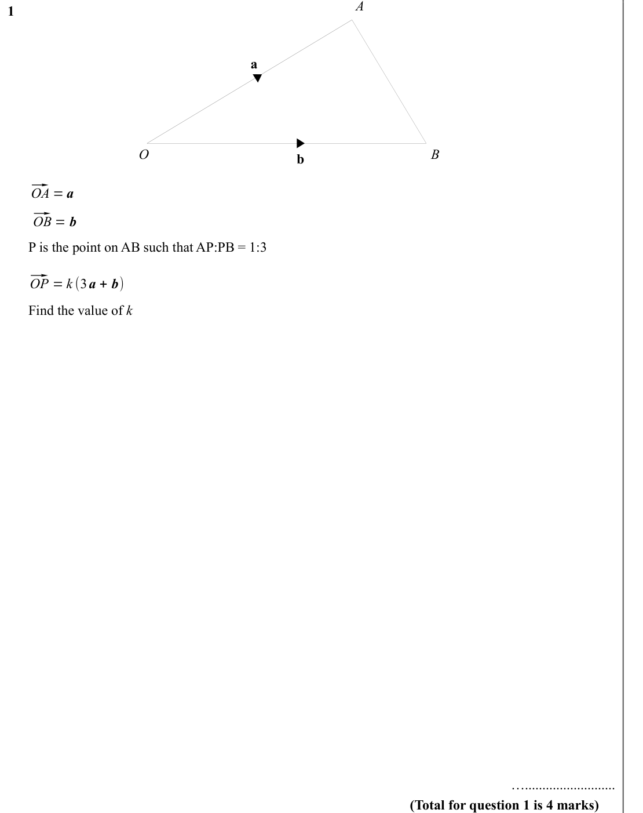
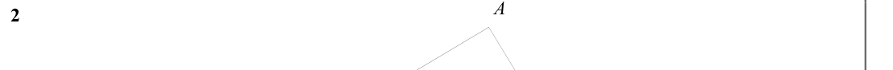
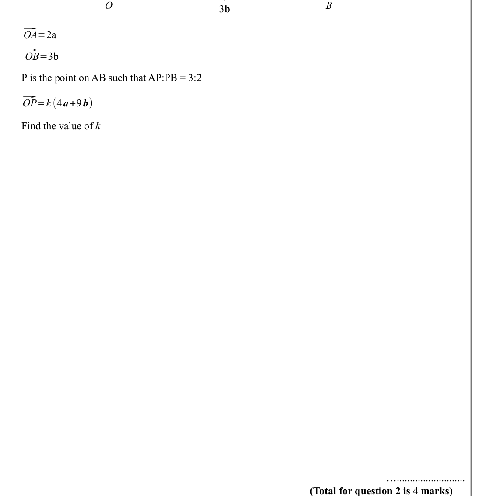
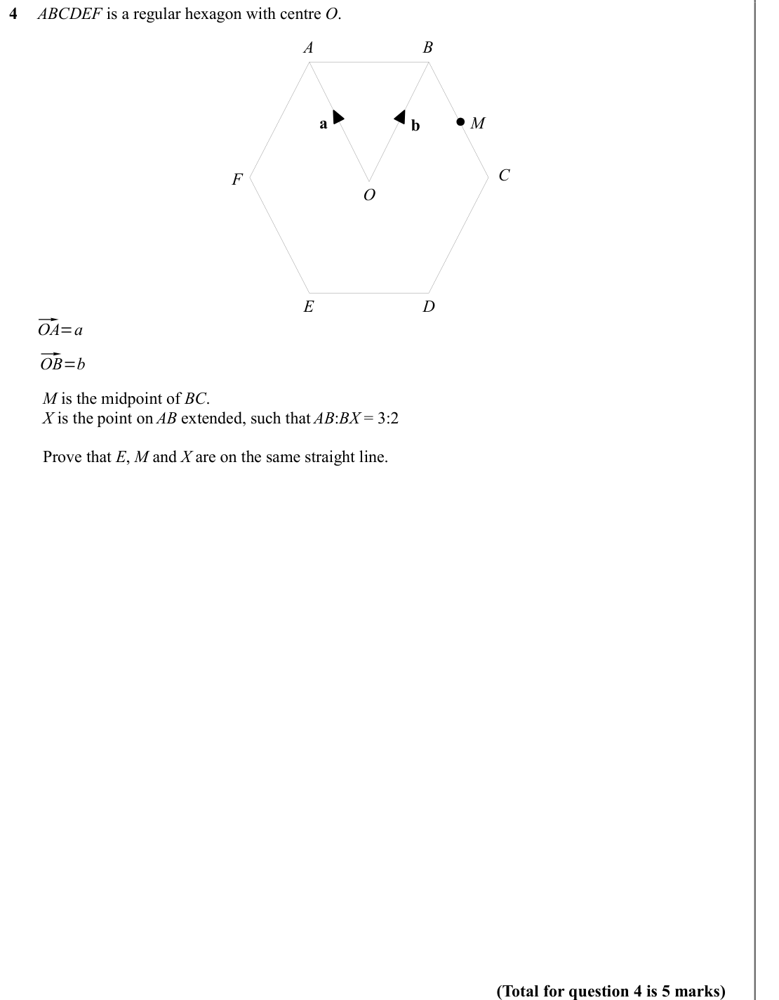
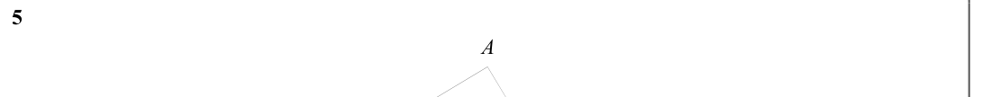
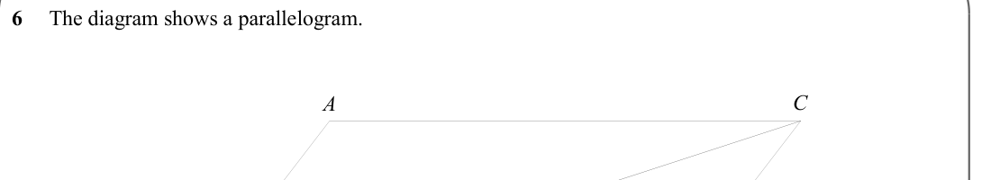

# Vectors Proof Questions — Exam Questions (GCSE Maths · Edexcel · Grade 8-9)

Topic code `8.10` · slug `grade-8-9-8-10-vectors-proof-questions` · source sheet sha256 `a8dc5f81b3fd67f1…`

## Q1 (marks not printed)

Text (lossy): 1     / a / O / B / b / ⃗ / OA = a / ⃗ / OB = b /    /       P is the point on AB such that AP:PB = 1:3  / ⃗ / OP = k (3 a + b) /       Find the value of k     / ….......................... / (Total for question 1 is 4 marks)

## Q2 (marks not printed)

Text (lossy): 2

## Q3 (marks not printed)

Text (lossy): 3 b / ⃗ / OA=2a / ⃗ / OB=3b /    /       P is the point on AB such that AP:PB = 3:2  / ⃗ / OP=k (4 a+9 b) /       Find the value of k     / ….......................... / (Total for question 2 is 4 marks)

## Q4 (marks not printed)

Text (lossy): 4     ABCDEF is a regular hexagon with centre O.  / A / B / a / b / M / C / F / O / D / E / ⃗ / OA=a / ⃗ / OB=b /    /         M is the midpoint of BC.  /         X is the point on AB extended, such that AB:BX = 3:2 /         Prove that E, M and X are on the same straight line.  / (Total for question 4 is 5 marks)

## Q5 (marks not printed)

Text (lossy): 5     / A

## Q6 (marks not printed)

Text (lossy): 6     The diagram shows a parallelogram.  / C / A

## Q7 (marks not printed)

Text (lossy): 7     / A

