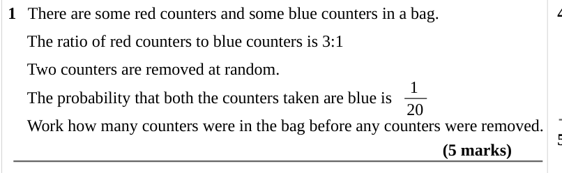
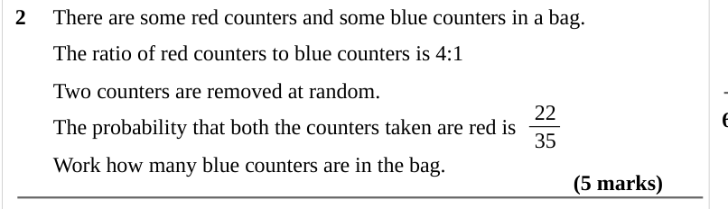
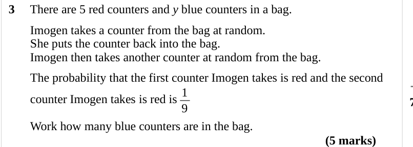
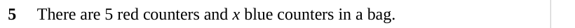
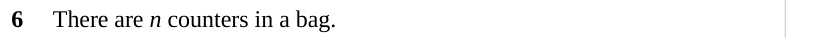
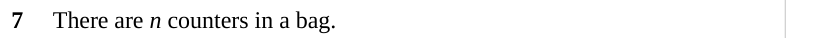
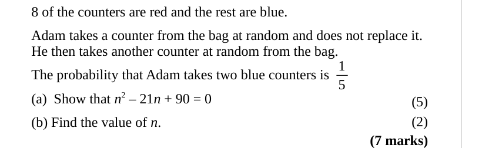

# Probability Equation Questions — Exam Questions (GCSE Maths · Edexcel · Grade 8-9)

Topic code `8.11` · slug `grade-8-9-8-11-probability-equation-questions` · source sheet sha256 `5f0956562f7e327d…`

## Q1 (5 marks)

Text (lossy): 1   There are some red counters and some blue counters in a bag.  /      The ratio of red counters to blue counters is 3:1 /      Two counters are removed at random.  / 1 / 20 /      The probability that both the counters taken are blue is  /      Work how many counters were in the bag before any counters were removed.    / (5 marks)

## Q2 (5 marks)

Text (lossy): 2     There are some red counters and some blue counters in a bag.  /        The ratio of red counters to blue counters is 4:1  /        Two counters are removed at random.  / 22 / 35 /        The probability that both the counters taken are red is  /        Work how many blue counters are in the bag.   / (5 marks)

## Q3 (5 marks)

Text (lossy): 3     There are 5 red counters and y blue counters in a bag.  /        Imogen takes a counter from the bag at random.  /        She puts the counter back into the bag.  /        Imogen then takes another counter at random from the bag.   /        The probability that the first counter Imogen takes is red and the second     / 1 / 9 /        counter Imogen takes is red is  /        Work how many blu

## Q4 (marks not printed)

Text (lossy): 4     There are 4 red counters and x blue counters in a bag.

## Q5 (marks not printed)

Text (lossy): 5     There are 5 red counters and x blue counters in a bag.

## Q6 (marks not printed)

Text (lossy): 6     There are n counters in a bag.

## Q7 (marks not printed)

Text (lossy): 7     There are n counters in a bag.

## Q8 (7 marks · parts a, b)

Text (lossy): 8 of the counters are red and the rest are blue.   /        Adam takes a counter from the bag at random and does not replace it.  /        He then takes another counter at random from the bag.   / 1 / 5 /        The probability that Adam takes two blue counters is  /        (a)  Show that n 2 – 21 n + 90 = 0 / (5) / (2) /        (b) Find the value of n.    / (7 marks)

