# The Nth Term of a Quadratic Sequence — Exam Questions (GCSE Maths · Edexcel · Grade 8-9)

Topic code `8.5` · slug `grade-8-9-8-5-the-nth-term-of-a-quadratic-sequence` · source sheet sha256 `3d7c9d4b7e532c7a…`

## Q1 (marks not printed)

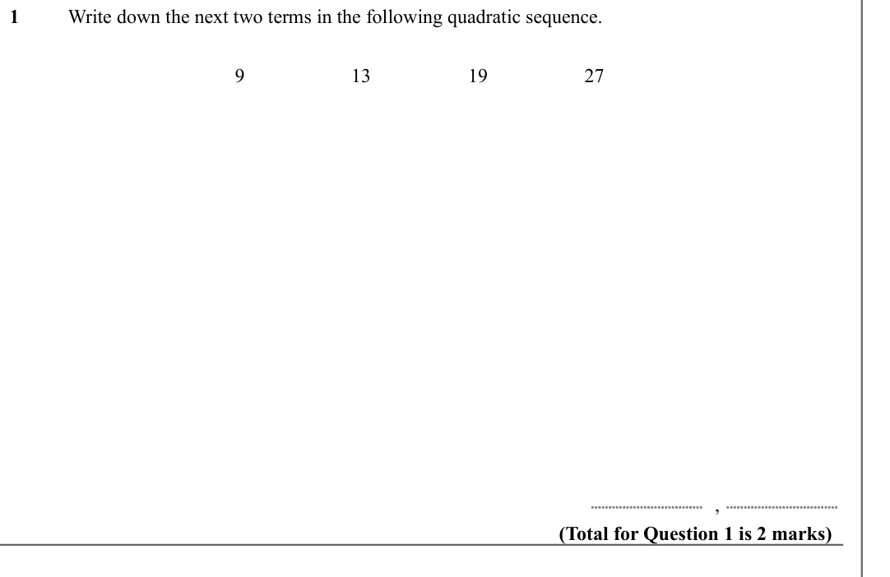

Text (lossy): 1 / Write down the next two terms in the following quadratic sequence.  / 9 / 13 / 19 / 27 /     / , / (Total for Question 1 is 2 marks)

## Q2 (marks not printed)

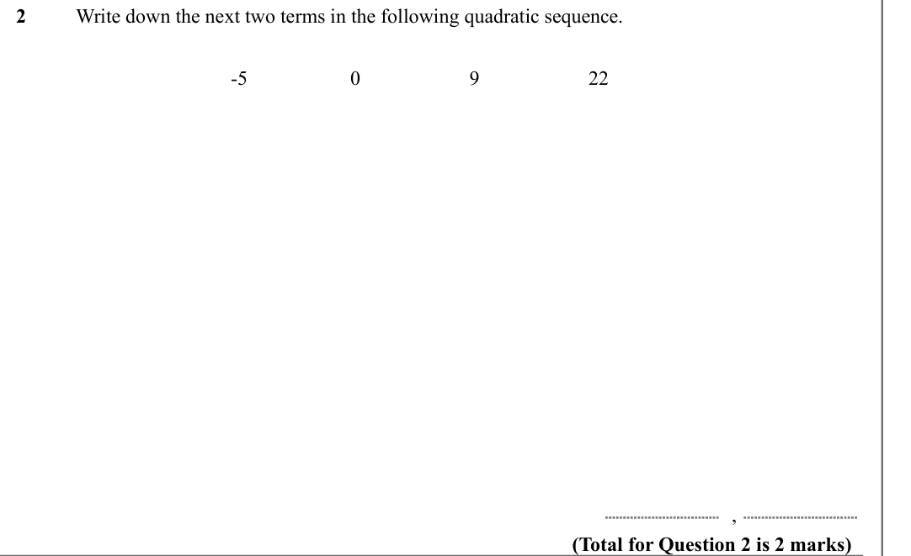

Text (lossy): 2 / Write down the next two terms in the following quadratic sequence.  / -5 / 0 / 9 / 22 / , / (Total for Question 2 is 2 marks)

## Q3 (marks not printed)

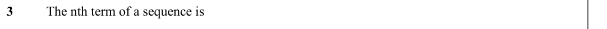

Text (lossy): 3 / The nth term of a sequence is

## Q4 (marks not printed)

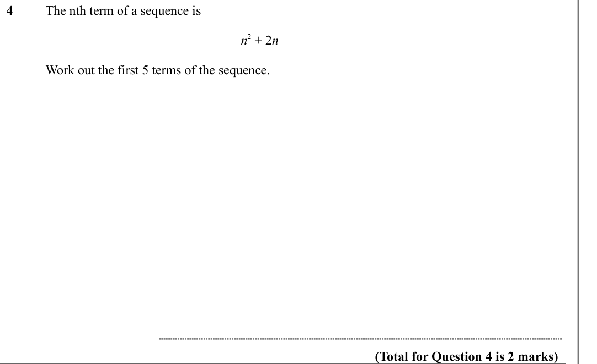

Text (lossy): 4 / The nth term of a sequence is   / n 2 + 2 n / Work out the first 5 terms of the sequence.  / (Total for Question 4 is 2 marks)

## Q5 (marks not printed)

Text (lossy): 5 / Here are the first 5 terms of a quadratic sequence.  / 5 / 11 / 19 / 29 / 41 / Find an expression, in terms of n, for the n th term of this sequence. / (Total for Question 5 is 4 marks)

## Q6 (marks not printed)

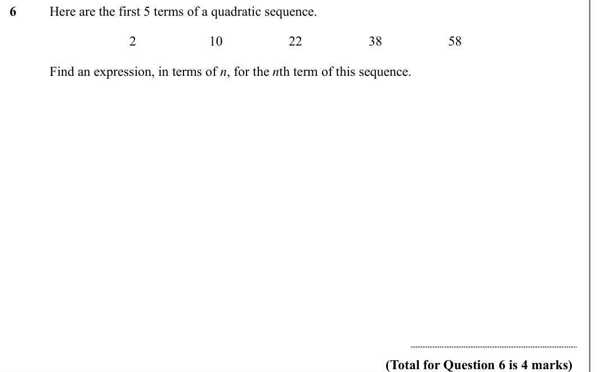

Text (lossy): 6 / Here are the first 5 terms of a quadratic sequence.  / 2 / 10 / 22 / 38 / 58 / Find an expression, in terms of n, for the n th term of this sequence. / (Total for Question 6 is 4 marks)

## Q7 (marks not printed)

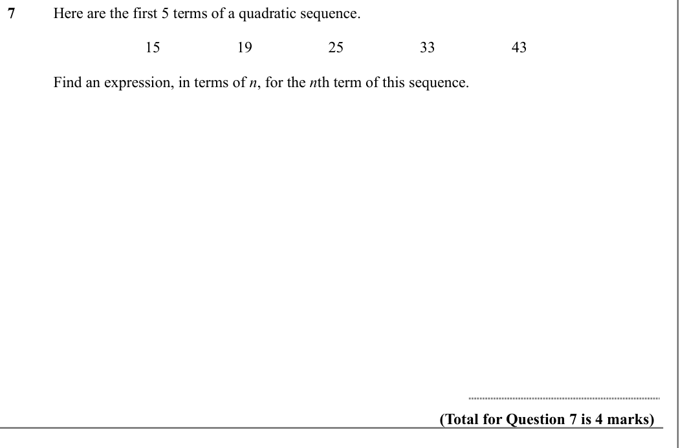

Text (lossy): 7 / Here are the first 5 terms of a quadratic sequence.  / 15 / 19 / 25 / 33 / 43 / Find an expression, in terms of n, for the n th term of this sequence. / (Total for Question 7 is 4 marks)

## Q8 (marks not printed)

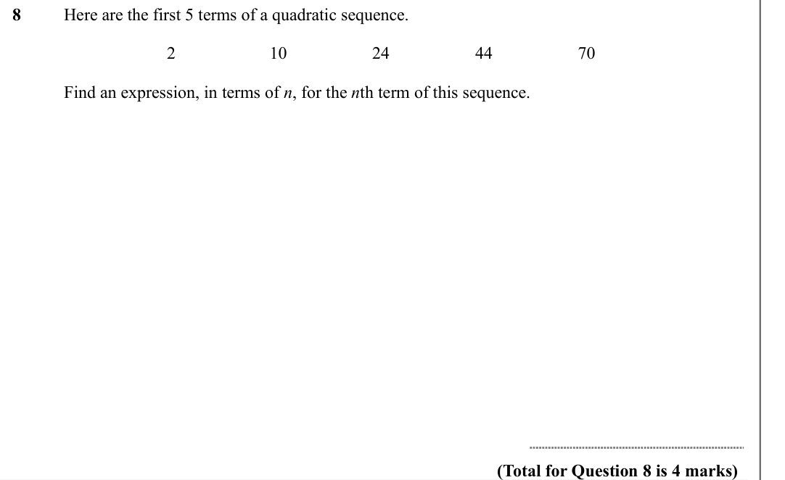

Text (lossy): 8 / Here are the first 5 terms of a quadratic sequence.  / 2 / 10 / 24 / 44 / 70 / Find an expression, in terms of n, for the n th term of this sequence. / (Total for Question 8 is 4 marks)

## Q9 (marks not printed)

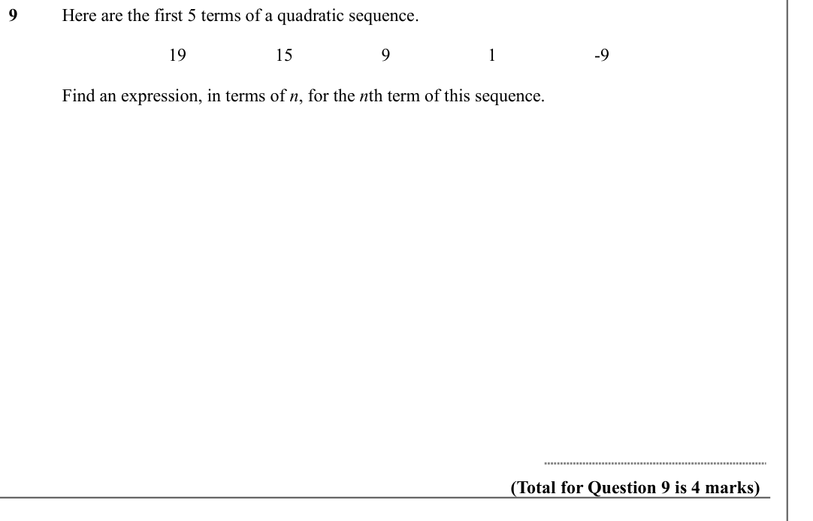

Text (lossy): 9 / Here are the first 5 terms of a quadratic sequence.  / 19 / 15 / 9 / 1 / -9 / Find an expression, in terms of n, for the n th term of this sequence. / (Total for Question 9 is 4 marks)

## Q10 (marks not printed)

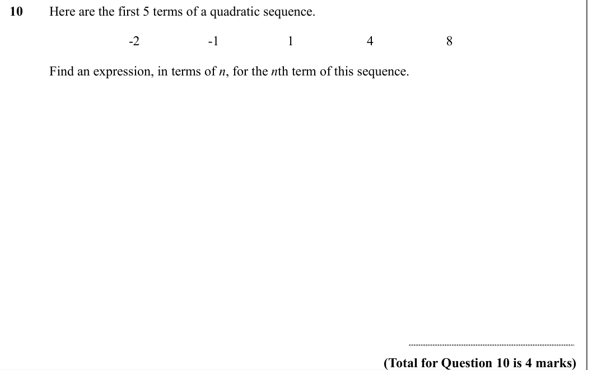

Text (lossy): 10 / Here are the first 5 terms of a quadratic sequence.  / -2 / -1 / 1 / 4 / 8 / Find an expression, in terms of n, for the n th term of this sequence. / (Total for Question 10 is 4 marks)

## Q11 (marks not printed · parts a, b)

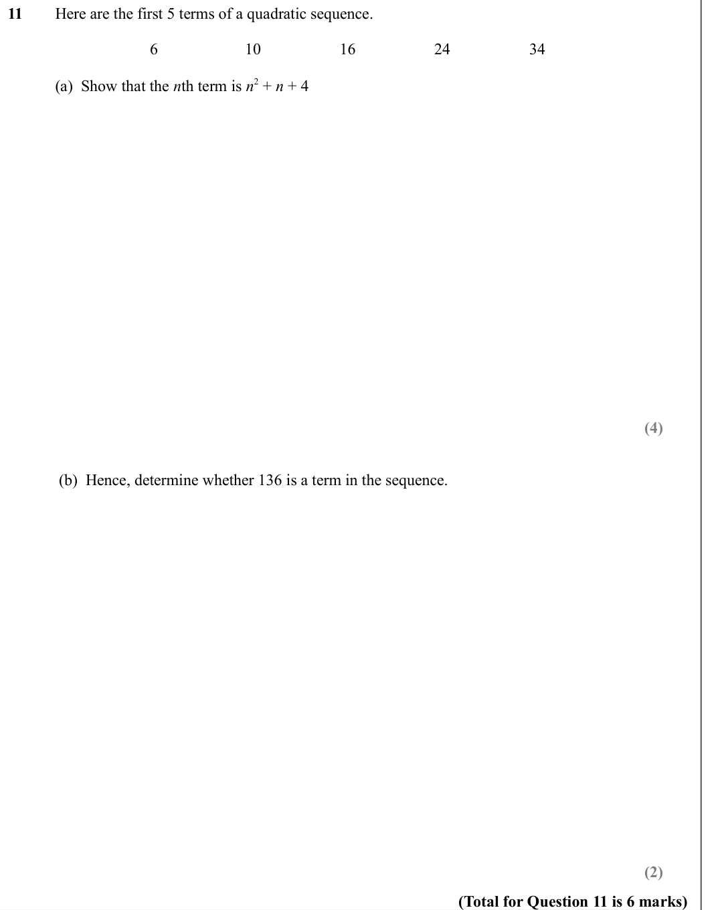

Text (lossy): 11 / Here are the first 5 terms of a quadratic sequence.  / 6 / 10 / 16 / 24 / 34 / (a)  Show that the n th term is n 2 + n + 4 / (4) / (b)  Hence, determine whether 136 is a term in the sequence.   / (2) / (Total for Question 11 is 6 marks)

## Q12 (marks not printed · parts a, b)

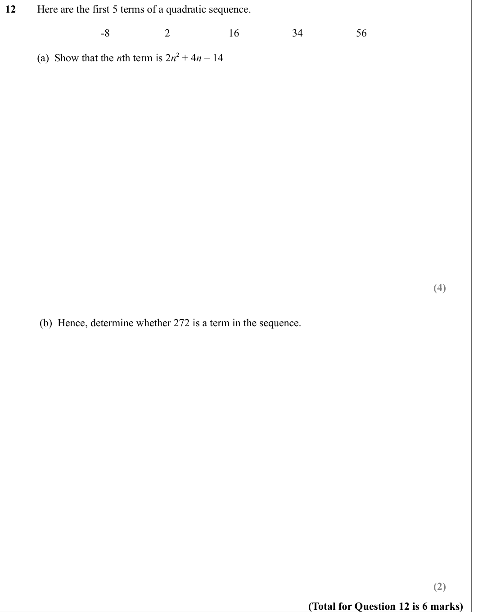

Text (lossy): 12 / Here are the first 5 terms of a quadratic sequence.  / -8 / 2 / 16 / 34 / 56 / (a)  Show that the n th term is 2 n 2 + 4 n – 14  / (4) / (b)  Hence, determine whether 272 is a term in the sequence.   / (2) / (Total for Question 12 is 6 marks)

