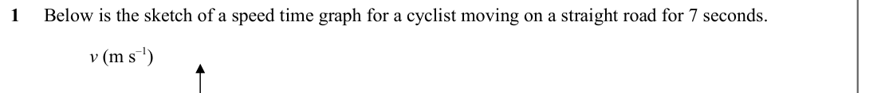
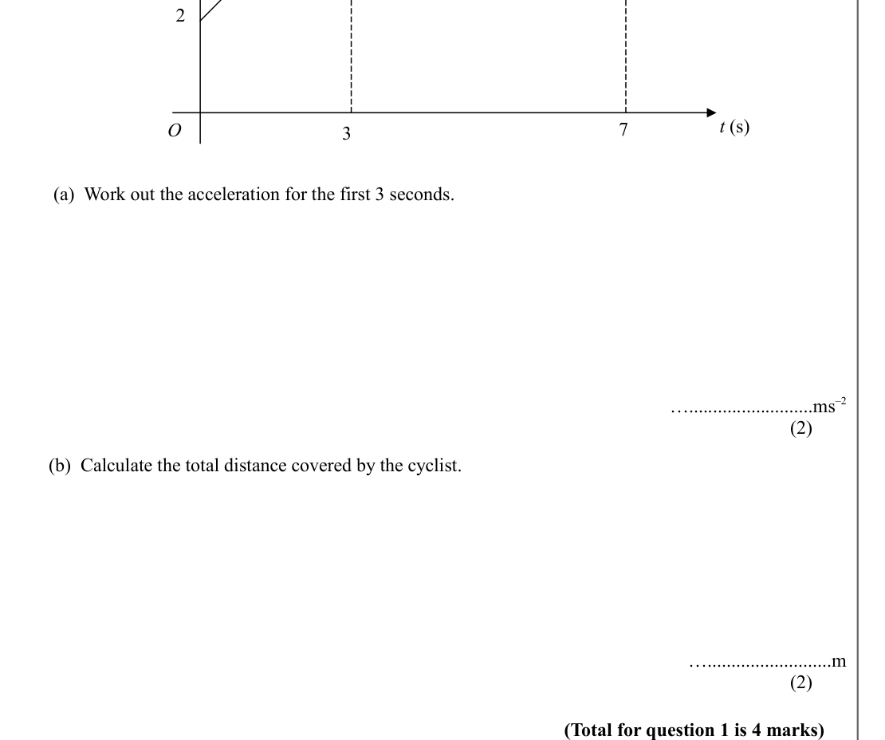
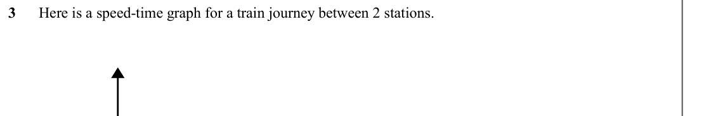
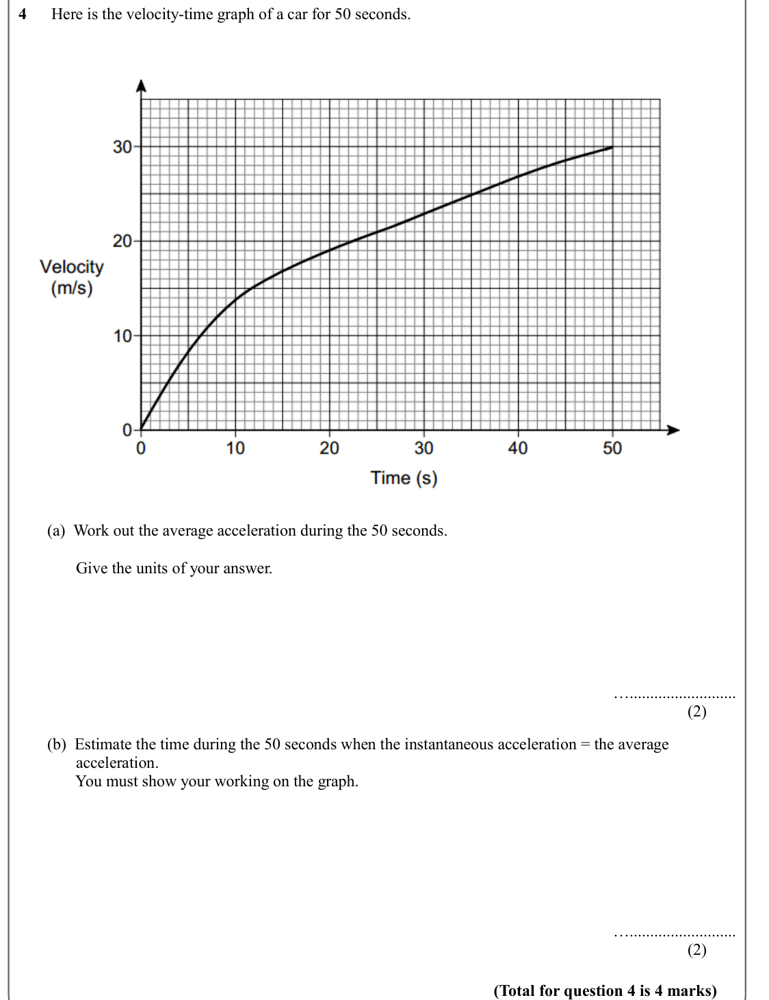
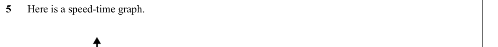
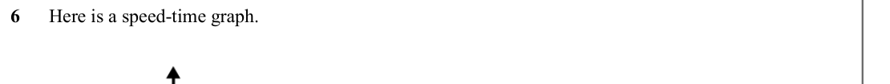
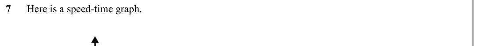

# Velocity Time Graphs — Exam Questions (GCSE Maths · Edexcel · Grade 8-9)

Topic code `8.7` · slug `grade-8-9-8-7-velocity-time-graphs` · source sheet sha256 `16d3288570550896…`

## Q1 (marks not printed)

Text (lossy): 1     Below is the sketch of a speed time graph for a cyclist moving on a straight road for 7 seconds.  / v (m s–1)

## Q2 (marks not printed · parts a, b)

Text (lossy): 2 / t (s) / O / 7 / 3 /          (a)  Work out the acceleration for the first 3 seconds.  / …..........................ms–2 / (2) /         (b)  Calculate the total distance covered by the cyclist.  / …..........................m / (2) / (Total for question 1 is 4 marks)

## Q3 (marks not printed)

Text (lossy): 3      Here is a speed-time graph for a train journey between 2 stations.

## Q4 (marks not printed · parts a, b)

Text (lossy): 4      Here is the velocity-time graph of a car for 50 seconds. /        (a)  Work out the average acceleration during the 50 seconds. /               Give the units of your answer. / ….......................... / (2) /        (b)  Estimate the time during the 50 seconds when the instantaneous acceleration = the average                  /               acceleration. /               You must show y

## Q5 (marks not printed)

Text (lossy): 5      Here is a speed-time graph.

## Q6 (marks not printed)

Text (lossy): 6      Here is a speed-time graph.

## Q7 (marks not printed)

Text (lossy): 7      Here is a speed-time graph.

## Q8 (marks not printed)

Text (lossy): 8

