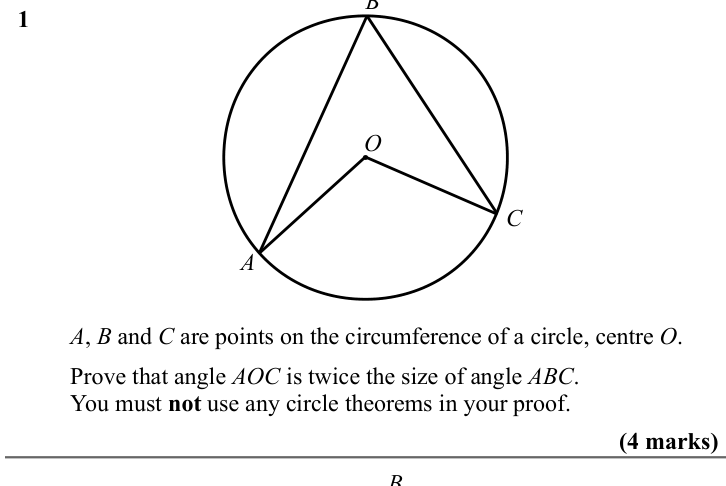
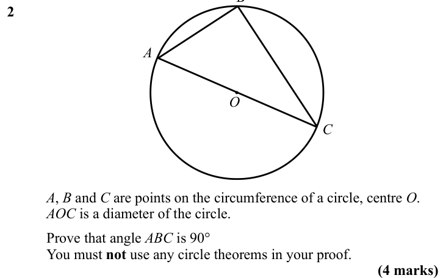
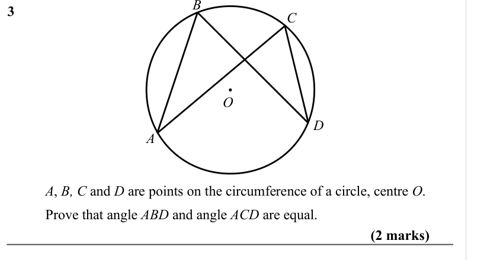
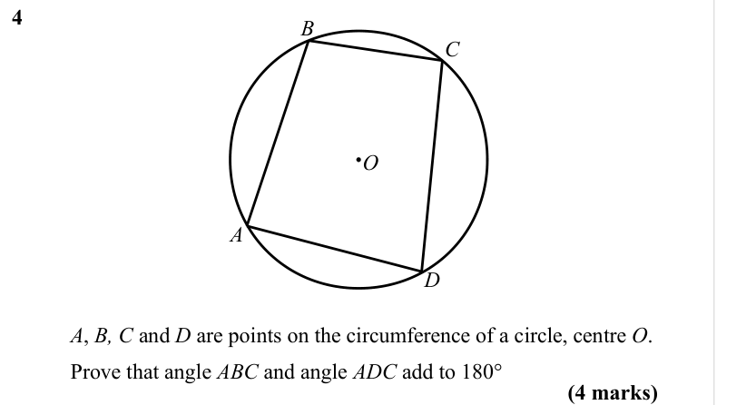
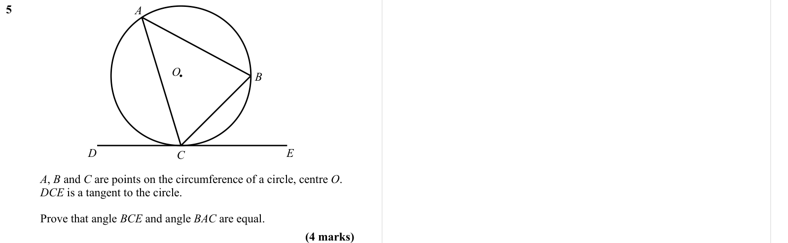

# Proof of the Circle Theorems — Exam Questions (GCSE Maths · Edexcel · Grade 8-9)

Topic code `8.8` · slug `grade-8-9-8-8-proof-of-the-circle-theorems` · source sheet sha256 `4ed61e2748ec460c…`

## Q1 (4 marks)

Text (lossy): 1 / O / C / A / A, B and C are points on the circumference of a circle, centre O. / Prove that angle AOC is twice the size of angle ABC.  / You must not use any circle theorems in your proof. / (4 marks) / B

## Q2 (4 marks)

Text (lossy): 2      / A / O / C / A, B and C are points on the circumference of a circle, centre O. / AOC is a diameter of the circle. / Prove that angle ABC is 90° / You must not use any circle theorems in your proof. / (4 marks)

## Q3 (2 marks)

Text (lossy): 3      / C / O / D / A / A, B, C and D are points on the circumference of a circle, centre O. / Prove that angle ABD and angle ACD are equal. / (2 marks)

## Q4 (4 marks)

Text (lossy): 4      / B / C / O / A / D / A, B, C and D are points on the circumference of a circle, centre O. / Prove that angle ABC and angle ADC add to 180° / (4 marks)

## Q5 (4 marks)

Text (lossy): 5      / A / O / B / D / E / C / A, B and C are points on the circumference of a circle, centre O. / DCE is a tangent to the circle. / Prove that angle BCE and angle BAC are equal.  / (4 marks)

