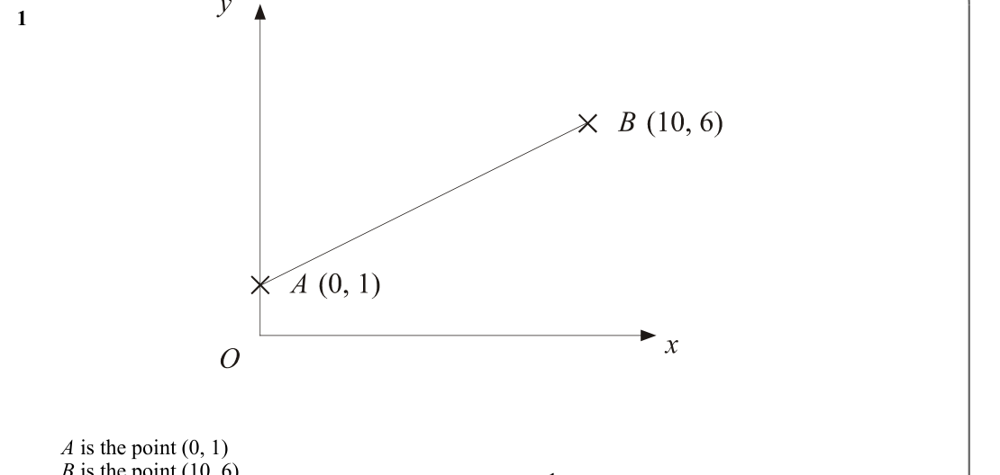
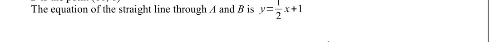
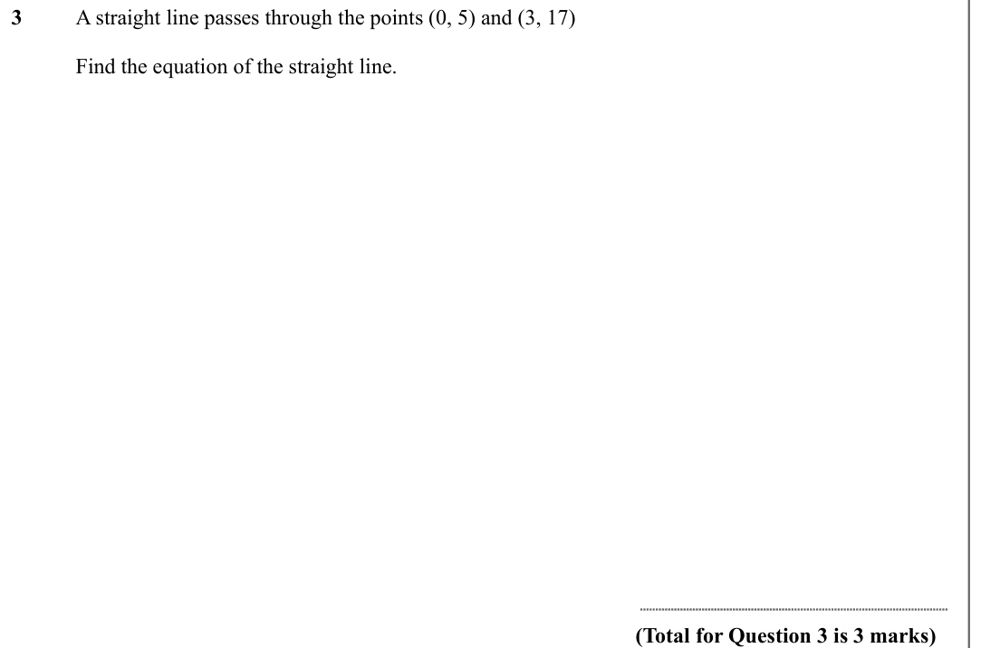
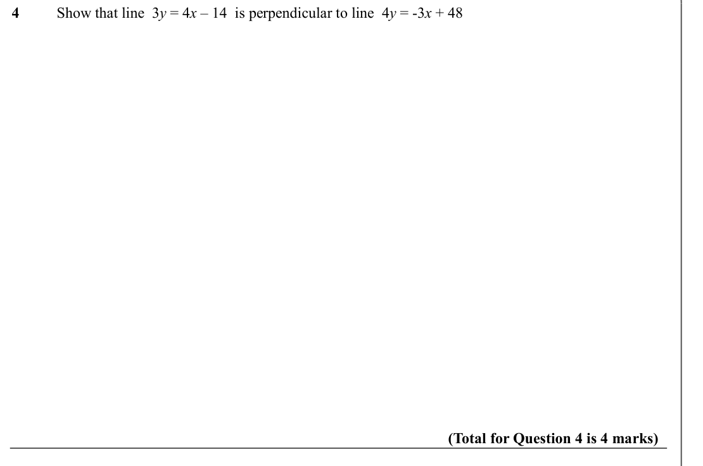
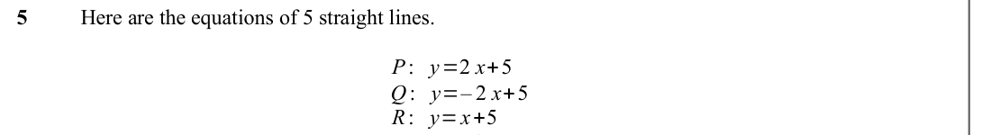
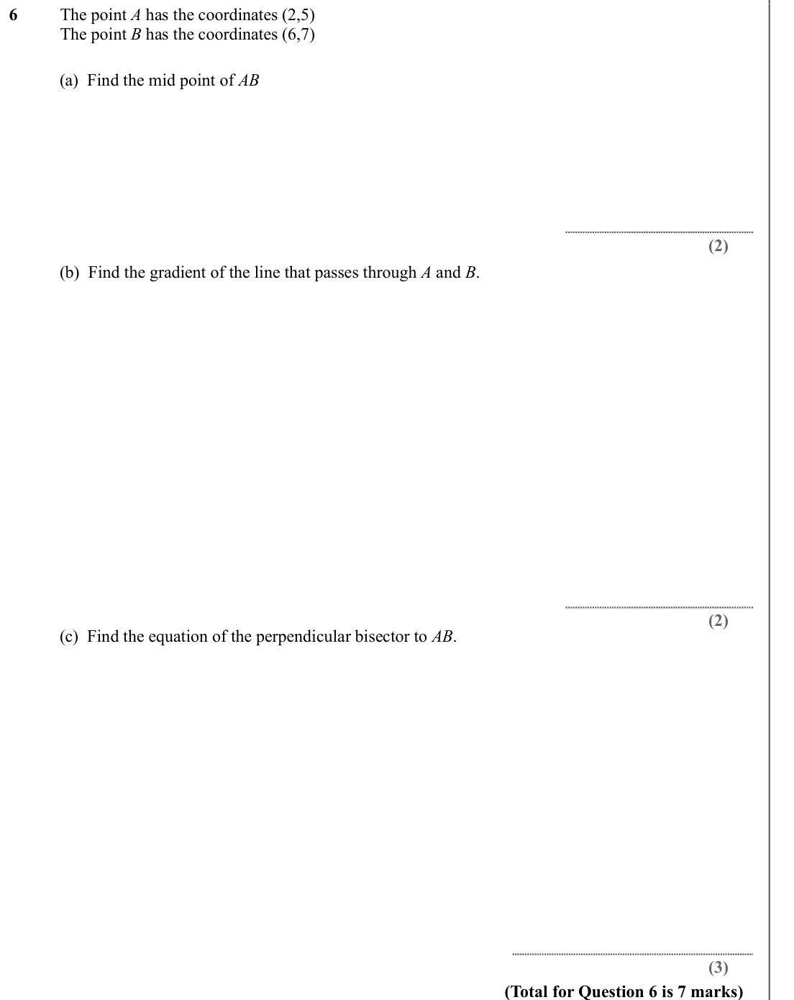
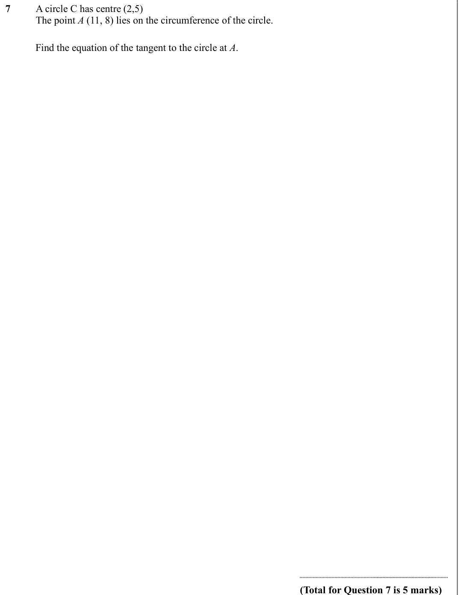
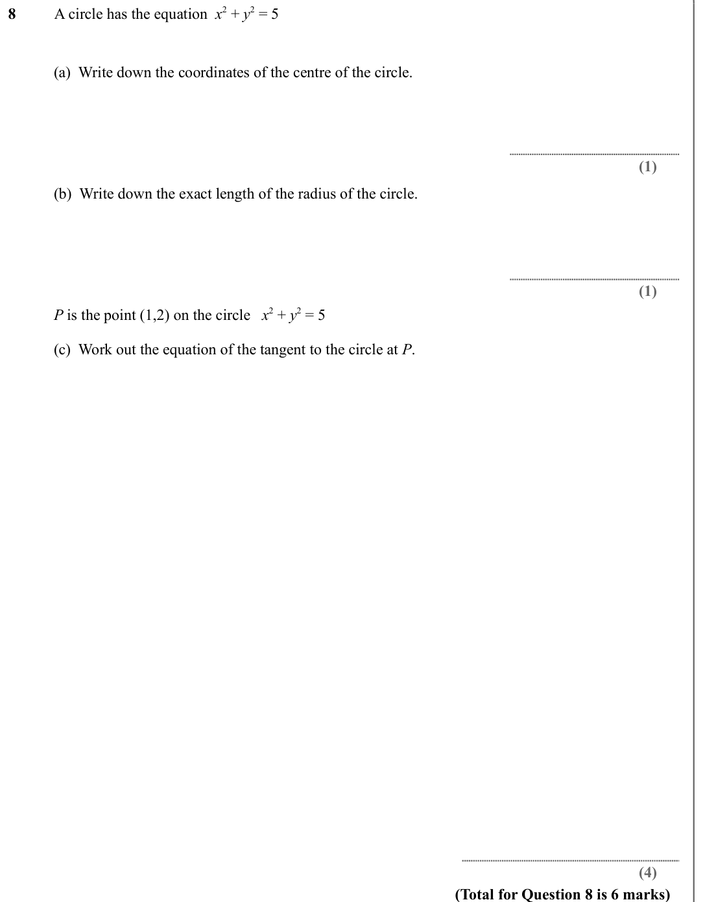
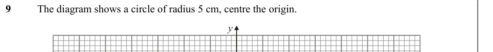

# Perpendicular Lines and the equation of a tangent — Exam Questions (GCSE Maths · Edexcel · Grade 8-9)

Topic code `8.9` · slug `grade-8-9-8-9-perpendicular-lines-and-the-equation-of-a-tangent` · source sheet sha256 `23d657e3857c5bdd…`

## Q1 (marks not printed)

Text (lossy): 1 / A is the point (0, 1) / B is the point (10, 6) / The equation of the straight line through A and B is  y=1

## Q2 (marks not printed · parts a)

Text (lossy): 2 x+1 /          (a)  Write down the equation of another straight line parallel to y=1

## Q3 (marks not printed)

Text (lossy): 3 / A straight line passes through the points (0, 5) and (3, 17) / Find the equation of the straight line. / (Total for Question 3 is 3 marks)

## Q4 (marks not printed)

Text (lossy): 4 / Show that line  3 y = 4 x – 14  is perpendicular to line  4 y = -3 x + 48   / (Total for Question 4 is 4 marks)

## Q5 (marks not printed)

Text (lossy): 5 / Here are the equations of 5 straight lines.  / P: y=2 x+5 / Q : y=– 2 x+5 / R: y=x+5 / S : y=– 1

## Q6 (marks not printed · parts a, b, c)

Text (lossy): 6 / The point A has the coordinates (2,5) / The point B has the coordinates (6,7)   /          (a)  Find the mid point of AB / (2) /          (b)  Find the gradient of the line that passes through A and B.  / (2) /          (c)  Find the equation of the perpendicular bisector to AB. / (3) / (Total for Question 6 is 7 marks)

## Q7 (marks not printed)

Text (lossy): 7 / A circle C has centre (2,5) / The point A (11, 8) lies on the circumference of the circle. /          Find the equation of the tangent to the circle at A. / (Total for Question 7 is 5 marks)

## Q8 (marks not printed · parts a, b, c)

Text (lossy): 8 / A circle has the equation  x 2 + y 2 = 5 /          (a)  Write down the coordinates of the centre of the circle.  / (1) /          (b)  Write down the exact length of the radius of the circle.  / (1) /          P is the point (1,2) on the circle   x 2 + y 2 = 5 /          (c)  Work out the equation of the tangent to the circle at P. / (4) / (Total for Question 8 is 6 marks)

## Q9 (marks not printed)

Text (lossy): 9 / The diagram shows a circle of radius 5 cm, centre the origin. / y

