# Addition and Subtraction — Exam Questions (IGCSE Maths · Edexcel · Grade 1)

Topic code `1.1` · slug `grade-1-1-1-addition-and-subtraction` · source sheet sha256 `28f69312b2a854f3…`

## Q1 (2 marks)

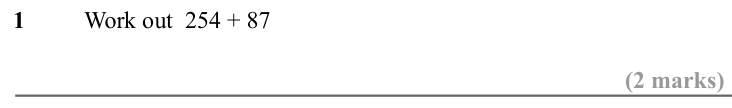

Text (lossy): 1  / Work out  254 + 87 / (2 marks)

## Q2 (2 marks)

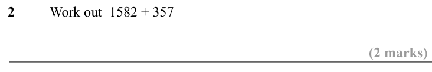

Text (lossy): 2  / Work out  1582 + 357 / (2 marks)

## Q3 (2 marks)

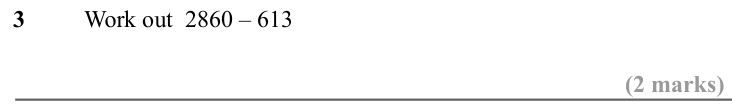

Text (lossy): 3  / Work out  2860 – 613 / (2 marks)

## Q4 (2 marks)

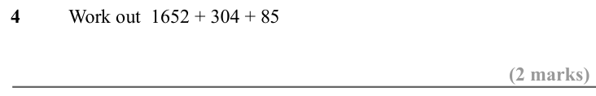

Text (lossy): 4  / Work out  1652 + 304 + 85 / (2 marks)

## Q5 (2 marks)

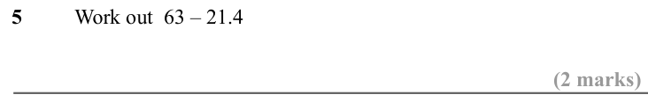

Text (lossy): 5  / Work out  63 – 21.4  / (2 marks)

## Q6 (2 marks)

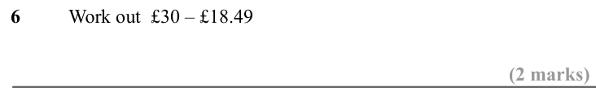

Text (lossy): 6  / Work out  £30 – £18.49  / (2 marks)

## Q7 (2 marks)

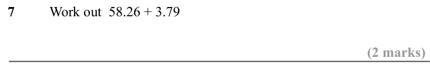

Text (lossy): 7  / Work out  58.26 + 3.79 / (2 marks)

## Q8 (2 marks)

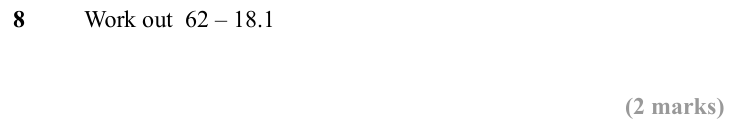

Text (lossy): 8  / Work out  62 – 18.1 / (2 marks)

## Q9 (2 marks)

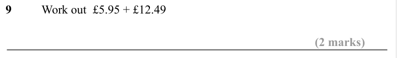

Text (lossy): 9  / Work out  £5.95 + £12.49  / (2 marks)

## Q10 (2 marks)

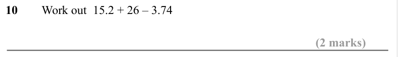

Text (lossy): 10  / Work out  15.2 + 26 – 3.74  / (2 marks)

## Q11 (2 marks)

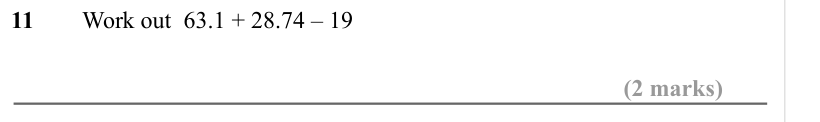

Text (lossy): 11  / Work out  63.1 + 28.74 – 19  / (2 marks)

## Q12 (2 marks)

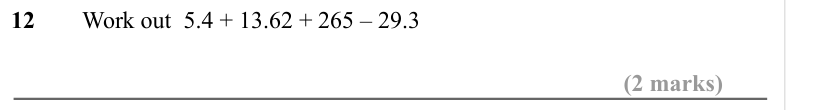

Text (lossy): 12  / Work out  5.4 + 13.62 + 265 – 29.3 / (2 marks)

## Q13 (2 marks)

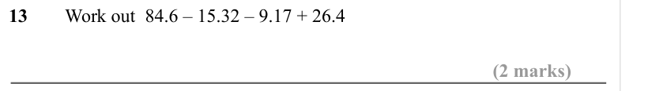

Text (lossy): 13  / Work out  84.6 – 15.32 – 9.17 + 26.4  / (2 marks)

## Q14 (2 marks)

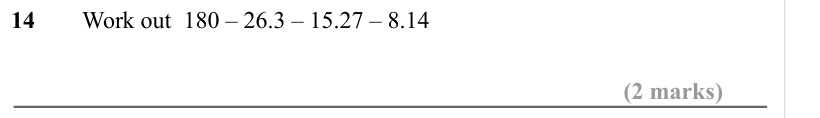

Text (lossy): 14  / Work out  180 – 26.3 – 15.27 – 8.14  / (2 marks)

## Q15 (2 marks)

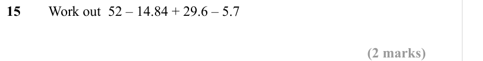

Text (lossy): 15  / Work out  52 – 14.84 + 29.6 – 5.7 / (2 marks)

