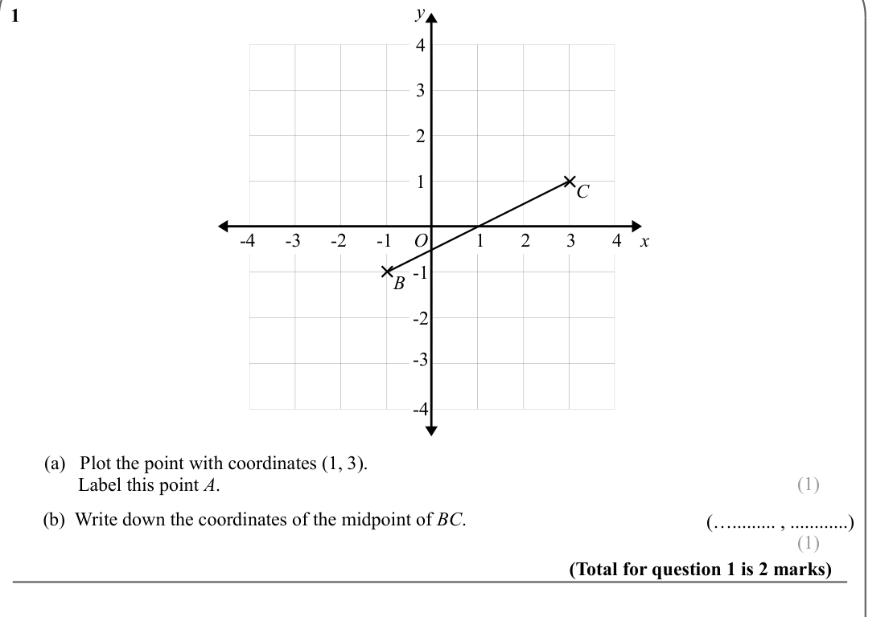
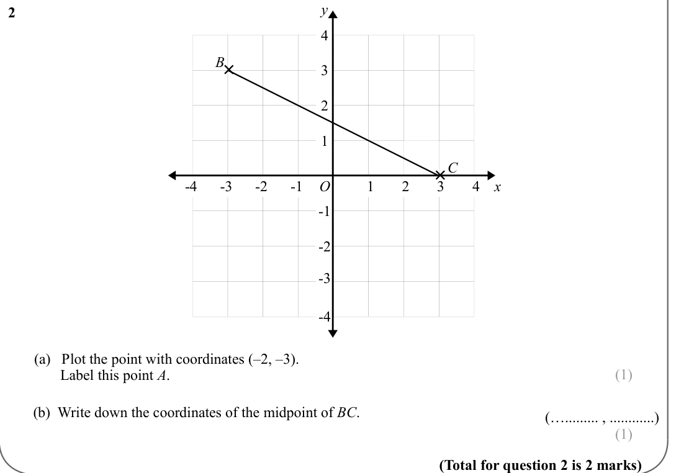
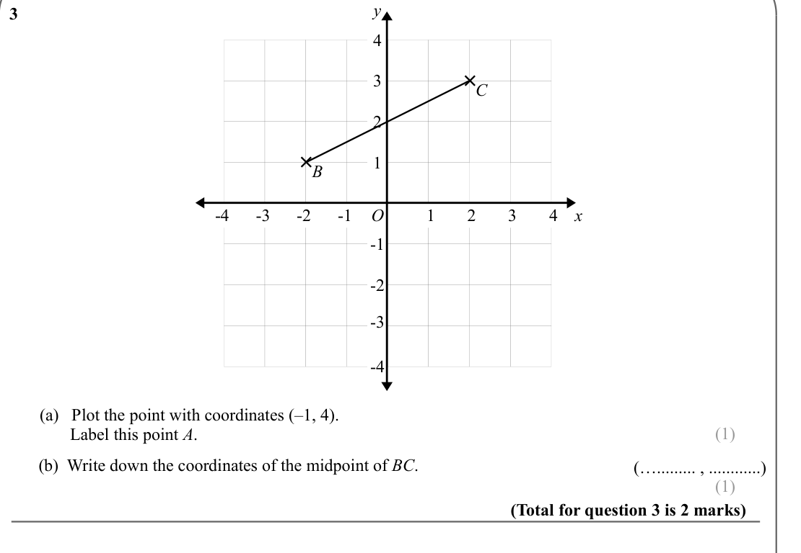
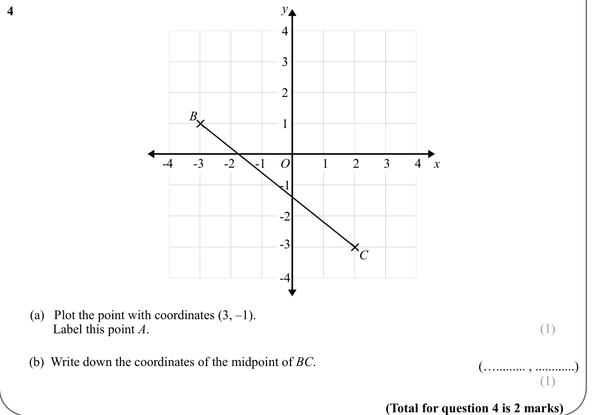
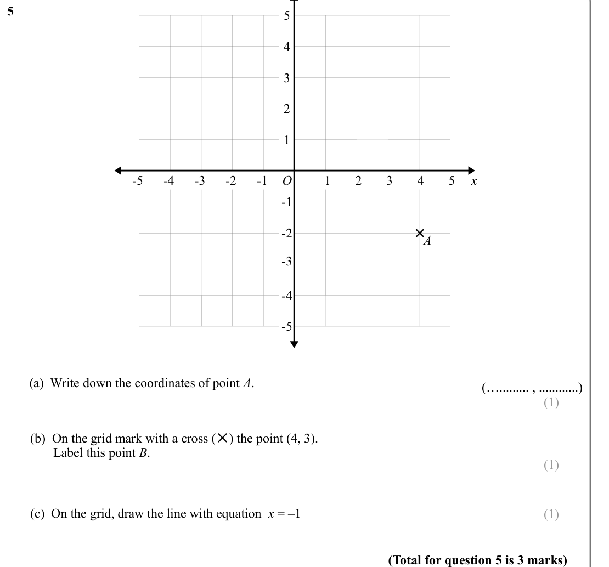
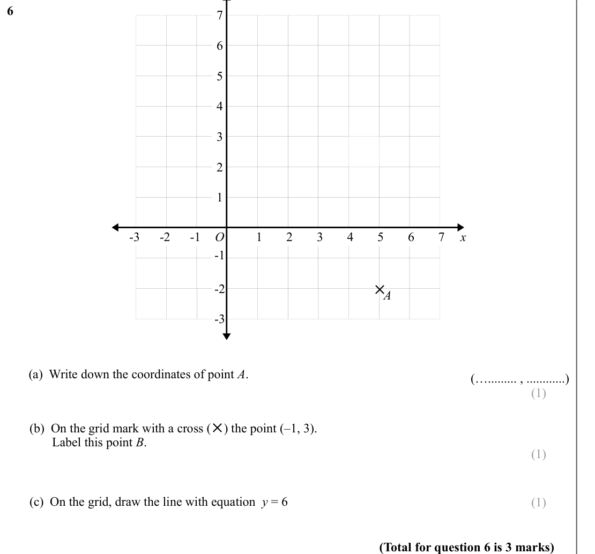
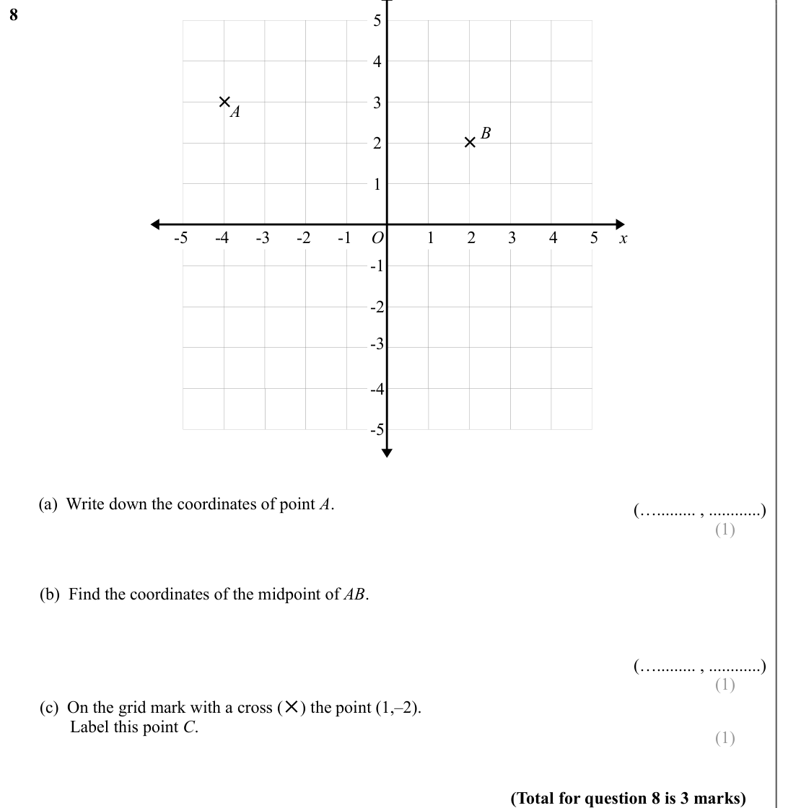
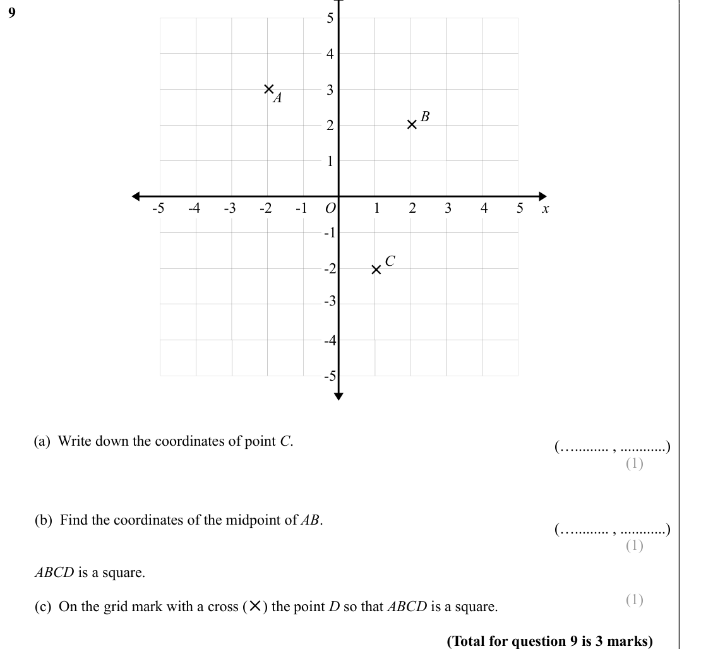

# Coordinates — Exam Questions (IGCSE Maths · Edexcel · Grade 1)

Topic code `1.11` · slug `grade-1-1-11-coordinates` · source sheet sha256 `bac526bdd438106f…`

## Q1 (marks not printed · parts a, b)

Text (lossy): 1       / 4 / 3 / 2 / × / 1 / C / 1 / -1 / -2 / -3 / -4 / 2 / 3 / 4 / O / x / B / × / -1 / -2 / -3 / -4 /        (a)   Plot the point with coordinates (1, 3). /               Label this point A.  / (1) /        (b)  Write down the coordinates of the midpoint of BC.  / (…......... , ............) / (1) / (Total for question 1 is 2 marks)

## Q2 (marks not printed · parts a, b)

Text (lossy): 2       / 4 / B× / 3 / 2 / 1 / C / 1 / -1 / -2 / -3 / -4 / 2 / 3 / 4 / × / O / x / -1 / -2 / -3 / -4 /        (a)   Plot the point with coordinates (–2, –3). /               Label this point A.  / (1) /        (b)  Write down the coordinates of the midpoint of BC.  / (…......... , ............) / (1) / (Total for question 2 is 2 marks)

## Q3 (marks not printed · parts a, b)

Text (lossy): 3       / 4 / × / 3 / C / 2 / B / × / 1 / 1 / -1 / -2 / -3 / -4 / 2 / 3 / 4 / O / x / -1 / -2 / -3 / -4 /        (a)   Plot the point with coordinates (–1, 4). /               Label this point A.  / (1) /        (b)  Write down the coordinates of the midpoint of BC.  / (…......... , ............) / (1) / (Total for question 3 is 2 marks)

## Q4 (marks not printed · parts a, b)

Text (lossy): 4       / 4 / 3 / 2 / B× / 1 / 1 / -1 / -2 / -3 / -4 / 2 / 3 / 4 / O / x / -1 / -2 / × / -3 / C / -4 /        (a)   Plot the point with coordinates (3, –1). /               Label this point A.  / (1) /        (b)  Write down the coordinates of the midpoint of BC.  / (…......... , ............) / (1) / (Total for question 4 is 2 marks)

## Q5 (marks not printed · parts a, b, c)

Text (lossy): 5       / 5 / 4 / 3 / 2 / 1 / 1 / -1 / -2 / -3 / -4 / -5 / 2 / 3 / 4 / 5 / O / x / -1 / × / -2 / A / -3 / -4 / -5 /        (a)  Write down the coordinates of point A.  / (…......... , ............) / (1) /        (b)  On the grid mark with a cross (✕) the point (4, 3). /               Label this point B.  / (1) /        (c)  On the grid, draw the line with equation  x = –1   / (1) / (Total for que

## Q6 (marks not printed · parts a, b, c)

Text (lossy): 6       / 7 / 6 / 5 / 4 / 3 / 2 / 1 / 3 / -1 / -2 / -3 / 4 / 5 / 6 / 7 / O / -1 / 2 / 1 / x / -2 / ✕ / A / -3 /        (a)  Write down the coordinates of point A.  / (…......... , ............) / (1) /        (b)  On the grid mark with a cross ( / ) the point ( / ✕ / –1, 3). /               Label this point B.  / (1) /        (c)  On the grid, draw the line with equation  y = 6   / (1) / (Total fo

## Q7 (marks not printed · parts a, b, c)

Text (lossy): 7       / 7 / 6 / ✕ / A / 5 / 4 / 3 / 2 / 1 / 3 / -1 / -2 / -3 / 4 / 5 / 6 / 7 / O / -1 / 2 / 1 / x / -2 / -3 /        (a)  Write down the coordinates of point A.  / (…......... , ............) / (1) /        (b)  On the grid mark with a cross ( / ) the point (5,  / ✕ / –1). /               Label this point B.  / (1) /        (c)  On the grid, draw the line with equation  x = 3  / (1) / (Total for

## Q8 (marks not printed · parts a, b, c)

Text (lossy): 8       / 5 / 4 / × / 3 / A / B / × / 2 / 1 / 1 / -1 / -2 / -3 / -4 / -5 / 2 / 3 / 4 / 5 / O / x / -1 / -2 / -3 / -4 / -5 /        (a)  Write down the coordinates of point A.  / (…......... , ............) / (1) /        (b)  Find the coordinates of the midpoint of AB.  / (…......... , ............) / (1) /        (c)  On the grid mark with a cross (✕) the point (1,–2). /               Label this 

## Q9 (marks not printed · parts a, b, c)

Text (lossy): 9       / 5 / 4 / × / 3 / A / B / × / 2 / 1 / 1 / -1 / -2 / -3 / -4 / -5 / 2 / 3 / 4 / 5 / O / x / -1 / C / × / -2 / -3 / -4 / -5 /        (a)  Write down the coordinates of point C.  / (…......... , ............) / (1) /        (b)  Find the coordinates of the midpoint of AB.  / (…......... , ............) / (1) /        ABCD is a square. / (1) /        (c)  On the grid mark with a cross (✕) the 

