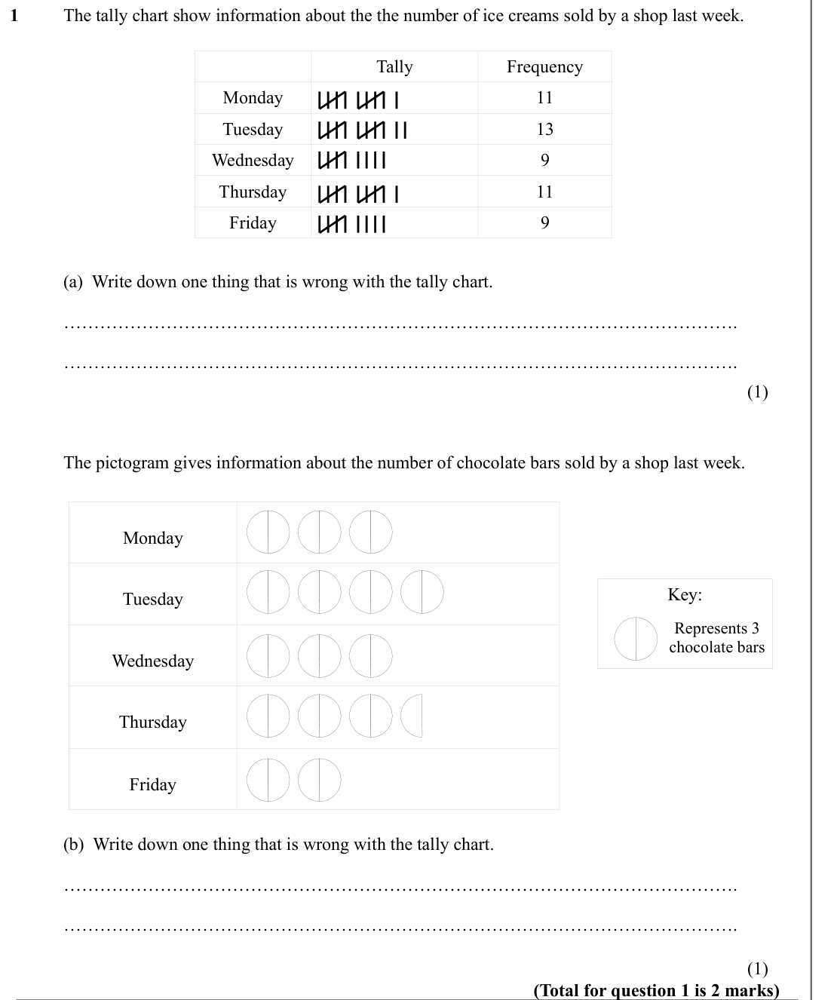
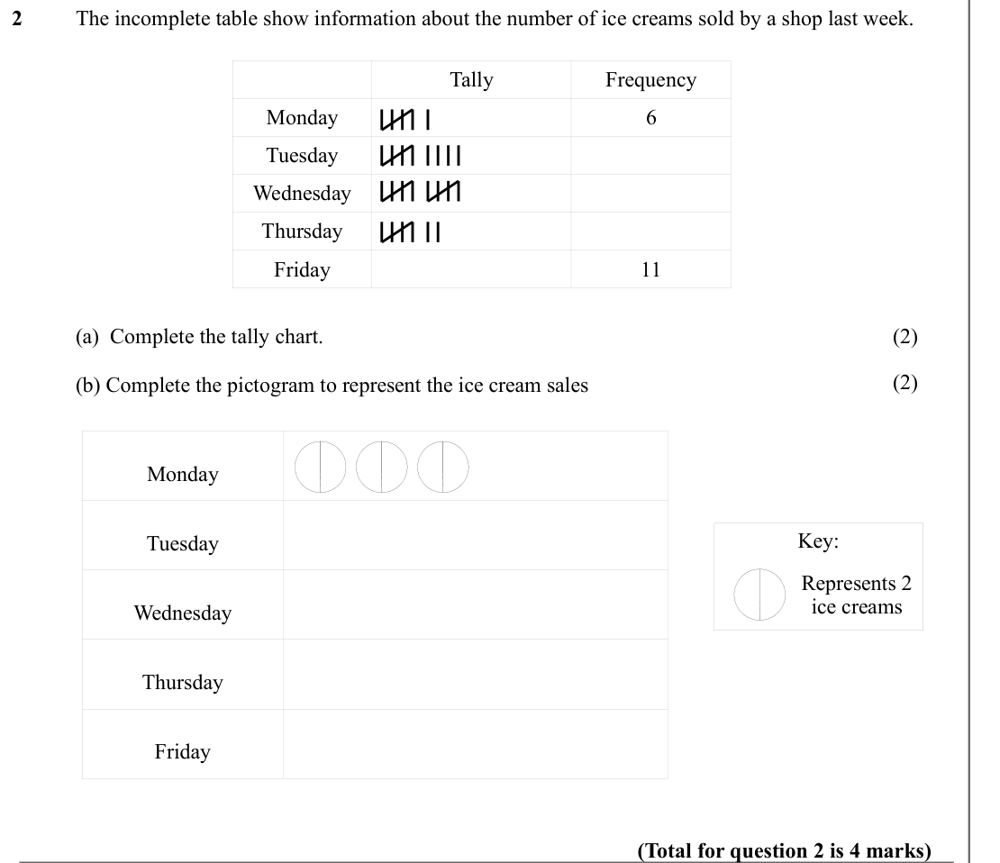
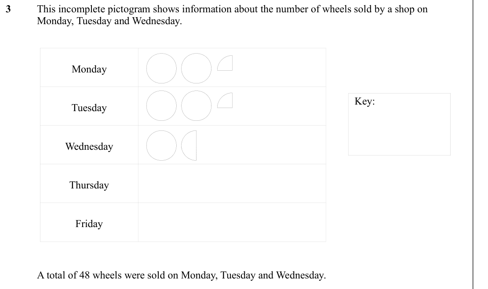
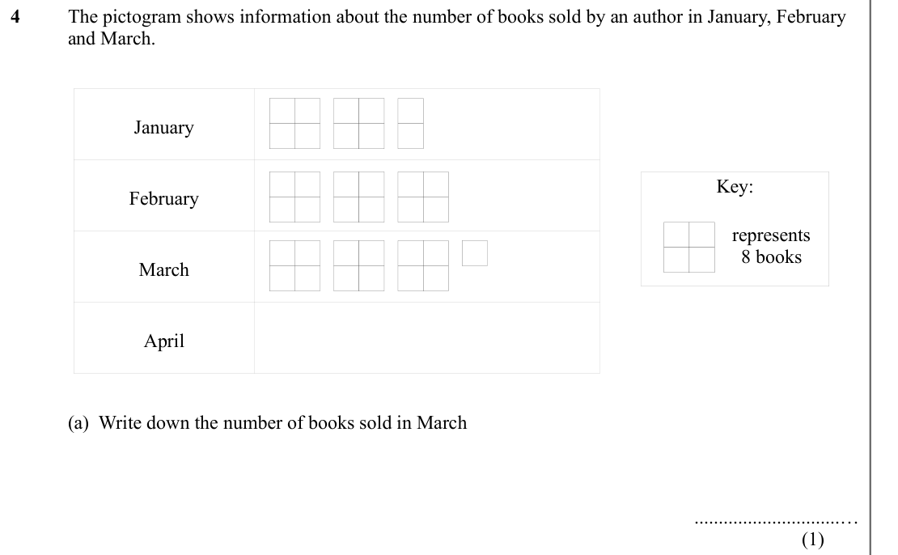
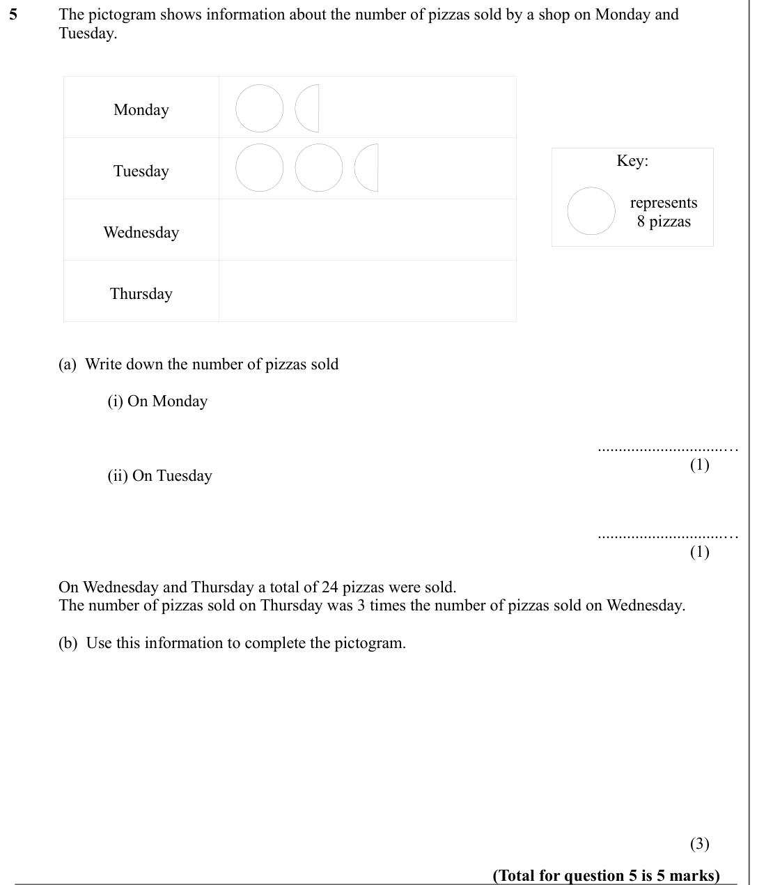

# Pictograms — Exam Questions (IGCSE Maths · Edexcel · Grade 1)

Topic code `1.12` · slug `grade-1-1-12-pictograms` · source sheet sha256 `8f22a4f6b431693d…`

## Q1 (marks not printed · parts a, b)

Text (lossy): 1  / The tally chart show information about the the number of ice creams sold by a shop last week.  / Tally / Frequency / Monday / 11 / Tuesday / 13 / Wednesday / 9 / Thursday / 11 / Friday / 9 /   / (a)  Write down one thing that is wrong with the tally chart.  / …………………………………………………………………………………………………. / …………………………………………………………………………………………………. / (1) / The pictogram gives information about the numbe

## Q2 (marks not printed · parts a, b)

Text (lossy): 2  / The incomplete table show information about the number of ice creams sold by a shop last week.  / Tally / Frequency / Monday / 6 / Tuesday / Wednesday / Thursday / Friday / 11 /   / (a)  Complete the tally chart.  / (2) / (2) / (b) Complete the pictogram to represent the ice cream sales / Monday / Key: / Tuesday / Represents 2  / ice creams / Wednesday / Thursday / Friday / (Total for questio

## Q3 (marks not printed)

Text (lossy): 3  / This incomplete pictogram shows information about the number of wheels sold by a shop on  / Monday, Tuesday and Wednesday.  / Monday / Key: / Tuesday / Wednesday / Thursday / Friday /   / A total of 48 wheels were sold on Monday, Tuesday and Wednesday.

## Q4 (marks not printed · parts a)

Text (lossy): 4  / The pictogram shows information about the number of books sold by an author in January, February  / and March.  / January / Key: / February / represents / 8 books / March / April /   / (a)  Write down the number of books sold in March /       ..............................… / (1)

## Q5 (marks not printed · parts a, b)

Text (lossy): 5  / The pictogram shows information about the number of pizzas sold by a shop on Monday and  / Tuesday.  / Monday / Key: / Tuesday / represents / 8 pizzas / Wednesday / Thursday /   / (a)  Write down the number of pizzas sold / (i) On Monday /       ..............................… / (1) / (ii) On Tuesday /       ..............................… / (1) / On Wednesday and Thursday a total of 24 pizza

