# Writing, Simplifying and Ordering Fractions — Exam Questions (IGCSE Maths · Edexcel · Grade 1)

Topic code `1.4` · slug `grade-1-1-4-writing-simplifying-and-ordering-fractions` · source sheet sha256 `0a7324d032dcb116…`

## Q1 (1 marks)

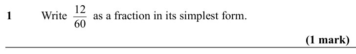

Text (lossy): 1     / Write       as a fraction in its simplest form.  / 12 / 60 / (1 mark)

## Q2 (1 marks)

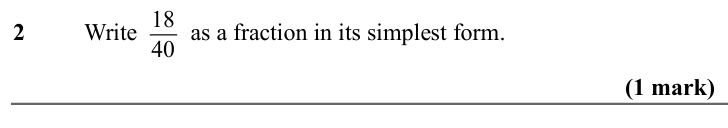

Text (lossy): 2     / Write       as a fraction in its simplest form.  / 18 / 40 / (1 mark)

## Q3 (1 marks)

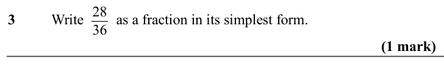

Text (lossy): 3     / Write       as a fraction in its simplest form.  / 28 / 36 / (1 mark)

## Q4 (1 marks)

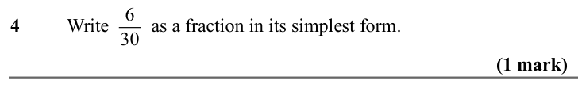

Text (lossy): 4     / Write       as a fraction in its simplest form.  / 6 / 30 / (1 mark)

## Q5 (1 marks)

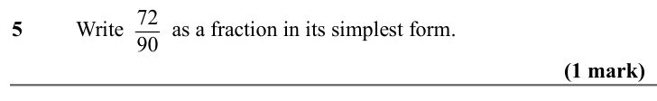

Text (lossy): 5     / Write       as a fraction in its simplest form.  / 72 / 90 / (1 mark)

## Q6 (1 marks)

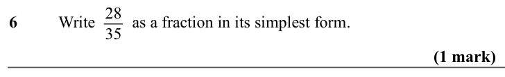

Text (lossy): 6     / Write       as a fraction in its simplest form.  / 28 / 35 / (1 mark)

## Q7 (1 marks)

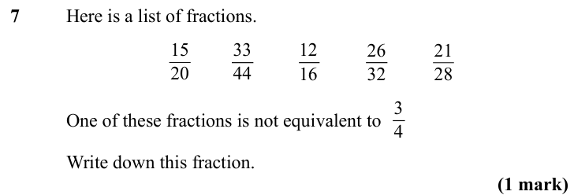

Text (lossy): 7     / Here is a list of fractions.  / 15 / 20 / 33 / 44 / 12 / 16 / 26 / 32 / 21 / 28 / 3 / 4 / One of these fractions is not equivalent to  / Write down this fraction.  / (1 mark)

## Q8 (1 marks)

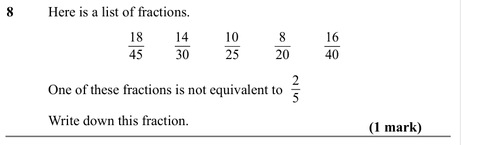

Text (lossy): 8     / Here is a list of fractions.  / 18 / 45 / 14 / 10 / 8 / 20 / 16 / 40 / 30 / 25 / 2 / 5 / One of these fractions is not equivalent to  / Write down this fraction.  / (1 mark)

## Q9 (1 marks)

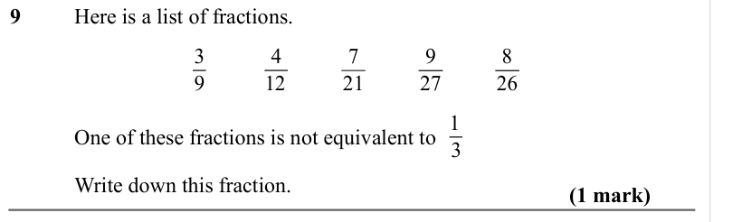

Text (lossy): 9     / Here is a list of fractions.  / 3 / 9 / 4 / 12 / 7 / 21 / 9 / 27 / 8 / 26 / 1 / One of these fractions is not equivalent to  / 3 / Write down this fraction.  / (1 mark)

## Q10 (1 marks)

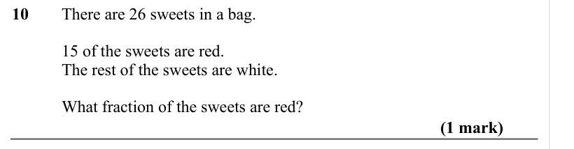

Text (lossy): 10     / There are 26 sweets in a bag.  / 15 of the sweets are red. / The rest of the sweets are white. / What fraction of the sweets are red? / (1 mark)

## Q11 (1 marks)

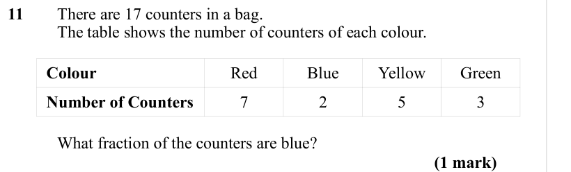

Text (lossy): 11     / There are 17 counters in a bag.  / The table shows the number of counters of each colour.  / Colour / Red / Blue / Yellow / Green / Number of Counters / 7 / 2 / 5 / 3 / What fraction of the counters are blue? / (1 mark)

## Q12 (marks not printed)

Text (lossy): 12    / There are 9 pens in a box.

## Q13 (2 marks)

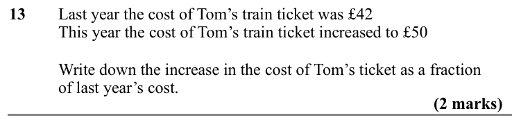

Text (lossy): 13     / Last year the cost of Tom’s train ticket was £42 / This year the cost of Tom’s train ticket increased to £50 / Write down the increase in the cost of Tom’s ticket as a fraction  / of last year’s cost. / (2 marks)

## Q14 (2 marks)

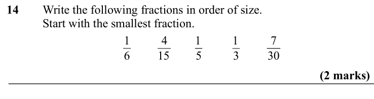

Text (lossy): 14     / Write the following fractions in order of size.  / Start with the smallest fraction.  / 1 / 6 / 1 / 7 / 30 / 4 / 15 / 1 / 5 / 3 / (2 marks)

## Q15 (2 marks)

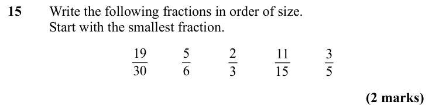

Text (lossy): 15     / Write the following fractions in order of size.  / Start with the smallest fraction.  / 19 / 30 / 5 / 6 / 2 / 3 / 11 / 15 / 3 / 5 / (2 marks)

## Q16 (2 marks)

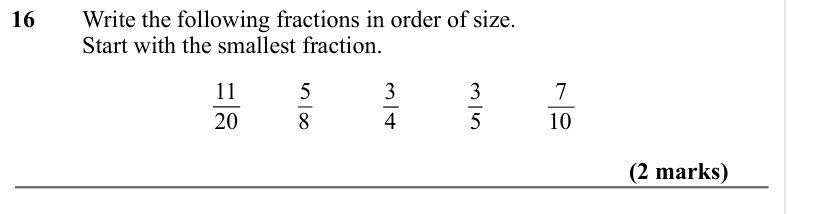

Text (lossy): 16     / Write the following fractions in order of size.  / Start with the smallest fraction.  / 11 / 20 / 5 / 8 / 3 / 4 / 3 / 5 / 7 / 10 / (2 marks)

## Q17 (2 marks)

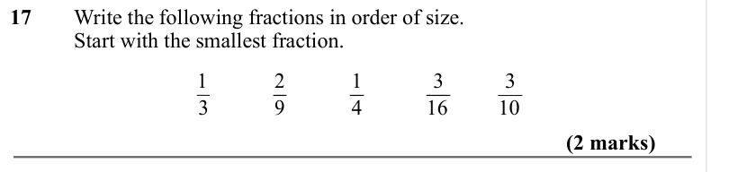

Text (lossy): 17     / Write the following fractions in order of size.  / Start with the smallest fraction.  / 1 / 2 / 9 / 1 / 4 / 3 / 16 / 3 / 10 / 3 / (2 marks)

## Q18 (3 marks)

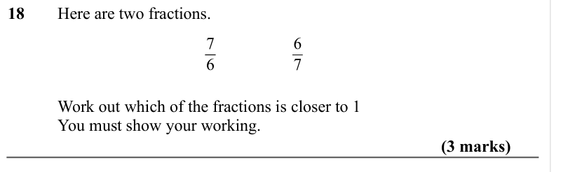

Text (lossy): 18     / Here are two fractions. / 7 / 6 / 6 / 7 / Work out which of the fractions is closer to 1 / You must show your working.  / (3 marks)

## Q19 (3 marks)

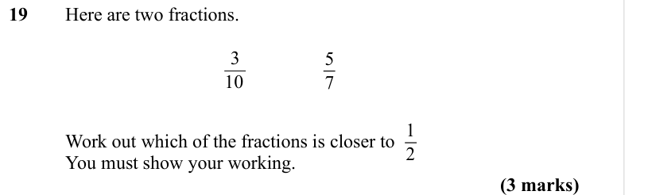

Text (lossy): 19     / Here are two fractions. / 3 / 10 / 5 / 7 / 1 / 2 / Work out which of the fractions is closer to  / You must show your working.  / (3 marks)

