# Rounding — Exam Questions (IGCSE Maths · Edexcel · Grade 1)

Topic code `1.6` · slug `grade-1-1-6-rounding` · source sheet sha256 `164a3895bec7cdb1…`

## Q1 (marks not printed)

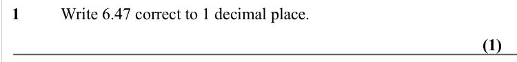

Text (lossy): 1  / Write 6.47 correct to 1 decimal place. / (1)

## Q2 (marks not printed)

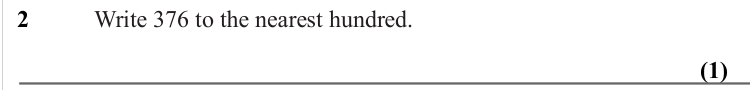

Text (lossy): 2  /  Write 376 to the nearest hundred. / (1)

## Q3 (marks not printed)

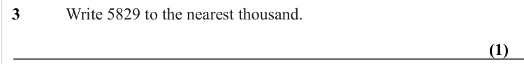

Text (lossy): 3  /  Write 5829 to the nearest thousand. / (1)

## Q4 (marks not printed)

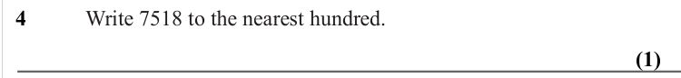

Text (lossy): 4  /  Write 7518 to the nearest hundred. / (1)

## Q5 (marks not printed)

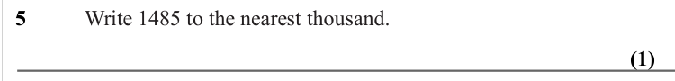

Text (lossy): 5  /  Write 1485 to the nearest thousand. / (1)

## Q6 (marks not printed)

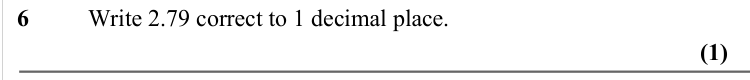

Text (lossy): 6  / Write 2.79 correct to 1 decimal place. / (1)

## Q7 (marks not printed)

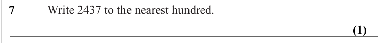

Text (lossy): 7  /  Write 2437 to the nearest hundred. / (1)

## Q8 (marks not printed)

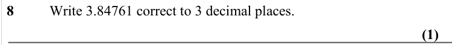

Text (lossy): 8  / Write 3.84761 correct to 3 decimal places. / (1)

## Q9 (marks not printed)

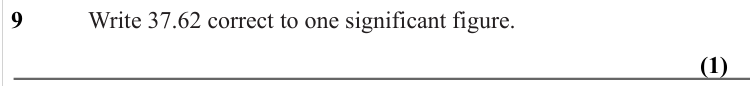

Text (lossy): 9  /  Write 37.62 correct to one significant figure. / (1)

## Q10 (marks not printed)

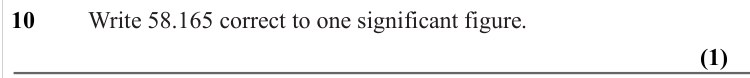

Text (lossy): 10  /  Write 58.165 correct to one significant figure. / (1)

## Q11 (marks not printed)

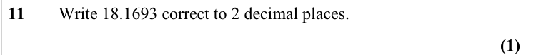

Text (lossy): 11  / Write 18.1693 correct to 2 decimal places. / (1)

## Q12 (marks not printed)

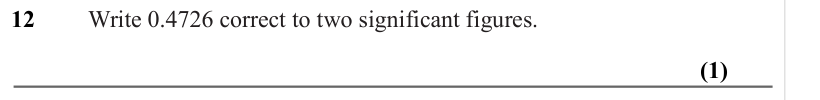

Text (lossy): 12  /  Write 0.4726 correct to two significant figures. / (1)

## Q13 (marks not printed)

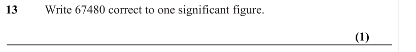

Text (lossy): 13  /  Write 67480 correct to one significant figure. / (1)

## Q14 (marks not printed)

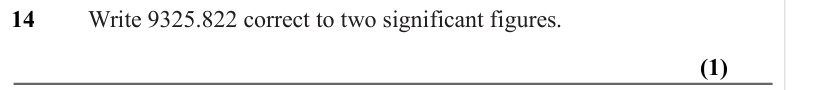

Text (lossy): 14  /  Write 9325.822 correct to two significant figures. / (1)

## Q15 (marks not printed)

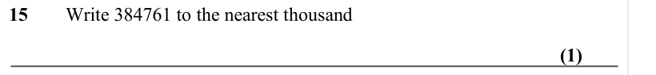

Text (lossy): 15  / Write 384761 to the nearest thousand / (1)

## Q16 (marks not printed)

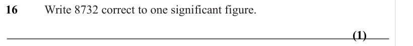

Text (lossy): 16  /  Write 8732 correct to one significant figure. / (1)

## Q17 (marks not printed)

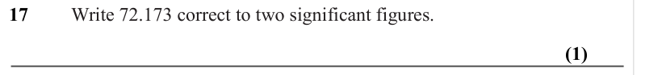

Text (lossy): 17  /  Write 72.173 correct to two significant figures. / (1)

## Q18 (marks not printed)

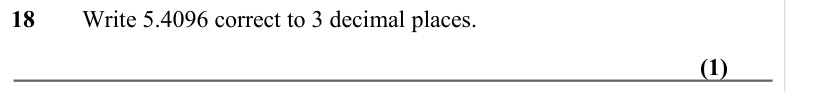

Text (lossy): 18  / Write 5.4096 correct to 3 decimal places. / (1)

## Q19 (marks not printed)

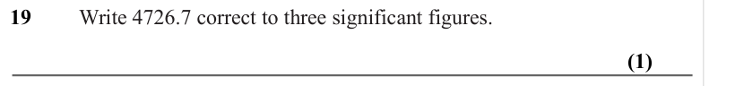

Text (lossy): 19  /  Write 4726.7 correct to three significant figures. / (1)

## Q20 (marks not printed)

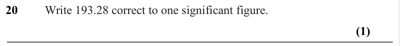

Text (lossy): 20  /  Write 193.28 correct to one significant figure. / (1)

## Q21 (marks not printed)

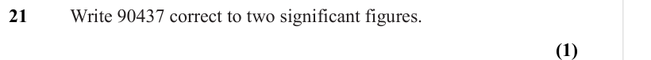

Text (lossy): 21  /  Write 90437 correct to two significant figures. / (1)

