# BIDMAS — Exam Questions (IGCSE Maths · Edexcel · Grade 1)

Topic code `1.9` · slug `grade-1-1-9-bidmas` · source sheet sha256 `a2cf8302ec6af806…`

## Q1 (1 marks)

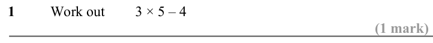

Text (lossy): 1  / Work out / 3 × 5 – 4  / (1 mark)

## Q2 (1 marks)

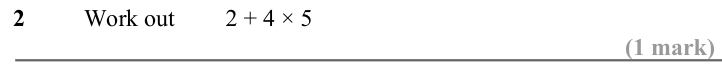

Text (lossy): 2  / Work out / 2 + 4 × 5 / (1 mark)

## Q3 (1 marks)

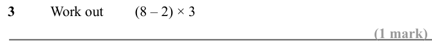

Text (lossy): 3  / Work out / (8 – 2) × 3  / (1 mark)

## Q4 (1 marks)

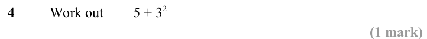

Text (lossy): 4  / Work out / 5 + 3 2 / (1 mark)

## Q5 (1 marks)

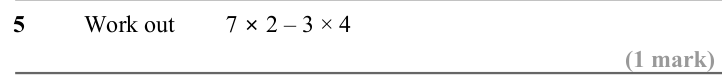

Text (lossy): 5  / Work out / 7 × 2 – 3 × 4 / (1 mark)

## Q6 (1 marks)

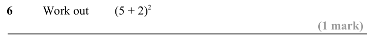

Text (lossy): 6  / Work out / (5 + 2)2 / (1 mark)

## Q7 (1 marks)

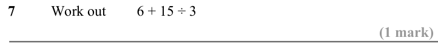

Text (lossy): 7  / Work out / 6 + 15 ÷ 3 / (1 mark)

## Q8 (1 marks)

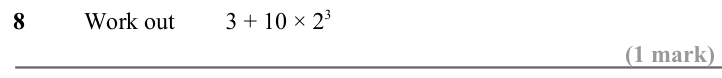

Text (lossy): 8  / Work out / 3 + 10 × 2 3 / (1 mark)

## Q9 (1 marks)

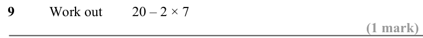

Text (lossy): 9  / Work out / 20 – 2 × 7  / (1 mark)

## Q10 (1 marks)

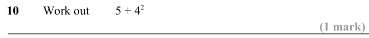

Text (lossy): 10  / Work out / 5 + 4 2 / (1 mark)

## Q11 (1 marks)

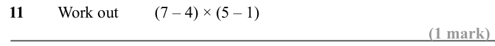

Text (lossy): 11  / Work out / (7 – 4) × (5 – 1)  / (1 mark)

## Q12 (1 marks)

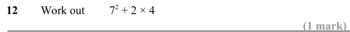

Text (lossy): 12  / Work out / 7 2 + 2 × 4 / (1 mark)

## Q13 (1 marks)

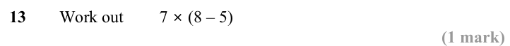

Text (lossy): 13  / Work out / 7 × (8 – 5) / (1 mark)

## Q14 (1 marks)

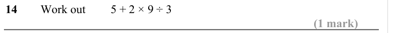

Text (lossy): 14  / Work out / 5 + 2 × 9 ÷ 3 / (1 mark)

## Q15 (1 marks)

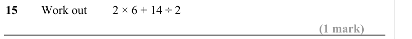

Text (lossy): 15  / Work out / 2 × 6 + 14 ÷ 2 / (1 mark)

## Q16 (1 marks)

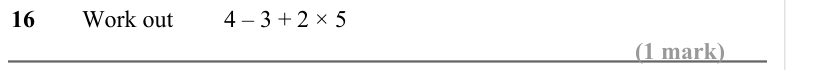

Text (lossy): 16  / Work out / 4 – 3 + 2 × 5 / (1 mark)

## Q17 (1 marks)

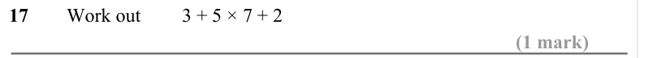

Text (lossy): 17  / Work out / 3 + 5 × 7 + 2 / (1 mark)

## Q18 (1 marks)

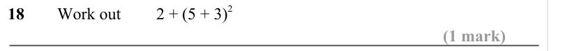

Text (lossy): 18  / Work out / 2 + (5 + 3)2 / (1 mark)

## Q19 (1 marks)

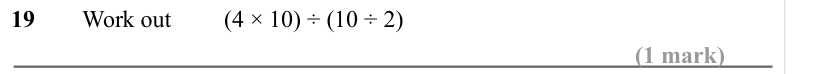

Text (lossy): 19  / Work out / (4 × 10) ÷ (10 ÷ 2)  / (1 mark)

## Q20 (3 marks · parts a, b, c)

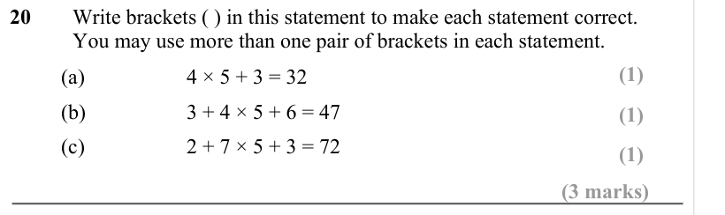

Text (lossy): 20  / Write brackets ( ) in this statement to make each statement correct. / You may use more than one pair of brackets in each statement. / (1) / (a) / 4 × 5 + 3 = 32  / (b) / 3 + 4 × 5 + 6 = 47  / (1) / (c) / 2 + 7 × 5 + 3 = 72  / (1) / (3 marks)

## Q21 (3 marks · parts a, b, c)

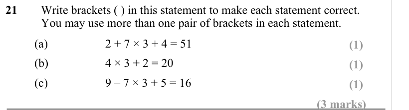

Text (lossy): 21  / Write brackets ( ) in this statement to make each statement correct. / You may use more than one pair of brackets in each statement. / (a) / 2 + 7 × 3 + 4 = 51  / (1) / (b) / 4 × 3 + 2 = 20  / (1) / (c) / 9 – 7 × 3 + 5 = 16 / (1) / (3 marks)

