# Probability — Exam Questions (IGCSE Maths · Edexcel · Grade 2)

Topic code `2.12` · slug `grade-2-2-12-probability` · source sheet sha256 `9cd1f91251eebee9…`

## Q1 (2 marks · parts a, b)

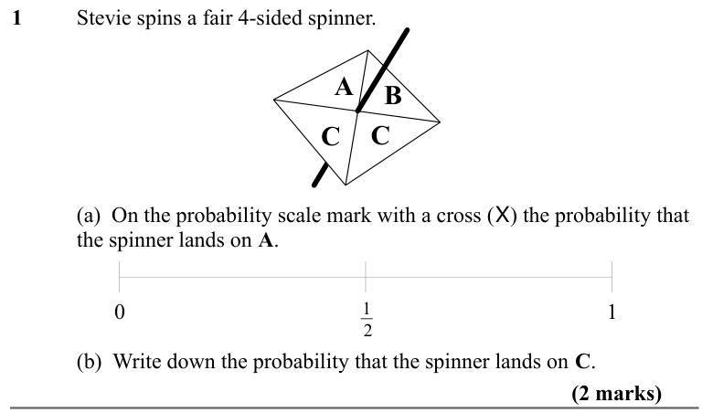

Text (lossy): 1     / Stevie spins a fair 4-sided spinner. / A / B / C / C / (a)  On the probability scale mark with a cross (X) the probability that  / the spinner lands on A. / 0 / 1 / 1 / 2 / (b)  Write down the probability that the spinner lands on C.  / (2 marks)

## Q2 (2 marks · parts a, b)

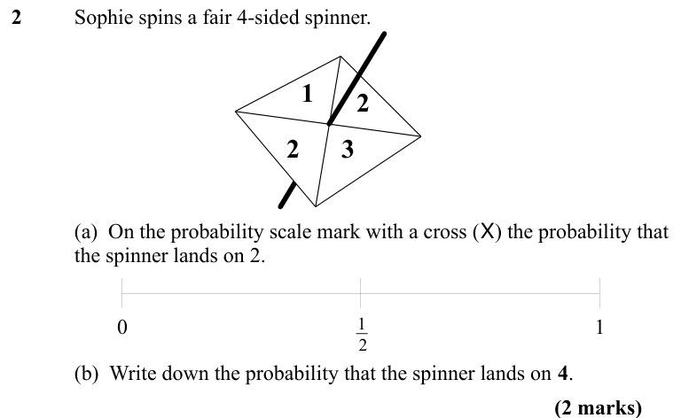

Text (lossy): 2     / Sophie spins a fair 4-sided spinner. / 1 / 2 / 3 / 2 / (a)  On the probability scale mark with a cross (X) the probability that  / the spinner lands on 2. / 0 / 1 / 1 / 2 / (b)  Write down the probability that the spinner lands on 4.  / (2 marks)

## Q3 (1 marks)

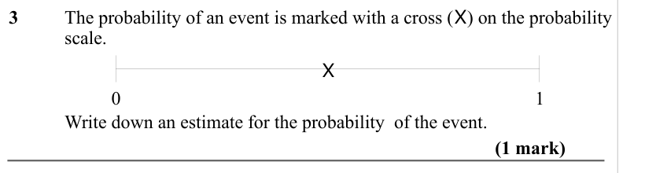

Text (lossy): 3     / The probability of an event is marked with a cross (X) on the probability / scale.  / 0 / 1 / X / Write down an estimate for the probability  of the event.  / (1 mark)

## Q4 (1 marks)

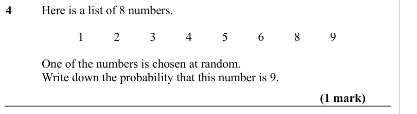

Text (lossy): 4     / Here is a list of 8 numbers. / 1 / 2 / 3 / 4 / 5 / 6 / 8 / 9 / One of the numbers is chosen at random.  / Write down the probability that this number is 9.  / (1 mark)

## Q5 (2 marks · parts a, b)

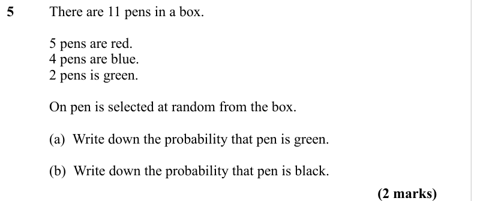

Text (lossy): 5     / There are 11 pens in a box.  / 5 pens are red.  / 4 pens are blue. / 2 pens is green.  / On pen is selected at random from the box.  / (a)  Write down the probability that pen is green.  / (b)  Write down the probability that pen is black.  / (2 marks)

## Q6 (2 marks · parts a, b)

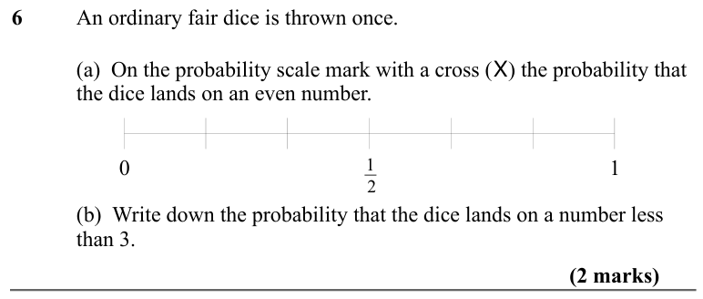

Text (lossy): 6     / An ordinary fair dice is thrown once.  / (a)  On the probability scale mark with a cross (X) the probability that  / the dice lands on an even number.  / 0 / 1 / 1 / 2 / (b)  Write down the probability that the dice lands on a number less  / than 3.  / (2 marks)

## Q7 (2 marks · parts a, b)

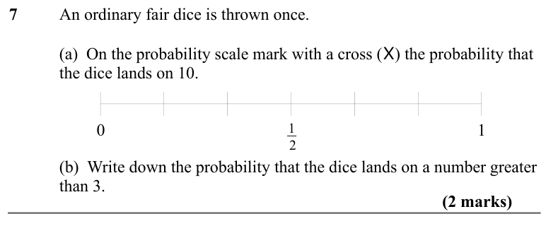

Text (lossy): 7     / An ordinary fair dice is thrown once.  / (a)  On the probability scale mark with a cross (X) the probability that  / the dice lands on 10. / 0 / 1 / 1 / 2 / (b)  Write down the probability that the dice lands on a number greater  / than 3.  / (2 marks)

## Q8 (2 marks · parts a, b)

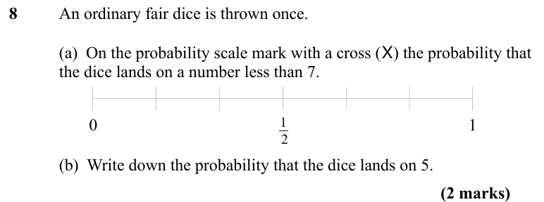

Text (lossy): 8     / An ordinary fair dice is thrown once.  / (a)  On the probability scale mark with a cross (X) the probability that  / the dice lands on a number less than 7. / 0 / 1 / 1 / (b)  Write down the probability that the dice lands on 5.  / (2 marks)

## Q9 (1 marks)

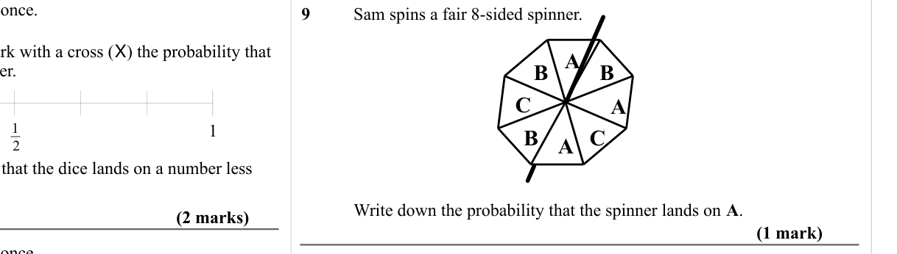

Text (lossy): 9     / Sam spins a fair 8-sided spinner. / A / B / B / C / C / A / B / A / Write down the probability that the spinner lands on A.  / (1 mark)

## Q10 (2 marks · parts a, b)

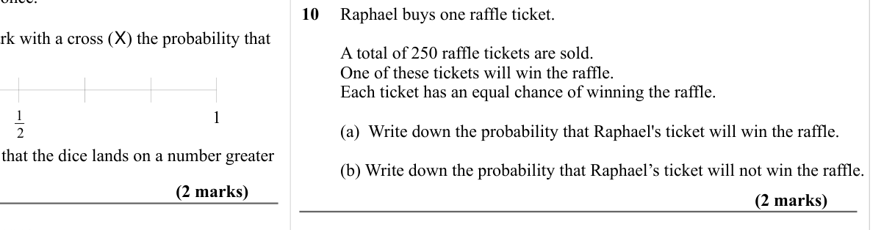

Text (lossy): 10   Raphael buys one raffle ticket. / A total of 250 raffle tickets are sold. / One of these tickets will win the raffle. / Each ticket has an equal chance of winning the raffle. / (a)  Write down the probability that Raphael's ticket will win the raffle. / (b) Write down the probability that Raphael’s ticket will not win the raffle.  / (2 marks)

## Q11 (2 marks)

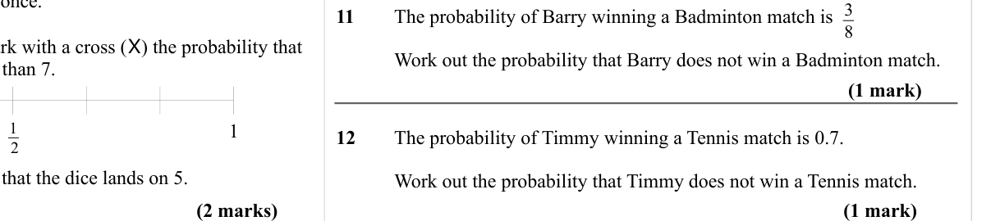

Text (lossy): 11     / The probability of Barry winning a Badminton match is   / Work out the probability that Barry does not win a Badminton match.  / (1 mark) / 2 / 12     / The probability of Timmy winning a Tennis match is 0.7.  / Work out the probability that Timmy does not win a Tennis match.  / (1 mark)

