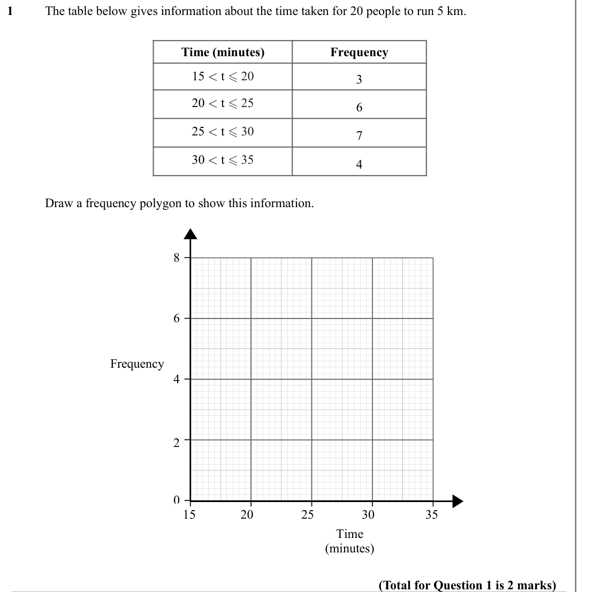
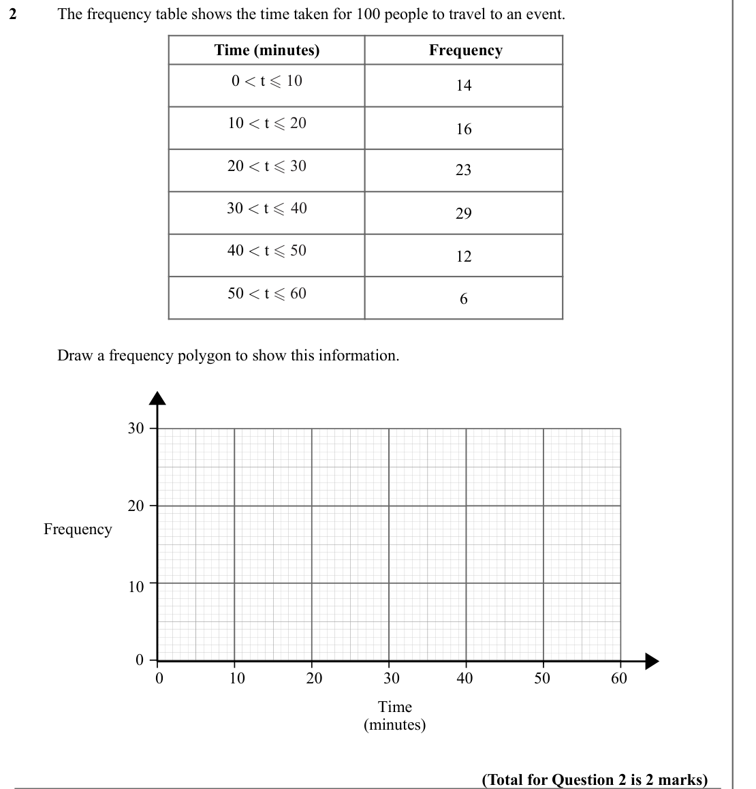
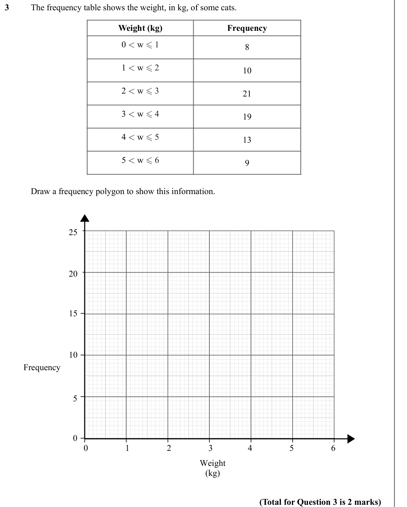
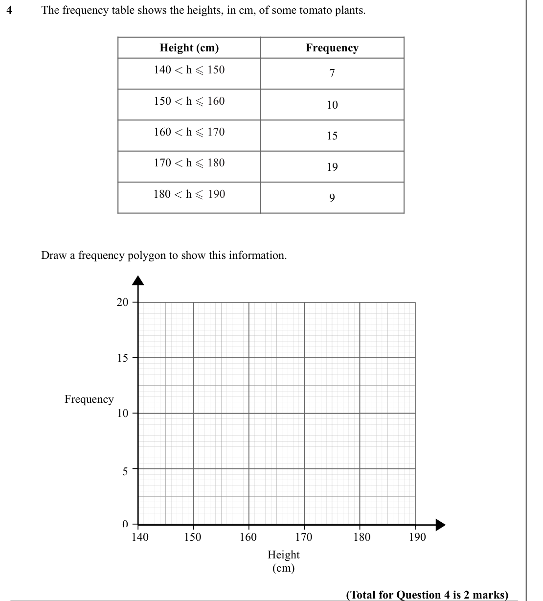
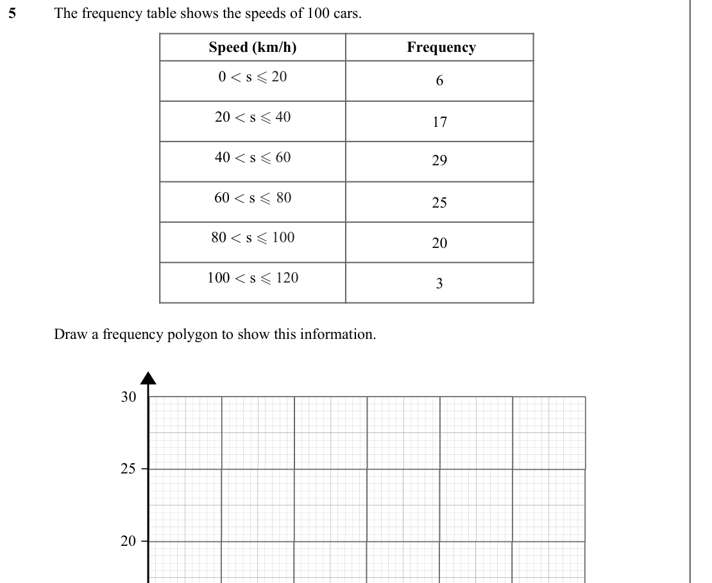
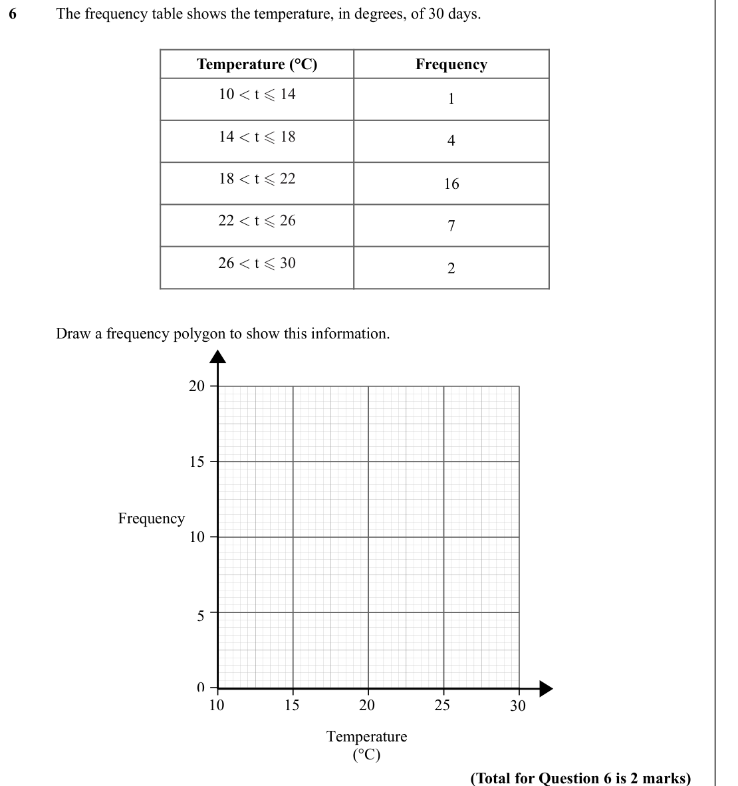
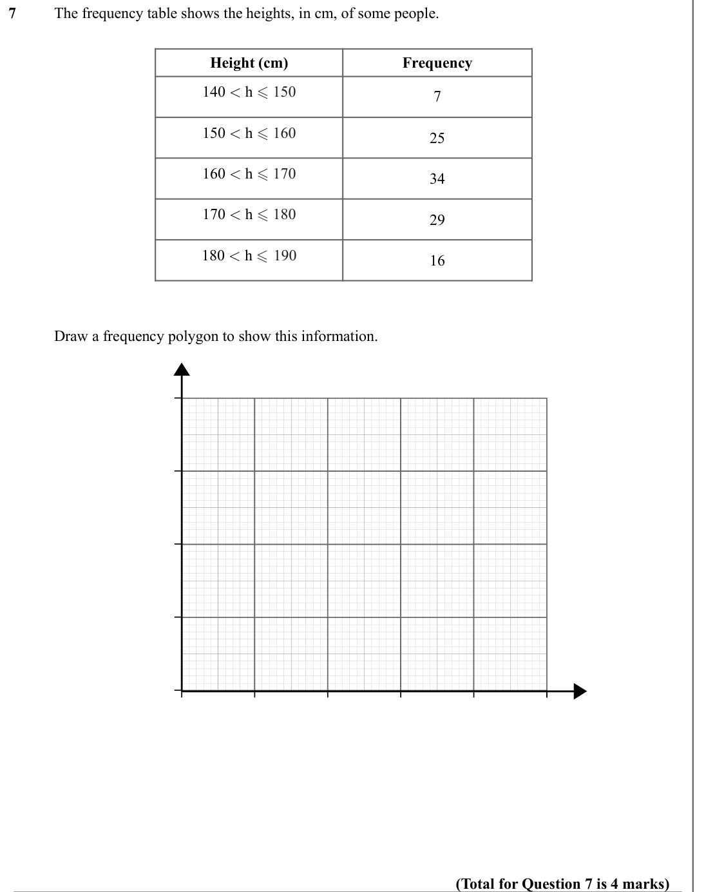

# Frequency Polygons — Exam Questions (IGCSE Maths · Edexcel · Grade 2)

Topic code `2.13` · slug `grade-2-2-13-frequency-polygons` · source sheet sha256 `847a66b0224c175a…`

## Q1 (marks not printed)

Text (lossy): 1 / The table below gives information about the time taken for 20 people to run 5 km.   / Time (minutes) / Frequency / 15 < t  20 / 3 / 20 < t  25 / 6 / 25 < t  30 / 7 / 30 < t  35 / 4 / Draw a frequency polygon to show this information. / 8 / 6 / Frequency / 4 / 2 / 0 / 15 / 20 / 25 / 30 / 35 / Time / (minutes) / (Total for Question 1 is 2 marks)

## Q2 (marks not printed)

Text (lossy): 2 / The frequency table shows the time taken for 100 people to travel to an event. / Time (minutes) /  Frequency / 0 < t  10 / 14 / 10 < t  20 / 16 / 20 < t  30 / 23 / 30 < t  40 / 29 / 40 < t  50 / 12 / 50 < t  60 / 6 /       / Draw a frequency polygon to show this information. / 30 / 20 / Frequency / 10 / 0 / 0 / 10 / 20 / 30 / 40 / 60 / 50 / Time / (minutes) / (Total for Question 2 is 2 m

## Q3 (marks not printed)

Text (lossy): 3 / The frequency table shows the weight, in kg, of some cats. / Weight (kg) / Frequency / 0 < w  1 / 8 / 1 < w  2 / 10 / 2 < w  3 / 21 / 3 < w  4 / 19 / 4 < w  5 / 13 / 5 < w  6 / 9 /       / Draw a frequency polygon to show this information. / 25 / 20 / 15 / 10 / Frequency / 5 / 0 / 0 / 1 / 2 / 3 / 4 / 6 / 5 / Weight / (kg) / (Total for Question 3 is 2 marks)

## Q4 (marks not printed)

Text (lossy): 4 / The frequency table shows the heights, in cm, of some tomato plants.   / Height (cm) / Frequency / 140 < h  150 / 7 / 150 < h  160 / 10 / 160 < h  170 / 15 / 170 < h  180 / 19 / 180 < h  190 / 9 /       / Draw a frequency polygon to show this information. / 20 / 15 / Frequency / 10 / 5 / 0 / 140 / 150 / 160 / 170 / 180 / 190 / Height / (cm) / (Total for Question 4 is 2 marks)

## Q5 (marks not printed)

Text (lossy): 5 / The frequency table shows the speeds of 100 cars. / Speed (km/h) /  Frequency / 0 < s  20 / 6 / 20 < s  40 / 17 / 40 < s  60 / 29 / 60 < s  80 / 25 / 80 < s  100 / 20 / 100 < s  120 / 3 /       / Draw a frequency polygon to show this information. / 30 / 25 / 20

## Q6 (marks not printed)

Text (lossy): 6 / The frequency table shows the temperature, in degrees, of 30 days.   / Temperature (°C) / Frequency / 10 < t  14 / 1 / 14 < t  18 / 4 / 18 < t  22 / 16 / 22 < t  26 / 7 / 26 < t  30 / 2 /       / Draw a frequency polygon to show this information. / 20 / 15 / Frequency / 10 / 5 / 0 / 10 / 15 / 20 / 25 / 30 / Temperature / (°C) / (Total for Question 6 is 2 marks)

## Q7 (marks not printed)

Text (lossy): 7 / The frequency table shows the heights, in cm, of some people.  / Height (cm) / Frequency / 140 < h  150 / 7 / 150 < h  160 / 25 / 160 < h  170 / 34 / 170 < h  180 / 29 / 180 < h  190 / 16 /       / Draw a frequency polygon to show this information. / (Total for Question 7 is 4 marks)

