# Averages — Exam Questions (IGCSE Maths · Edexcel · Grade 2)

Topic code `2.14` · slug `grade-2-2-14-averages` · source sheet sha256 `7967a54ebc1f7e48…`

## Q1 (marks not printed · parts a, b, c)

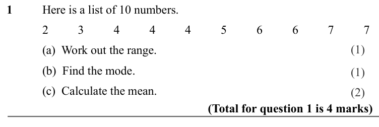

Text (lossy): 1 / Here is a list of 10 numbers.  / 2 / 3 / 4 / 4 / 4 / 5 / 6 / 6 / 7 / 7 /        / (1) / (a)  Work out the range. / (b)  Find the mode.   / (1) / (c)  Calculate the mean.  / (2) / (Total for question 1 is 4 marks)

## Q2 (marks not printed · parts a, b, c)

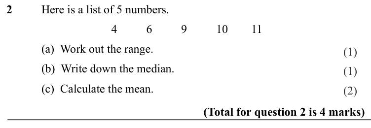

Text (lossy): 2 / Here is a list of 5 numbers.  / 4 / 6 / 9 / 10 / 11 /        / (a)  Work out the range.  / (1) / (b)  Write down the median.   / (1) / (c)  Calculate the mean.  / (2) / (Total for question 2 is 4 marks)

## Q3 (marks not printed · parts a, b, c)

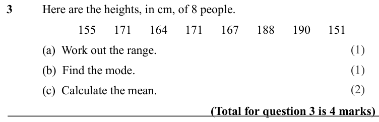

Text (lossy): 3 / Here are the heights, in cm, of 8 people.  / 155 / 171 / 164 / 171 / 167 / 188 / 190 / 151 /        / (1) / (a)  Work out the range.  / (1) / (b)  Find the mode.   / (2) / (c)  Calculate the mean.  / (Total for question 3 is 4 marks)

## Q4 (marks not printed · parts a, b)

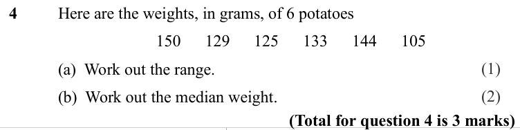

Text (lossy): 4 / Here are the weights, in grams, of 6 potatoes  / 150 / 129 / 125 / 133 / 144 / 105 /        / (1) / (a)  Work out the range.  / (2) / (b)  Work out the median weight.  / (Total for question 4 is 3 marks)

## Q5 (marks not printed · parts a, b)

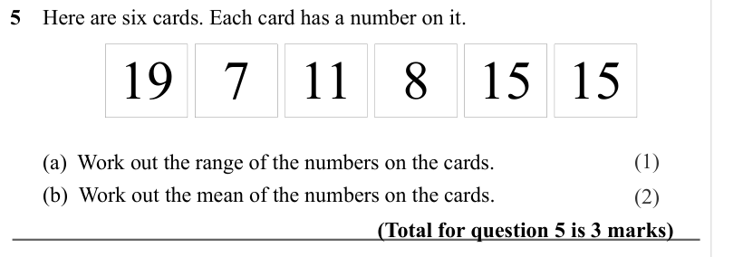

Text (lossy): 5    Here are six cards. Each card has a number on it.     / 8 / 7 / 15 / 15 / 19 / 11 / (1) /       (a)  Work out the range of the numbers on the cards.  /       (b)  Work out the mean of the numbers on the cards.  / (2) / (Total for question 5 is 3 marks)

## Q6 (marks not printed · parts a, b)

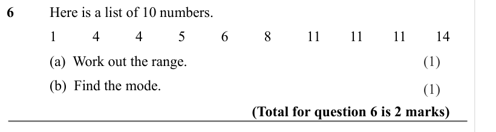

Text (lossy): 6 / Here is a list of 10 numbers.  / 1 / 4 / 4 / 5 / 6 / 8 / 11 / 11 / 11 / 14 /        / (a)  Work out the range.  / (1) / (b)  Find the mode.   / (1) / (Total for question 6 is 2 marks)

## Q7 (marks not printed · parts a, b, c)

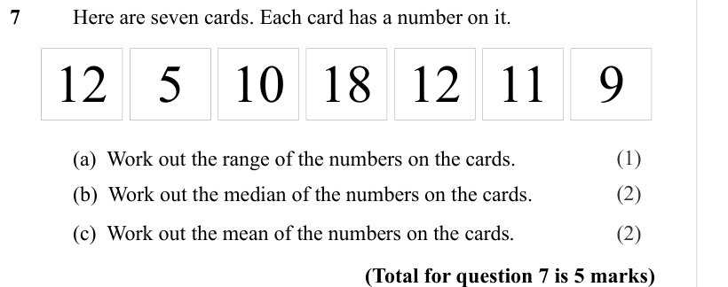

Text (lossy): 7     / Here are seven cards. Each card has a number on it.     / 18 / 5 / 9 / 11 / 12 / 12 / 10 / (1) /        / (a)  Work out the range of the numbers on the cards.  / (2) /       / (b)  Work out the median of the numbers on the cards.  /        / (c)  Work out the mean of the numbers on the cards.  / (2) / (Total for question 7 is 5 marks)

## Q8 (marks not printed · parts a, b)

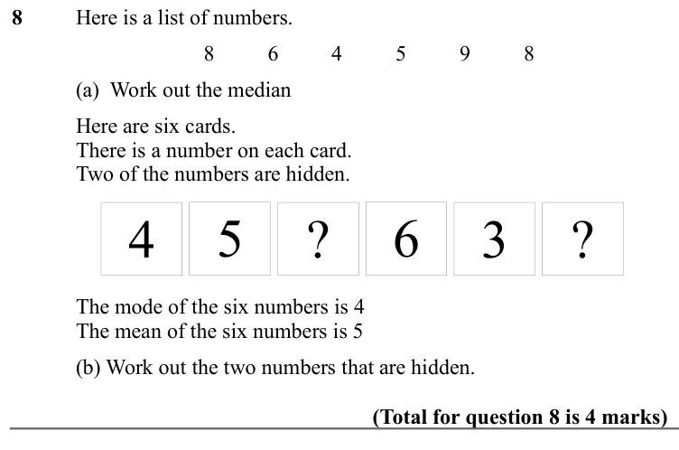

Text (lossy): 8 / Here is a list of numbers.  / 8 / 6 / 4 / 5 / 9 / 8 /        / (a)  Work out the median  / Here are six cards.  / There is a number on each card.  / Two of the numbers are hidden. / ? / 4 / ? / 3 / 6 / 5 / The mode of the six numbers is 4 / The mean of the six numbers is 5 / (b) Work out the two numbers that are hidden.  / (Total for question 8 is 4 marks)

## Q9 (marks not printed · parts a, b, c)

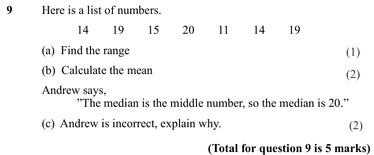

Text (lossy): 9 / Here is a list of numbers.  / 14 / 19 / 15 / 20 / 11 / 14 / 19 /        / (a)  Find the range / (b)  Calculate the mean / Andrew says,  / ”The median is the middle number, so the median is 20.” / (c)  Andrew is incorrect, explain why.  / (Total for question 9 is 5 marks)

## Q10 (marks not printed)

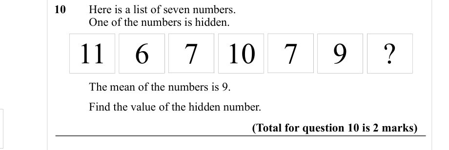

Text (lossy): 10     / Here is a list of seven numbers.  / One of the numbers is hidden.  / 10 / 6 / ? / 9 / 7 / 11 / 7 / The mean of the numbers is 9.  / Find the value of the hidden number.  / (Total for question 10 is 2 marks)

## Q11 (marks not printed)

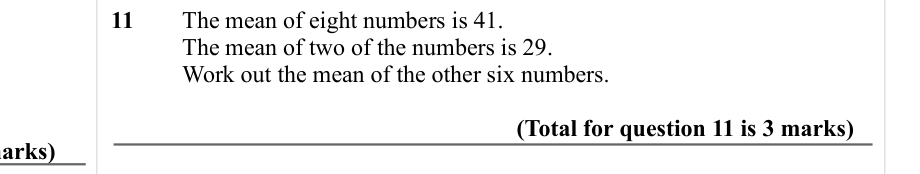

Text (lossy): 11     / The mean of eight numbers is 41. / The mean of two of the numbers is 29. / Work out the mean of the other six numbers. / (Total for question 11 is 3 marks)

## Q12 (marks not printed)

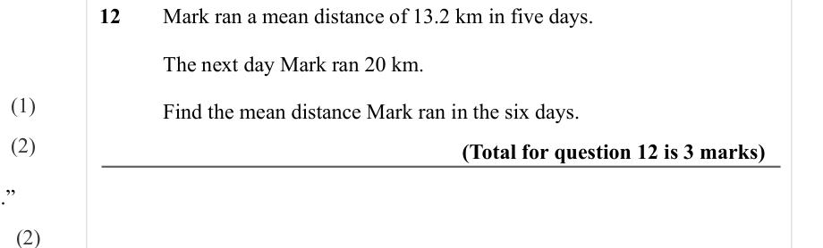

Text (lossy): 12    / Mark ran a mean distance of 13.2 km in five days. / The next day Mark ran 20 km.  / (1) / Find the mean distance Mark ran in the six days.  / (2) / (Total for question 12 is 3 marks) / (2)

