# Using a Calculator — Exam Questions (IGCSE Maths · Edexcel · Grade 2)

Topic code `2.2` · slug `grade-2-2-2-using-a-calculator` · source sheet sha256 `872d9d473933dee1…`

## Q1 (marks not printed)

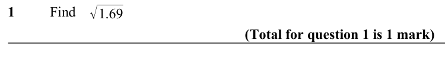

Text (lossy): 1     / Find / √1.69 / (Total for question 1 is 1 mark)

## Q2 (marks not printed)

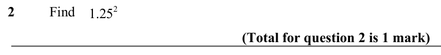

Text (lossy): 2     / Find / 1.25 2 / (Total for question 2 is 1 mark)

## Q3 (marks not printed)

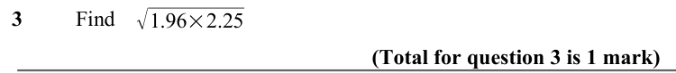

Text (lossy): 3     / Find / √1.96×2.25 / (Total for question 3 is 1 mark)

## Q4 (marks not printed)

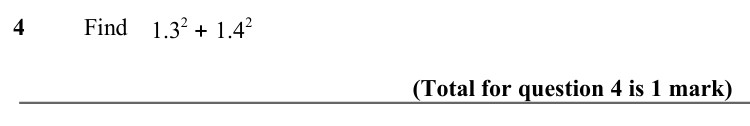

Text (lossy): 4     / Find / 1.3 2 + 1.4 2 / (Total for question 4 is 1 mark) / (3.15 −0.28)2 −4.076

## Q5 (marks not printed)

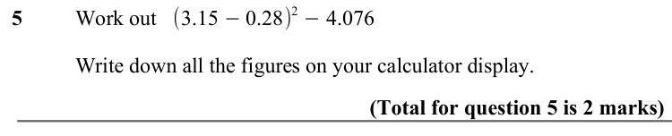

Text (lossy): 5     / Work out / Write down all the figures on your calculator display. / (Total for question 5 is 2 marks)

## Q6 (marks not printed)

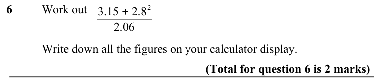

Text (lossy): 6     / Work out / 3.15 + 2.8 2 / 2.06 / Write down all the figures on your calculator display. / (Total for question 6 is 2 marks)

## Q7 (marks not printed)

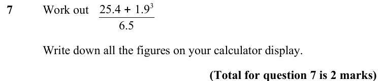

Text (lossy): 25.4 + 1.9 3 / 7     / Work out / 6.5 / Write down all the figures on your calculator display. / (Total for question 7 is 2 marks)

## Q8 (marks not printed · parts a, b)

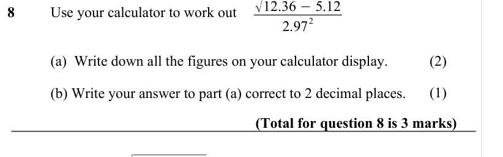

Text (lossy): 8     / Use your calculator to work out / 2 / 2.97 / (a)  Write down all the figures on your calculator display. / (2) / (b) Write your answer to part (a) correct to 2 decimal places. / (1) / (Total for question 8 is 3 marks) / √ / 25.1 −3.87 / 5.23 + 2.04

## Q9 (marks not printed)

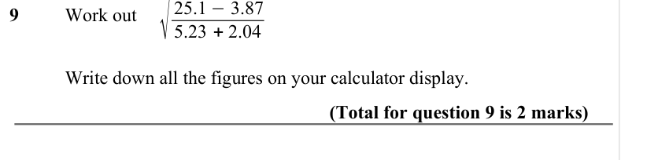

Text (lossy): 9     / Work out / Write down all the figures on your calculator display. / (Total for question 9 is 2 marks)

## Q10 (marks not printed · parts a, b)

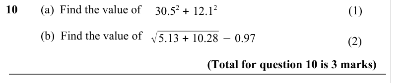

Text (lossy): 10     / (a)  Find the value of / (1) / (b)  Find the value of / √5.13 + 10.28 −0.97 / (2) / (Total for question 10 is 3 marks) / 2 + 15 / 2 −54cos(80)

## Q11 (marks not printed)

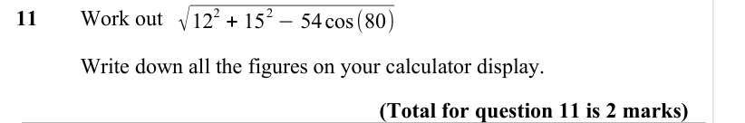

Text (lossy): 11     / Work out / Write down all the figures on your calculator display. / (Total for question 11 is 2 marks)

## Q12 (marks not printed · parts a, b, a, b)

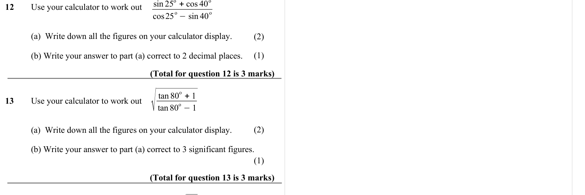

Text (lossy): 12     / Use your calculator to work out / o −sin 40 / o / cos25 / (a)  Write down all the figures on your calculator display. / (2) / (b) Write your answer to part (a) correct to 2 decimal places. / (1) / (Total for question 12 is 3 marks) / √ / o + 1 / tan 80 / tan 80 / o −1 / 13     / Use your calculator to work out / (2) / (a)  Write down all the figures on your calculator display. / (b) Write

