# Systematic Listing — Exam Questions (IGCSE Maths · Edexcel · Grade 2)

Topic code `2.3` · slug `grade-2-2-3-systematic-listing` · source sheet sha256 `68e2a8e4f7e3e9d1…`

## Q1 (marks not printed)

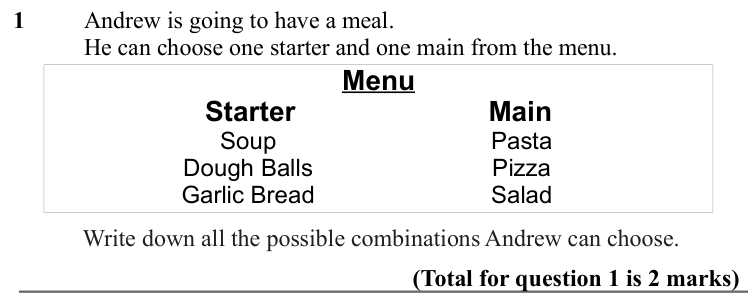

Text (lossy): 1     / Andrew is going to have a meal.  / He can choose one starter and one main from the menu.  / Menu / Starter / Main / Soup / Dough Balls / Garlic Bread / Pasta / Pizza / Salad / Write down all the possible combinations Andrew can choose.  / (Total for question 1 is 2 marks)

## Q2 (marks not printed)

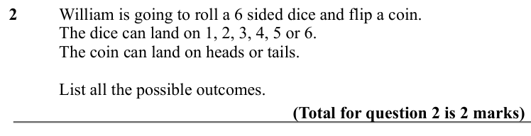

Text (lossy): 2     / William is going to roll a 6 sided dice and flip a coin.  / The dice can land on 1, 2, 3, 4, 5 or 6.  / The coin can land on heads or tails.  / List all the possible outcomes.  / (Total for question 2 is 2 marks)

## Q3 (marks not printed)

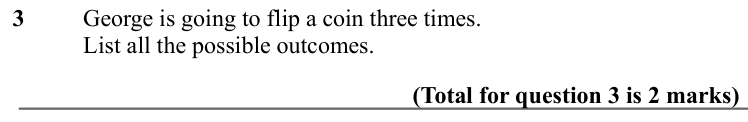

Text (lossy): 3     / George is going to flip a coin three times. / List all the possible outcomes.  / (Total for question 3 is 2 marks)

## Q4 (marks not printed)

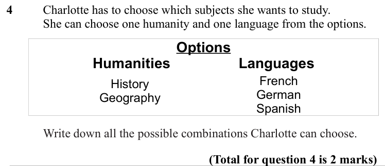

Text (lossy): 4     / Charlotte has to choose which subjects she wants to study.  / She can choose one humanity and one language from the options.  / Options / Humanities / Languages / French / German / Spanish / History / Geography / Write down all the possible combinations Charlotte can choose.  / (Total for question 4 is 2 marks)

## Q5 (marks not printed · parts a, b)

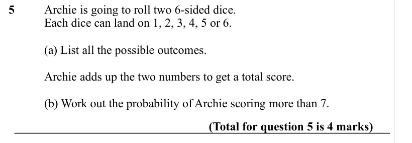

Text (lossy): 5     / Archie is going to roll two 6-sided dice.  / Each dice can land on 1, 2, 3, 4, 5 or 6.  / (a) List all the possible outcomes.  / Archie adds up the two numbers to get a total score.  / (b) Work out the probability of Archie scoring more than 7.  / (Total for question 5 is 4 marks)

## Q6 (marks not printed)

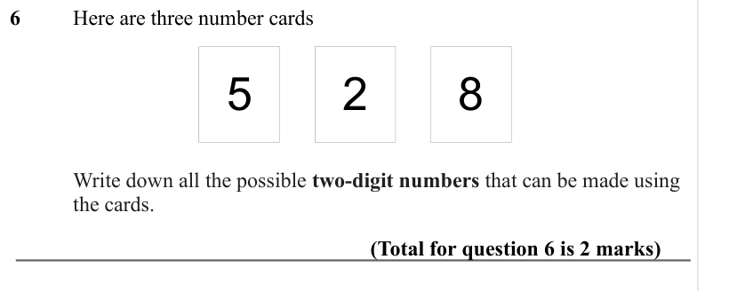

Text (lossy): 6     / Here are three number cards / 5 / 2 / 8 / Write down all the possible two-digit numbers that can be made using  / the cards.  / (Total for question 6 is 2 marks)

## Q7 (marks not printed)

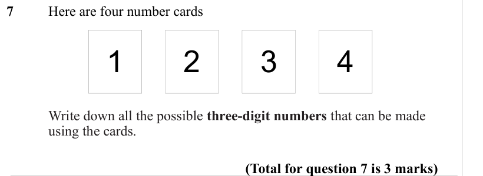

Text (lossy): 7     / Here are four number cards / 1 / 2 / 3 / 4 / Write down all the possible three-digit numbers that can be made  / using the cards.  / (Total for question 7 is 3 marks)

## Q8 (marks not printed)

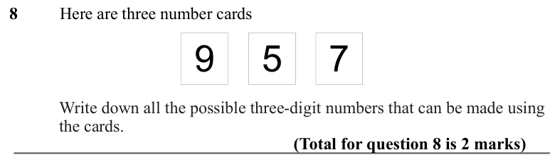

Text (lossy): 8     / Here are three number cards / 9 / 5 / 7 / Write down all the possible three-digit numbers that can be made using  / the cards.  / (Total for question 8 is 2 marks)

## Q9 (marks not printed)

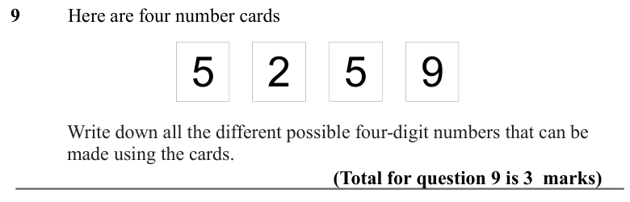

Text (lossy): 9     / Here are four number cards / 5 / 2 / 5 / 9 / Write down all the different possible four-digit numbers that can be  / made using the cards.  / (Total for question 9 is 3  marks)

## Q10 (marks not printed)

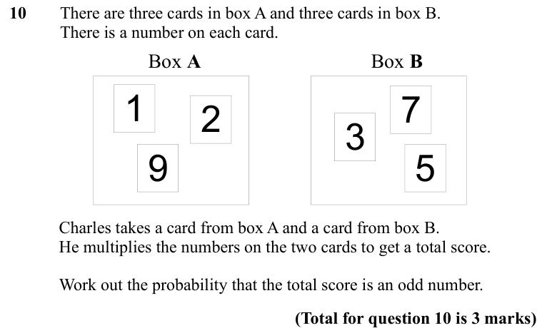

Text (lossy): 10    / There are three cards in box A and three cards in box B.  / There is a number on each card. / Box A / Box B / 1 / 2 / 9 / 7 / 3 / 5 / Charles takes a card from box A and a card from box B.  / He multiplies the numbers on the two cards to get a total score.  / Work out the probability that the total score is an odd number.  / (Total for question 10 is 3 marks)

## Q11 (marks not printed · parts a, b)

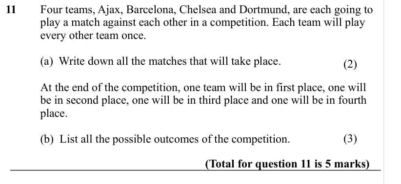

Text (lossy): 11     / Four teams, Ajax, Barcelona, Chelsea and Dortmund, are each going to  / play a match against each other in a competition. Each team will play  / every other team once.  / (a)  Write down all the matches that will take place.  / (2) / At the end of the competition, one team will be in first place, one will  / be in second place, one will be in third place and one will be in fourth  / place

## Q12 (marks not printed · parts a, b)

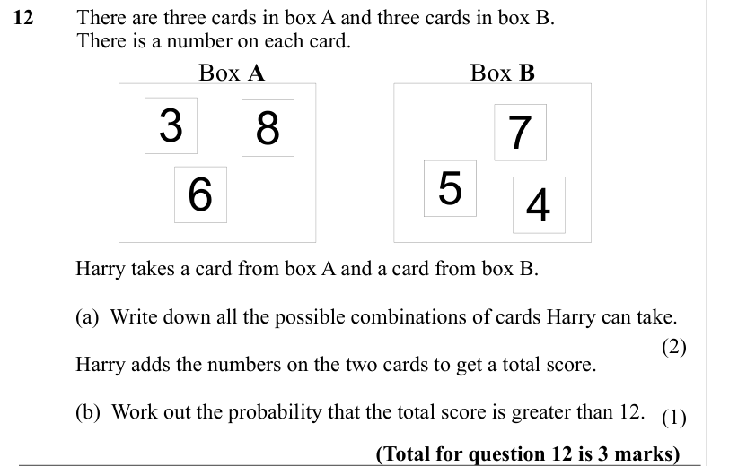

Text (lossy): 12     / There are three cards in box A and three cards in box B.  / There is a number on each card. / Box A / Box B / 3 / 8 / 6 / 5 / 4 / 7 / Harry takes a card from box A and a card from box B. / (a)  Write down all the possible combinations of cards Harry can take. / (2) / Harry adds the numbers on the two cards to get a total score.  / (b)  Work out the probability that the total score is grea

