# Fractions, Decimals and Percentages — Exam Questions (IGCSE Maths · Edexcel · Grade 2)

Topic code `2.5` · slug `grade-2-2-5-fractions-decimals-and-percentages` · source sheet sha256 `c841a336480fdeae…`

## Q1 (1 marks)

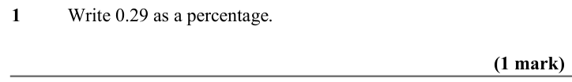

Text (lossy): 1     / Write 0.29 as a percentage.  / (1 mark)

## Q2 (1 marks)

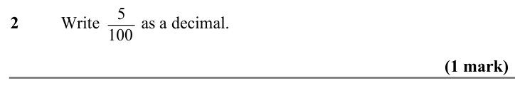

Text (lossy): 2     / Write        as a decimal.  / 5 / 100 / (1 mark)

## Q3 (1 marks)

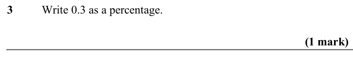

Text (lossy): 3     / Write 0.3 as a percentage.  / (1 mark)

## Q4 (1 marks)

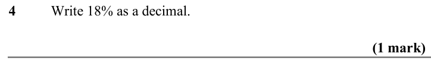

Text (lossy): 4     / Write 18% as a decimal.  / (1 mark)

## Q5 (1 marks)

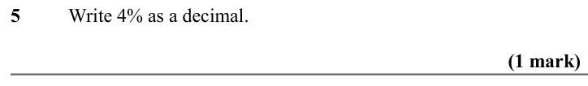

Text (lossy): 5     / Write 4% as a decimal.  / (1 mark)

## Q6 (1 marks)

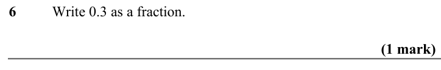

Text (lossy): 6     / Write 0.3 as a fraction.  / (1 mark) / 2 / 5

## Q7 (1 marks)

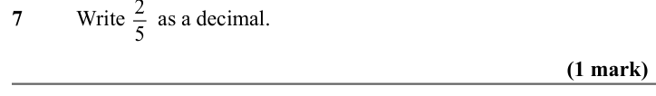

Text (lossy): 7     / Write      as a decimal. / (1 mark)

## Q8 (1 marks)

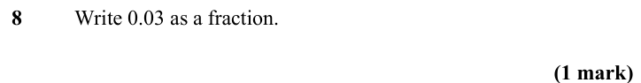

Text (lossy): 8     / Write 0.03 as a fraction.  / (1 mark)

## Q9 (1 marks)

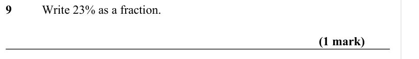

Text (lossy): 9     / Write 23% as a fraction.  / (1 mark)

## Q10 (1 marks)

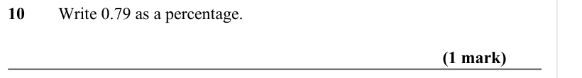

Text (lossy): 10     / Write 0.79 as a percentage.  / (1 mark)

## Q11 (1 marks)

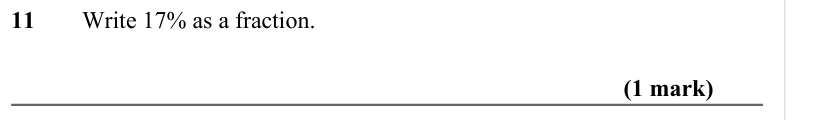

Text (lossy): 11     / Write 17% as a fraction.  / (1 mark)

## Q12 (1 marks)

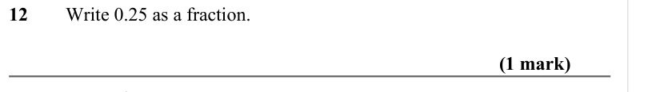

Text (lossy): 12     / Write 0.25 as a fraction.  / (1 mark) / 3 / 50

## Q13 (1 marks)

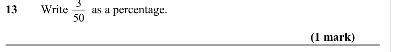

Text (lossy): 13     / Write        as a percentage. / (1 mark)

## Q14 (1 marks)

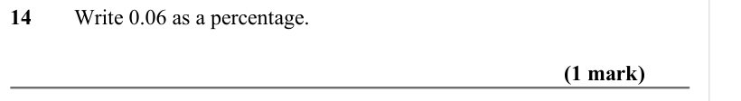

Text (lossy): 14     / Write 0.06 as a percentage.  / (1 mark)

## Q15 (1 marks)

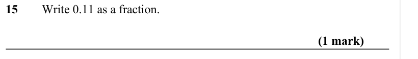

Text (lossy): 15     / Write 0.11 as a fraction.  / (1 mark)

## Q16 (1 marks)

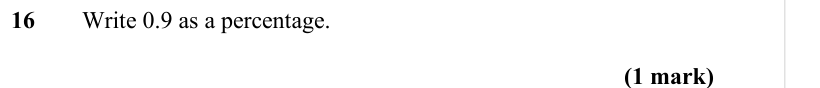

Text (lossy): 16     / Write 0.9 as a percentage.  / (1 mark)

## Q17 (1 marks)

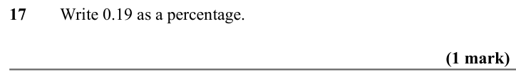

Text (lossy): 17     / Write 0.19 as a percentage.  / (1 mark)

## Q18 (1 marks)

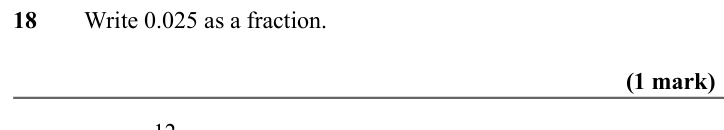

Text (lossy): 18     / Write 0.025 as a fraction.  / (1 mark) / 12 / 100

## Q19 (1 marks)

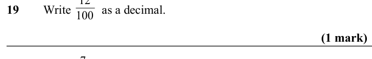

Text (lossy): 19     / Write          as a decimal. / (1 mark) / 7 / 10

## Q20 (1 marks)

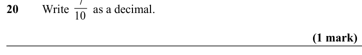

Text (lossy): 20     / Write        as a decimal.  / (1 mark)

## Q21 (1 marks)

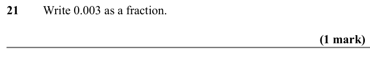

Text (lossy): 21     / Write 0.003 as a fraction.  / (1 mark)

## Q22 (1 marks)

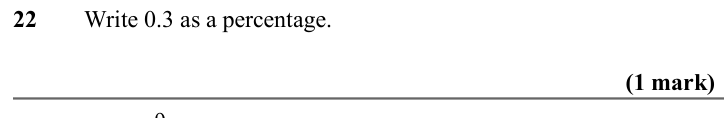

Text (lossy): 22     / Write 0.3 as a percentage.  / (1 mark) / 9 / 20

## Q23 (1 marks)

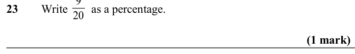

Text (lossy): 23     / Write        as a percentage.  / (1 mark)

## Q24 (1 marks)

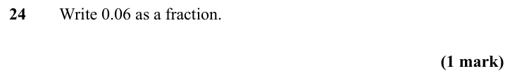

Text (lossy): 24    / Write 0.06 as a fraction.  / (1 mark)

## Q25 (1 marks)

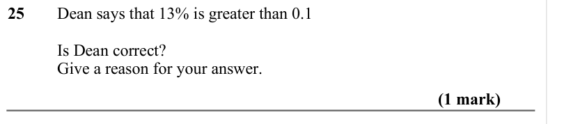

Text (lossy): 25    / Dean says that 13% is greater than 0.1 / Is Dean correct? / Give a reason for your answer.   / (1 mark)

## Q26 (2 marks)

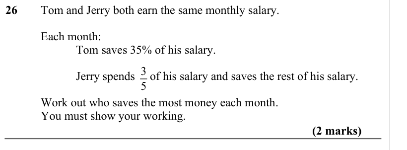

Text (lossy): 26     / Tom and Jerry both earn the same monthly salary.  / Each month: / Tom saves 35% of his salary.  / 3 / 5 / Jerry spends     of his salary and saves the rest of his salary.  / Work out who saves the most money each month. / You must show your working.  / (2 marks)

## Q27 (2 marks)

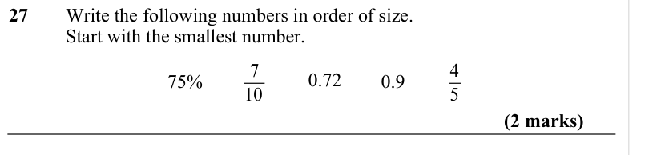

Text (lossy): 27     / Write the following numbers in order of size.  / Start with the smallest number.   / 0.72 / 7 / 10 / 75% / 4 / 5 / 0.9 / (2 marks)

## Q28 (2 marks)

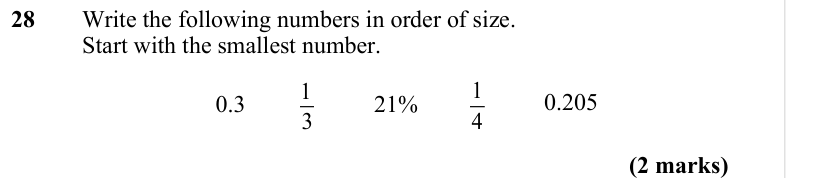

Text (lossy): 28    / Write the following numbers in order of size.  / Start with the smallest number.   / 0.205 / 1 / 4 / 21% / 1 / 3 / 0.3 / (2 marks)

