# Writing an Expression — Exam Questions (IGCSE Maths · Edexcel · Grade 2)

Topic code `2.7` · slug `grade-2-2-7-writing-an-expression` · source sheet sha256 `83266c514cf8a527…`

## Q1 (1 marks)

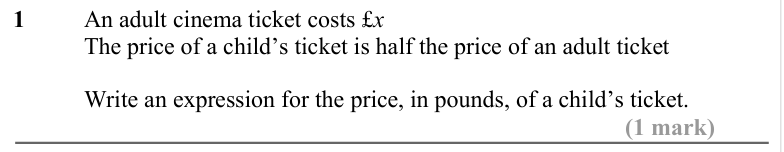

Text (lossy): 1 / An adult cinema ticket costs £x / The price of a child’s ticket is half the price of an adult ticket / Write an expression for the price, in pounds, of a child’s ticket.  / (1 mark)

## Q2 (1 marks)

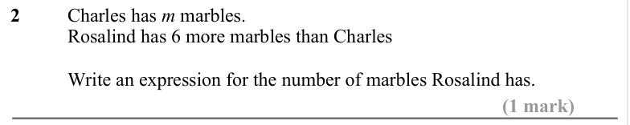

Text (lossy): 2 / Charles has m marbles.  / Rosalind has 6 more marbles than Charles  / Write an expression for the number of marbles Rosalind has. / (1 mark)

## Q3 (1 marks)

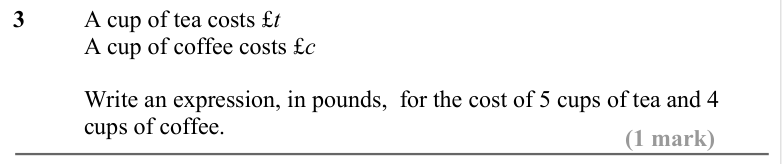

Text (lossy): 3 / A cup of tea costs £t / A cup of coffee costs £c / Write an expression, in pounds,  for the cost of 5 cups of tea and 4  / cups of coffee.  / (1 mark)

## Q4 (1 marks)

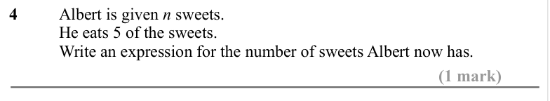

Text (lossy): 4  / Albert is given n sweets.  / He eats 5 of the sweets.  / Write an expression for the number of sweets Albert now has.  / (1 mark)

## Q5 (1 marks)

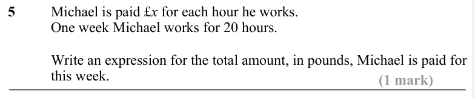

Text (lossy): 5 / Michael is paid £x for each hour he works.  / One week Michael works for 20 hours.  / Write an expression for the total amount, in pounds, Michael is paid for  / this week.  / (1 mark)

## Q6 (1 marks)

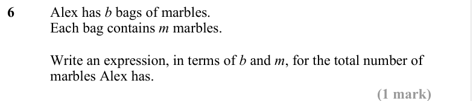

Text (lossy): 6 / Alex has b bags of marbles.  / Each bag contains m marbles.  / Write an expression, in terms of b and m, for the total number of  / marbles Alex has.  / (1 mark)

## Q7 (1 marks)

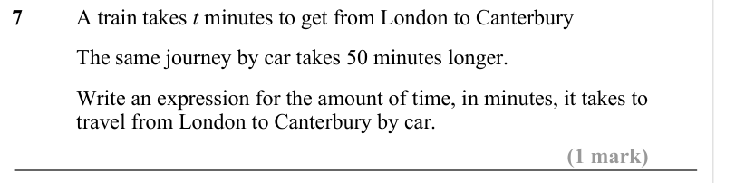

Text (lossy): 7 / A train takes t minutes to get from London to Canterbury / The same journey by car takes 50 minutes longer.  / Write an expression for the amount of time, in minutes, it takes to  / travel from London to Canterbury by car.  / (1 mark)

## Q8 (1 marks)

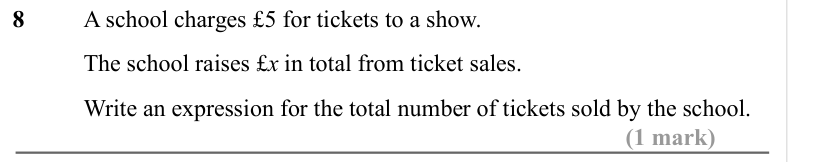

Text (lossy): 8  / A school charges £5 for tickets to a show.  / The school raises £x in total from ticket sales.  / Write an expression for the total number of tickets sold by the school.  / (1 mark)

## Q9 (1 marks)

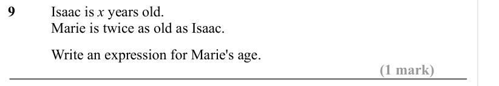

Text (lossy): 9  / Isaac is x years old.  / Marie is twice as old as Isaac. /   / Write an expression for Marie's age.  / (1 mark)

## Q10 (1 marks)

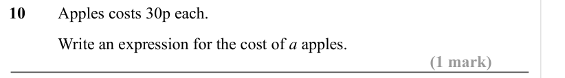

Text (lossy): 10  / Apples costs 30p each.  / Write an expression for the cost of a apples.  / (1 mark)

## Q11 (4 marks · parts a, b, c)

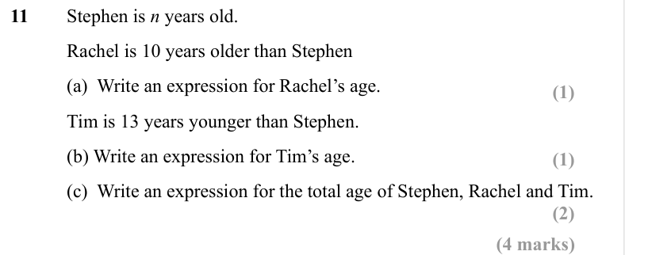

Text (lossy): 11  / Stephen is n years old.  / Rachel is 10 years older than Stephen / (a)  Write an expression for Rachel’s age. / (1) / Tim is 13 years younger than Stephen.  / (b) Write an expression for Tim’s age.  / (1) / (c)  Write an expression for the total age of Stephen, Rachel and Tim.  / (2) / (4 marks)

## Q12 (2 marks)

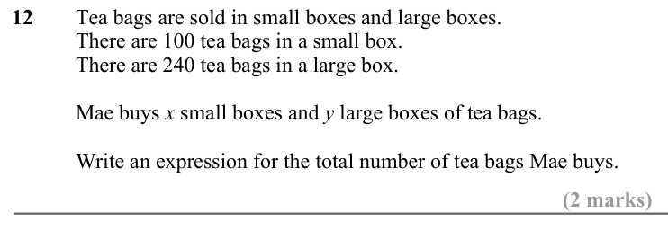

Text (lossy): 12 / Tea bags are sold in small boxes and large boxes.  / There are 100 tea bags in a small box.  / There are 240 tea bags in a large box.  / Mae buys x small boxes and y large boxes of tea bags. / Write an expression for the total number of tea bags Mae buys.   / (2 marks)

## Q13 (2 marks)

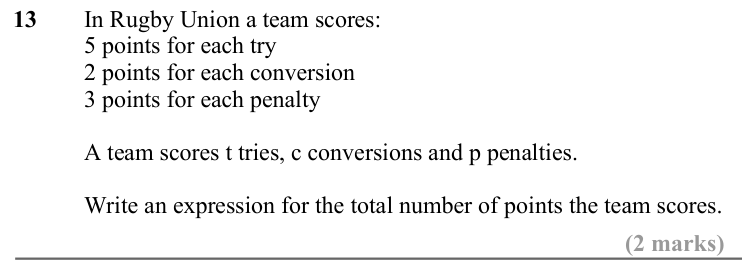

Text (lossy): 13 / In Rugby Union a team scores: / 5 points for each try / 2 points for each conversion / 3 points for each penalty  / A team scores t tries, c conversions and p penalties. / Write an expression for the total number of points the team scores.   / (2 marks)

## Q14 (2 marks)

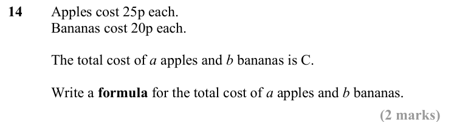

Text (lossy): 14 / Apples cost 25p each.  / Bananas cost 20p each. / The total cost of a apples and b bananas is C.  / Write a formula for the total cost of a apples and b bananas.  / (2 marks)

## Q15 (3 marks · parts a, b)

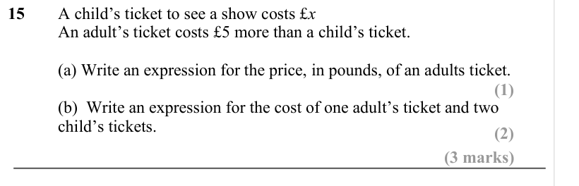

Text (lossy): 15 / A child’s ticket to see a show costs £x / An adult’s ticket costs £5 more than a child’s ticket.  / (a) Write an expression for the price, in pounds, of an adults ticket.  / (1) / (b)  Write an expression for the cost of one adult’s ticket and two  / child’s tickets.  / (2) / (3 marks)

## Q16 (3 marks · parts a, b)

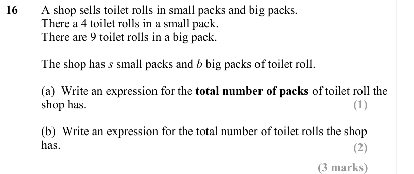

Text (lossy): 16 / A shop sells toilet rolls in small packs and big packs.  / There a 4 toilet rolls in a small pack.  / There are 9 toilet rolls in a big pack.  / The shop has s small packs and b big packs of toilet roll.  / (a)  Write an expression for the total number of packs of toilet roll the  / shop has.  / (1) / (b)  Write an expression for the total number of toilet rolls the shop  / has.  / (2) / (3 m

