# Solving One Step Equations — Exam Questions (IGCSE Maths · Edexcel · Grade 2)

Topic code `2.9` · slug `grade-2-2-9-solving-one-step-equations` · source sheet sha256 `6e1b5a0dc411de4d…`

## Q1 (2 marks)

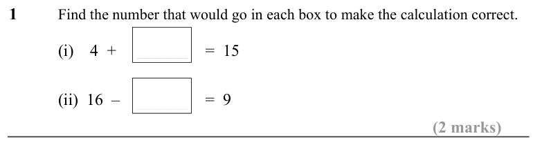

Text (lossy): 1      / Find the number that would go in each box to make the calculation correct.   / (i)    4  +  / =  15 / (ii)  16  –  / =  9 / (2 marks)

## Q2 (2 marks)

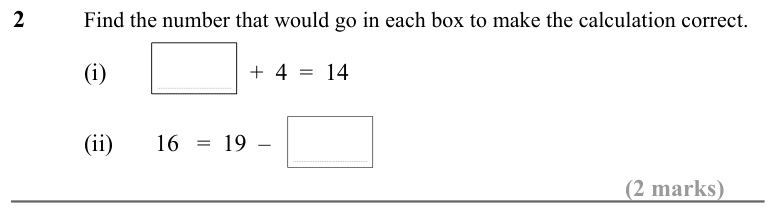

Text (lossy): 2      / Find the number that would go in each box to make the calculation correct.  / (i)                        +  4  =  14 / (ii)       16   =  19  –   / (2 marks)

## Q3 (2 marks)

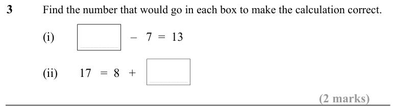

Text (lossy): 3      / Find the number that would go in each box to make the calculation correct.  / (i)                         –   7  =  13 / (ii)       17   =  8   +   / (2 marks)

## Q4 (1 marks)

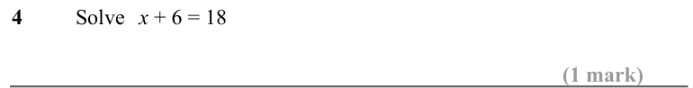

Text (lossy): 4      / Solve x + 6 = 18 / (1 mark)

## Q5 (1 marks)

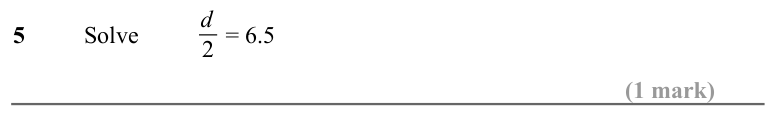

Text (lossy): 5      / Solve / = 6.5 / d / 2 / (1 mark)

## Q6 (1 marks)

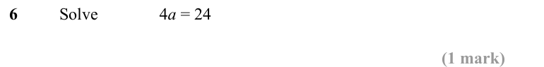

Text (lossy): 6      / Solve / 4 a = 24 / (1 mark)

## Q7 (1 marks)

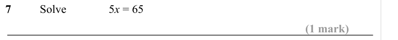

Text (lossy): 7      / Solve / 5 x = 65 / (1 mark)

## Q8 (1 marks)

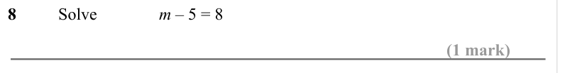

Text (lossy): 8      / Solve / m – 5 = 8 / (1 mark)

## Q9 (2 marks · parts a, b)

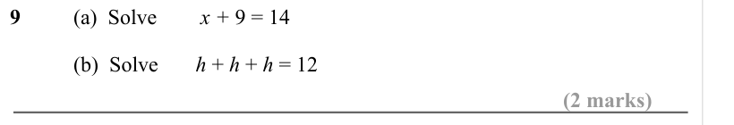

Text (lossy): 9 / (a)  Solve / x + 9 = 14 / (b)  Solve       h + h + h = 12 / (2 marks)

## Q10 (1 marks)

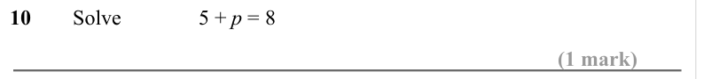

Text (lossy): 10     Solve / 5 + p = 8 / (1 mark)

## Q11 (3 marks · parts a, b, c)

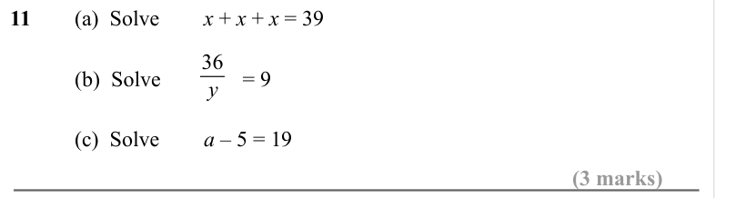

Text (lossy): 11 / (a)  Solve / x + x + x = 39 / 36 / (b)  Solve               = 9 / y / (c)  Solve / a – 5 = 19 / (3 marks)

## Q12 (1 marks)

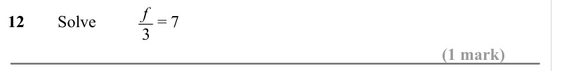

Text (lossy): 12     Solve / = 7 / f / 3 / (1 mark)

## Q13 (1 marks)

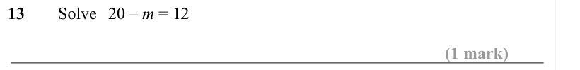

Text (lossy): 13     Solve 20 – m = 12 / (1 mark)

## Q14 (1 marks)

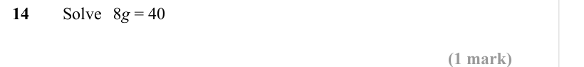

Text (lossy): 14     Solve 8 g = 40 / (1 mark)

