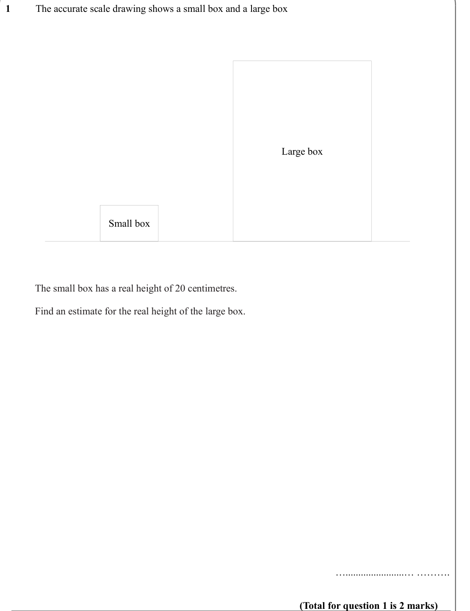
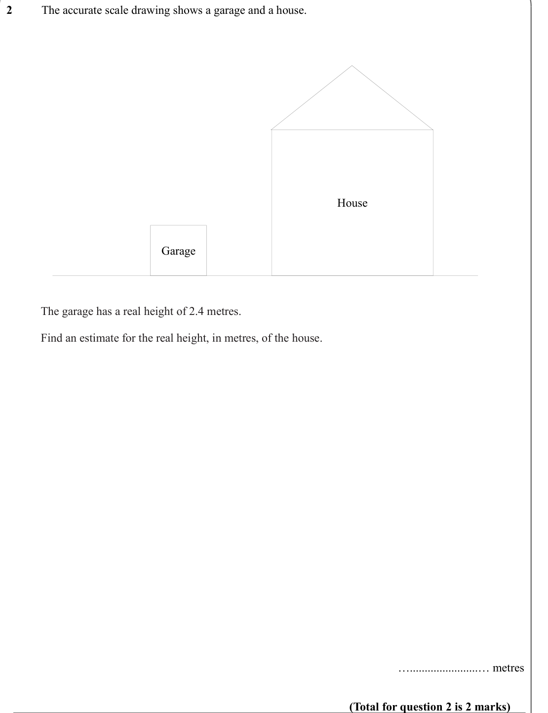
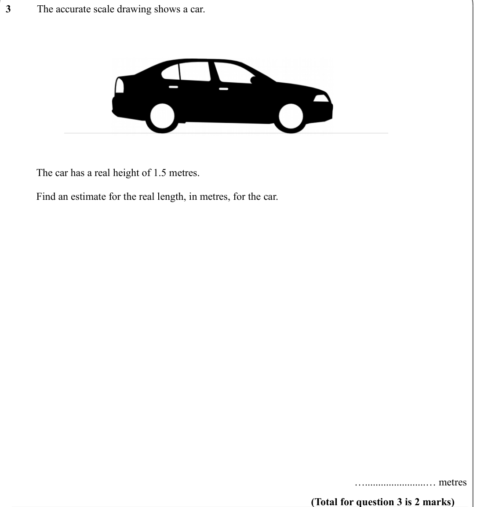
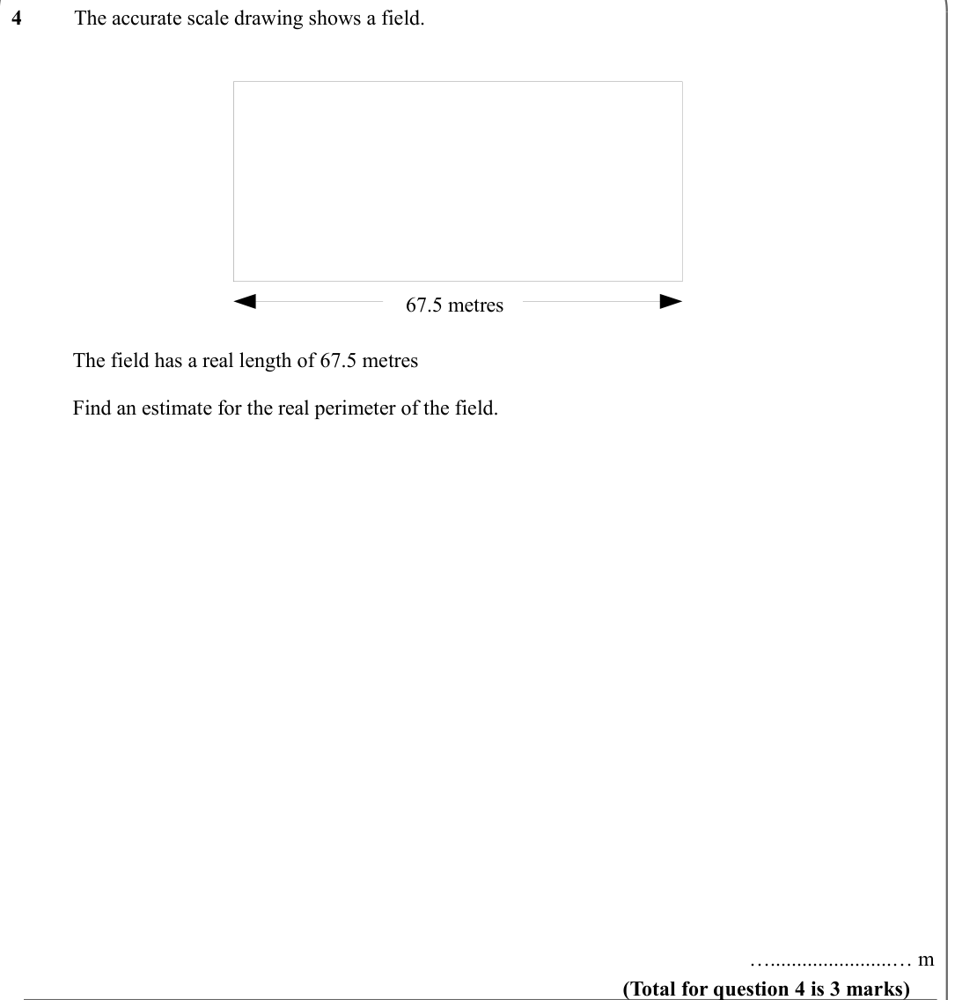
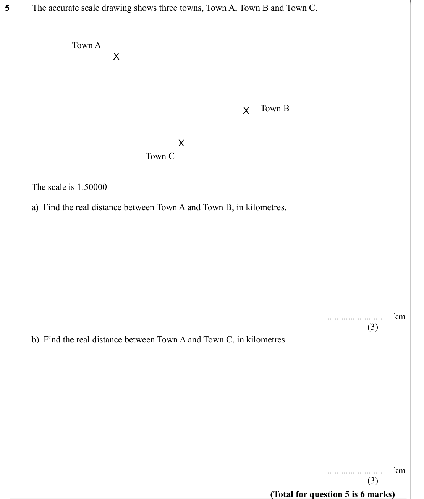
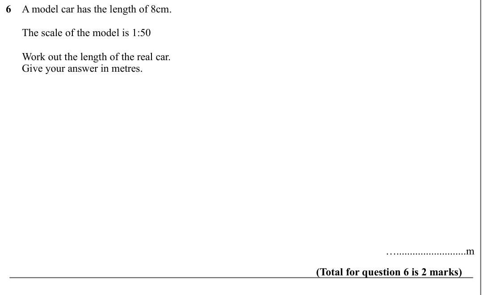
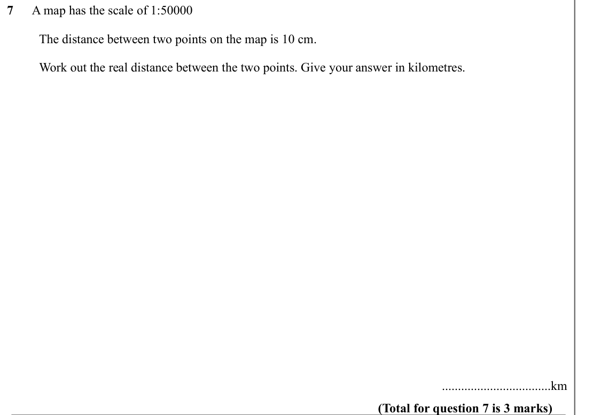
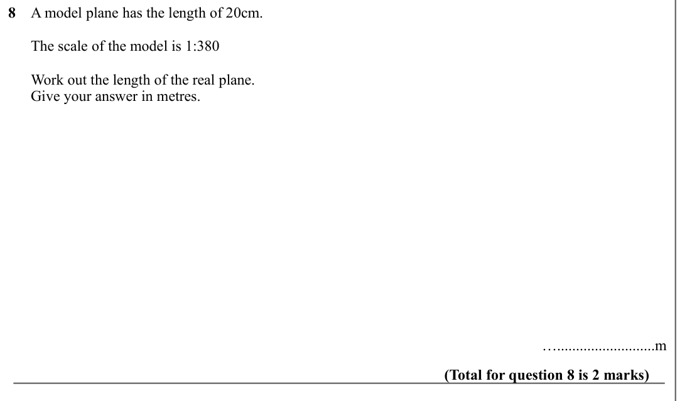
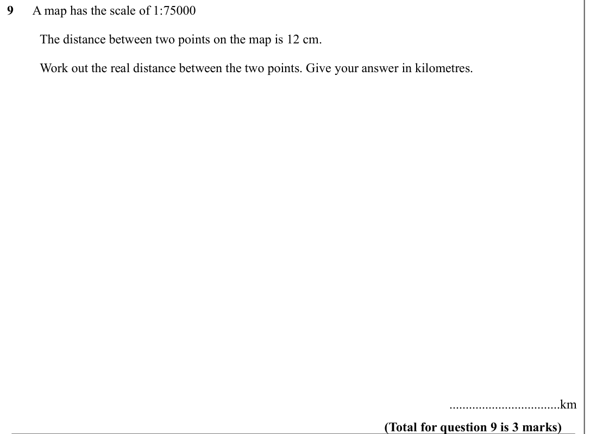

# Scale Drawings — Exam Questions (IGCSE Maths · Edexcel · Grade 3)

Topic code `3.10` · slug `grade-3-3-10-scale-drawings` · source sheet sha256 `c77c0cfc1c48937b…`

## Q1 (marks not printed)

Text (lossy): 1     / The accurate scale drawing shows a small box and a large box / Large box / Small box / The small box has a real height of 20 centimetres. /   / Find an estimate for the real height of the large box. / ….......................… ………. / (Total for question 1 is 2 marks)

## Q2 (marks not printed)

Text (lossy): 2     / The accurate scale drawing shows a garage and a house. / House / Garage / The garage has a real height of 2.4 metres. /   / Find an estimate for the real height, in metres, of the house. / ….......................… metres / (Total for question 2 is 2 marks)

## Q3 (marks not printed)

Text (lossy): 3     / The accurate scale drawing shows a car. / The car has a real height of 1.5 metres.  / Find an estimate for the real length, in metres, for the car.  / ….......................… metres / (Total for question 3 is 2 marks)

## Q4 (marks not printed)

Text (lossy): 4     / The accurate scale drawing shows a field. / 67.5 metres / The field has a real length of 67.5 metres / Find an estimate for the real perimeter of the field. / ….......................… m / (Total for question 4 is 3 marks)

## Q5 (marks not printed)

Text (lossy): 5     / The accurate scale drawing shows three towns, Town A, Town B and Town C. / Town A / X / Town B / X / X / Town C / The scale is 1:50000 / a)  Find the real distance between Town A and Town B, in kilometres. / ….......................… km / (3)             / b)  Find the real distance between Town A and Town C, in kilometres. / ….......................… km / (3)             / (Total for ques

## Q6 (marks not printed)

Text (lossy): 6    A model car has the length of 8cm.  /       The scale of the model is 1:50 /       Work out the length of the real car. /       Give your answer in metres.  / …..........................m / (Total for question 6 is 2 marks)

## Q7 (marks not printed)

Text (lossy): 7      A map has the scale of 1:50000  /           The distance between two points on the map is 10 cm.  /           Work out the real distance between the two points. Give your answer in kilometres.           / ..................................km / (Total for question 7 is 3 marks)

## Q8 (marks not printed)

Text (lossy): 8    A model plane has the length of 20cm.  /       The scale of the model is 1:380 /       Work out the length of the real plane. /       Give your answer in metres.  / …..........................m / (Total for question 8 is 2 marks)

## Q9 (marks not printed)

Text (lossy): 9      A map has the scale of 1:75000  /           The distance between two points on the map is 12 cm.  /           Work out the real distance between the two points. Give your answer in kilometres.           / ..................................km / (Total for question 9 is 3 marks)

